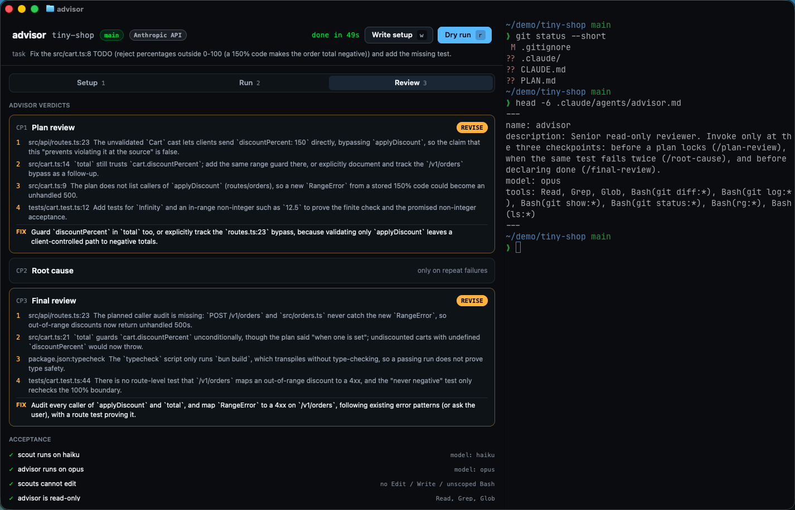

# advisor: Opus / Sonnet / Haiku advisor setup for Claude Code, as a GPUIX app in Ghostty

`advisor ./repo` scans a repository, writes a three-tier Claude Code workflow into it
(Sonnet builder, Haiku read-only scouts, Opus read-only advisor at three checkpoints),
then dry-runs a small real task and shows which agents ran, tokens per agent and the
advisor's `VERDICT` / issues. The dashboard is a React 19 tree painted by GPUIX inside
Ghostty over the kitty graphics protocol. There's no browser and no web view.



Demo: [`media/demo.mp4`](media/demo.mp4)

## Run

```sh
cd gpuix/advisor
bun install
bun link                      # puts `advisor` on PATH (bin -> src/cli.tsx)
bun run fixture               # fresh copy of examples/tiny-shop at ~/demo/tiny-shop (git repo on main)
cd ~/demo/tiny-shop && advisor          # or: advisor ./path/to/repo
```

Run it in Ghostty or kitty. Other terminals (tmux, VS Code/Zed terminals) don't speak the
kitty graphics protocol well enough and stay blank. `--window` opens a native window instead.

```
advisor [repo] [options]
  -e, --engine claude|api|replay   default: claude if the CLI is installed, else api
      --replay <file>              stream-json file for --engine replay
  -t, --task <text>                dry-run task (default: first TODO/FIXME in the repo)
  -W, --write                      write the setup files on start
  -r, --run                        start the dry run on start
      --window                     native window instead of the terminal
  -h, --help / -v, --version
```

Keys: `w` write setup · `r` dry run · `1`/`2`/`3` Setup/Run/Review · `↑`/`↓` files ·
`q` or `Ctrl-C` quit. All buttons, tabs and file rows also work with the mouse.

Replay the recorded real Claude Code run without spending tokens:

```sh
advisor ~/demo/tiny-shop -e replay --replay examples/runs/claude-code-dry-run.jsonl -W -r
```

Tests and typecheck:

```sh
bun test          # logic + GPUIX test-renderer tests
bun run typecheck
```

## What it writes into the target repo

| File | Purpose |
| --- | --- |
| `.claude/agents/scout.md` | `model: haiku`, tools `Read, Grep, Glob` + read-only Bash (`rg`, `ls`, `git log/show/grep`, `wc`). Returns compact path:line findings, ≤ ~300 words |
| `.claude/agents/advisor.md` | `model: opus`, read-only tools. Checklists for CP1 plan review, CP2 root cause, CP3 final review. Output: `VERDICT: approve/revise/block`, ≤ 5 issues with file:line, `MOST IMPORTANT FIX` |
| `CLAUDE.md` (managed `## Workflow` section) | scouts for >5-file exploration, PLAN.md + CP1 before editing, CP2 on the second failure of a test, tests/lint/typecheck + CP3 on `git diff main...HEAD` before done, block verdicts need a written override, plus the inferred invariants list (uncertain ones marked `(confirm)`) |
| `.claude/commands/plan-review.md`, `root-cause.md`, `final-review.md` | slash commands that invoke the advisor with the right context |
| `.claude/settings.json` + `.claude/hooks/advisor-guard.sh` | PostToolUse hook stamps edits, Stop hook reminds the session to run `/final-review` if code changed since the last CP3. Existing settings are preserved |
| `.gitignore` | `.claude/state/`, `.claude/advisor-runs/` |

The scanner finds test/lint/typecheck commands from `package.json` (plus Cargo, Python and Go defaults), and the
risky areas (auth, payments, migrations, public API) from file paths and content, and pulls
invariants from SQL `CHECK` constraints and comments such as `// Invariant:` / `-- Contract:`.

## Dry-run engines

- **claude** (default when `claude` is on PATH): runs `claude -p <task> --model sonnet --effort high
  --output-format stream-json` in the repo with the written config, and maps the stream into
  builder/scout/advisor lanes. Subagents are identified by their `Task`/`Agent` tool calls and
  `parent_tool_use_id`, and tokens come from each message's `usage`.
- **api**: runs the same roles straight through the Anthropic Messages API with `$ANTHROPIC_API_KEY`
  for when the CLI isn't installed or authorized. The header shows `Anthropic API` so it's clear this
  isn't Claude Code. Scouts are executed locally with the scout's own read-only tool list (grep /
  read only, never writes). The advisor gets CP1 on PLAN.md and CP3 on the real `git diff`, and the
  Sonnet builder writes files and runs the repo's test command. CP2 fires if the same test fails twice.
- **replay**: plays back a recorded `stream-json` file. `examples/runs/claude-code-dry-run.jsonl` is a
  real Claude Code 2.1.307 run on `examples/tiny-shop` (3 min 38 s, about $0.76): 3 Haiku scouts, Opus CP1
  and CP3, Sonnet builder.

Acceptance checks are shown live in the Setup and Review tabs. The app reads them from the
files on disk (it polls `.claude/`, `CLAUDE.md` and `.gitignore`, so edits from another pane
show up):

- `/agents` models: scout → haiku, advisor → opus (parsed from the agent front matter, the
  same source `/agents` reads).
- Scouts cannot edit: the scout's `tools:` list has no `Edit`, `Write`, `MultiEdit`,
  `NotebookEdit` or unscoped `Bash`, so Claude Code never offers it an edit tool.
- The dry run shows advisor CP1 and CP3.

## Adapted from the original prompt

The original is a prompt you paste into Claude Code (`claude --advisor opus --subagents haiku`
doesn't exist in the CLI, so it uses subagents, hooks and CLAUDE.md instead). This version turns that
into a tool that writes the same setup deterministically and makes the dry run visible:

- Kept: all eight steps, the three roles, the three checkpoints and their checklists, the verdict format,
  the slash commands, the Stop hook, the invariants list and the three acceptance criteria.
- Changed: the setup comes from templates plus a repo scan instead of an LLM writing it, so it's the same
  every time and testable. The dry-run report is a live dashboard (agent lanes, timeline, token bars,
  verdict cards) instead of a chat summary.
- Added: an Anthropic-API engine (truthfully labelled) for machines without Claude Code, a replay
  engine, and a small realistic fixture repo (`examples/tiny-shop`: auth, cart, orders, routes, a migration
  with CHECK constraints, and a real TODO bug).
- Cut: `/agents` is not opened interactively; the app checks the same front matter. CP2 only appears
  when a test really fails twice, which didn't happen in the recorded runs.

The demo video uses `-e api` because a full Claude Code run takes about 3.5 minutes. The API
engine finishes the same task in about 50 s.

## GPUIX findings (0.11.0, terminal mode in Ghostty, macOS paravirtual Metal)

- `RUST_LOG` has to be in the real process environment. The CLI has a
  `#!/usr/bin/env -S RUST_LOG=error bun` shebang and re-execs itself when started as `bun src/cli.tsx`.
  Without that, held INFO/WARN lines print under the prompt after Ctrl-C.
- `@gpuix/react` `console.log`s `[gpuix] created native window` / `mount complete`. In terminal mode stdout
  is held and replayed after exit, so the CLI filters those two lines.
- `StyleDesc` has no `letterSpacing`. Flex values must be numbers (no `'1 1 0'` strings).
- Only one vertical scroll container per column works well. The activity log is clipped
  (`overflow: hidden`, latest rows) instead of being a nested scroller.
- Rows that hold long text need `minWidth: 0` on the flex child, or the panel pushes past the pane
  width after a split.
- The test renderer (`createTestRoot`) has to be given the app's real size (`{ width, height }`). With
  the default size, buttons laid out off-screen silently ignore `.click()`.
- Keyboard: the handler reads `key`, `keyChar` and `text`, because terminal mode can report a letter as
  `key: "space"` with the letter elsewhere. Global keys go through `render(..., { onKeyDown })` plus a
  focused root `div tabIndex={-1} autoFocus`.
- Native `<code>` (setup preview) and `<diff>` (builder patch) look right in the terminal with no extra work.
- Ghostty split reflow is immediate: the app drops from three columns to two under 1180 px wide, and compacts the header under 760 px.
  Ghostty's divider hit area is the 1 px line to the right of the app's last painted column.
- Speed: the VM's GPU is Apple Paravirtual, so frames are slower than on a real Mac. Typing and
  tab switches look instant in the recording. I didn't measure an exact fps.
