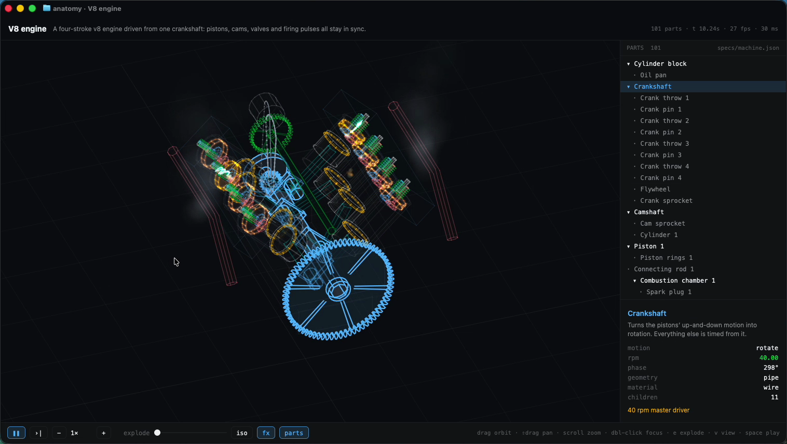
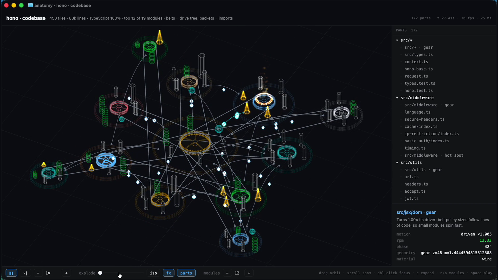

# Anatomy (GPUIX in Ghostty)

One line of text → an interactive, animated 3D machine, drawn by [GPUIX](https://github.com/remorses/gpuix) **inside your
terminal** over the Kitty graphics protocol.

```sh
anatomy "a V8 engine"
anatomy specs/v8.json          # edits to the file hot-reload
anatomy ~/code/hono            # the anatomy of a codebase: top modules as a running machine
```



Demos (Ghostty, GitHub Dark High Contrast, real input, real time): [`media/demo.mp4`](media/demo.mp4) is codebase mode on
[Hono](https://github.com/honojs/hono); [`media/demo-machine.mp4`](media/demo-machine.mp4) is machine mode (a V8 engine).

## Run

Requires [Bun](https://bun.sh) and Ghostty or kitty (other terminals, tmux and the VS Code/Zed terminals don't speak
kitty graphics; use `--window` there for a native window).

```sh
cd gpuix/anatomy
bun install
bun link                         # puts `anatomy` on your PATH (or use `bun src/cli.ts ...`)
anatomy "a steam locomotive"
anatomy examples/turbofan.json
```

| Command | What it does |
| --- | --- |
| `anatomy "<description>"` | design a machine from a one-liner and open it |
| `anatomy <dir> [--top N]` | the anatomy of a codebase (see below); source edits rescan live |
| `anatomy <spec.json>` | open a spec; the file is watched and hot-reloads (invalid edits keep the last good machine and show the issue) |
| `anatomy gen "<description>" -o specs/x.json` | write a designed spec |
| `anatomy validate <spec.json>...` | AJV schema + mechanical checks, exit 1 on issues |
| `anatomy snap <spec\|description> -o out.png` | headless PNG render |

Mouse: drag to orbit, shift/right-drag to pan, scroll to zoom, hover to highlight a part and its children, click to
inspect, double-click to focus. Keys: `space` play/pause, `,` `.` step, `[` `]` speed (0.1×–4×), `e` explode,
`-` `=` explode amount, `v` isometric/perspective, `f` effects, `i` part tree, `↑` `↓` walk the tree, `enter` focus,
`r` reset camera, `p` PNG snapshot, Ctrl-C quit.

**Split-pane workflow.** Open a spec, split Ghostty (Cmd-D) and edit or regenerate the file in the other pane:

```sh
anatomy specs/machine.json                                   # left pane
anatomy gen "a steam locomotive" -o specs/machine.json       # right pane: the left pane swaps machines live
sed -i '' 's/"rpm": 40/"rpm": 120/' specs/machine.json       # or tweak it: the engine speeds up, camera kept
```

The app reflows to the pane: the part tree and inspector collapse below 760 px and the camera re-fits tall panes.

## Codebase mode

Point it at a directory and it draws the codebase as a machine:



```sh
anatomy .                        # this repo
anatomy ~/code/hono --top 8      # top 8 modules (3-24, default 12); n / b or the toolbar − + change it live
```

| Codebase | Machine |
| --- | --- |
| a module (directory, split recursively until the top N are balanced) | a station: a ring housing sized by lines of code |
| the most depended-on module | the engine at the centre, the only part with its own rpm |
| how modules depend on each other | belts: every station is driven from the engine through the module it imports most, so pulley ratios follow size (small modules spin fast) |
| imports between modules | arcing wires with glowing packets riding them; more packets and a brighter wire for heavier traffic |
| a module's biggest files (up to 6) | parts on the station: cylinders (source, height = lines), springs (tests), beacons (entry points), cells (types), blocks (config) |
| the most-edited module (git log, last 400 commits) | a fire ring: the hot spot |
| a file you just saved | glows orange with an electric arc for 9 s |

Ranking: a module's score is its lines of code × (1 + 0.8·log(1 + modules importing it) + 0.15·log(1 + recent changes)); files
within a module rank by lines × (1 + log(1 + importers)), with tests discounted. Imports are found with per-language regexes
(TS/JS incl. `require`, dynamic `import()` and workspace package names, Python, Go, Rust `mod`/`use`, C/C++ `#include "…"`)
and resolved to files in the repo; external packages are ignored. `node_modules`, build output, vendored code, `.d.ts` and
minified files are skipped, and git-ignored files are left out when the folder is a git checkout.

Everything else works the same: play/pause/step/speed run the drive train and packets, `e` or the slider expands the
stations apart, click any part for its path, line count, importers and recent changes, double-click to fly to it.
**Split a pane and edit code**: the app watches the tree, rescans in ~50-200 ms (Hono: 450 files, 83k lines) and lights up
what changed. `anatomy gen <dir> -o x.json` and `anatomy snap <dir>` work too, and the output is a normal machine spec.

## The skill

`skill/SKILL.md` teaches a coding agent to turn a one-liner into a valid spec: decompose into 12–60 parts, pick
primitives, drive everything from one master clock, `anatomy validate` until clean, then `anatomy snap` and look.
Install: copy `skill/` into `~/.claude/skills/anatomy/` for Claude Code, or point any agent at `AGENTS.md`.

Built-in designers (used by `anatomy "<description>"` and `gen`): V6/V8/V12, inline-N and boxer engines, mechanical
watch movement, two-spool turbofan, 2-6-0 steam locomotive, planetary gearset. Other one-liners print a pointer to the
skill.

## Machine spec

`schema/machine.schema.json` (JSON Schema draft-07): `meta` (name, description, unit, camera), `bounds`, `parts[]`
(id, label, description, parentId, geometry, transform, material, animation), `connections[]` (belts, chains,
shafts, wires) and `annotations[]`.

- Geometry: box, cylinder, cone, sphere, torus, capsule, **gear** (involute teeth from teeth/module/pressure angle,
  bore, spokes), **spring** (helical, radius/wire/turns/height), pipe along a path, extrusion, lathe, blades.
- Materials: wire / solid / ghost / glow, plus fire, smoke, electric, plasma or water effects with optional pulses
  tied to the clock (firing order).
- Animation: rotate (rpm, or `drivenBy` + `ratio`), oscillate (sine or cam wave off a driver), slide, crank
  (slider-crank with real rod geometry), rod, follow. All of it evaluates from one master clock, so pistons, valves,
  cams and gears stay in sync at any speed, when stepping, and when exploded.

Examples: `examples/four-cylinder-engine.json`, `examples/mechanical-watch.json`, `examples/turbofan.json` (fire in the
combustor), `examples/steam-locomotive.json`, `specs/v8.json`.

`anatomy validate` catches: schema errors, duplicate ids, orphan parents, parent cycles, drive cycles, missing
drivers / crank references, NaN or Infinity anywhere, parts outside `bounds` (through the parent chain), and
degenerate gears/springs. Each class has a unit test in `tests/validate.test.ts`.

## Tests

```sh
bun test            # validator classes, gear/spring geometry, master-clock sync, CLI, app on the GPUIX GPU test renderer
bun run typecheck
```

## Adapted from the original prompt

The original was a Vite + Three.js browser runtime. Here:

- **Renderer**: a CPU renderer in TypeScript (`src/render/renderer.ts`) replaces Three.js: z-buffered flat-shaded
  faces at low alpha, thick anti-aliased screen-space edges with hidden-line dimming (back edges fainter), true
  isometric orthographic camera with a perspective toggle. Frames go into a GPUIX `` with `setImagePixels`.
- **Effect shaders → CPU effects**: fire and smoke are additive/soft particles, electric arcs are jittered polylines,
  glow is a bloom pass on emissive parts, plasma/water modulate color over time.
- **Loading**: URL hash / file drop / `?spec=` became CLI args plus a file watcher (edit in a split pane).
- **Export**: PNG snapshots (`p`, `anatomy snap`). **Cut**: the 6-second WebM loop export (no MediaRecorder in a
  terminal; record the terminal instead).
- **Skill**: same five steps; `npm run validate` is `anatomy validate` / `bun run validate`.

## Performance

Measured on this macOS VM (Apple Paravirtual GPU, CPU rendering is the bottleneck, honest numbers): in a
1417×876 Ghostty window the 101-part V8 renders at ~26 ms/frame (~29 fps) with effects on; in a half-width split the
109-part locomotive renders at ~7 ms (60 fps). The renderer caps the buffer at ~1.15 MP and skips frames when paused
and nothing changed. The headline "60 fps for a 60-part machine" holds for split panes, not for a full 1400 px
window on this VM.

## GPUIX findings (0.11.0, terminal mode)

- `` + `setImagePixels` is fast enough for a full-window CPU renderer through kitty graphics shared memory.
  Use `objectFit="fill"` and size the buffer from `onLayout` (we render at layout size, capped, and let GPUIX scale).
- Printable keys can arrive as `key: "space"` with the letter in `keyChar`; `keyName()` in `src/ui/app.tsx` handles both.
- The left mouse button is `0`. Hover labels over the viewport need `pointerEvents: 'none'`.
- A root `<div tabIndex={-1} autoFocus onKeyDown>` is needed for arrows/Esc. Ghostty owns Cmd shortcuts, so every
  action has a plain key.
- `RUST_LOG` must be set before the native module loads, so the CLI re-execs itself with `RUST_LOG=error`
  (Ghostty shells export `RUST_LOG=info`, and held logs would print under the prompt after exit).
- Don't pipe into stdin: it switches GPUIX to the automation protocol. Specs come in as file paths.
- Editors save by rename, so watch the spec's directory, not the file inode.

## License

MIT, see [LICENSE](LICENSE).
