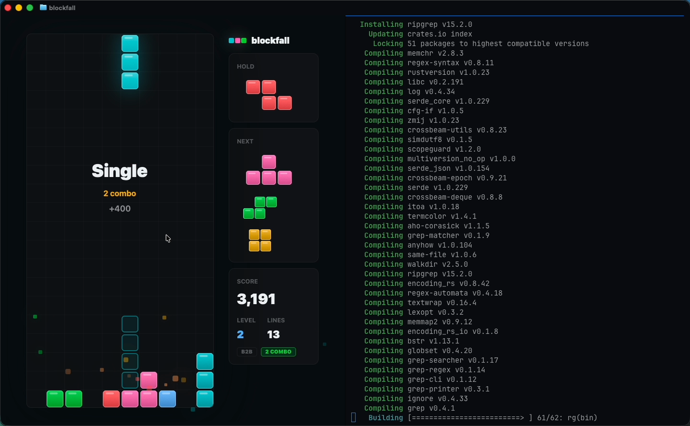

# blockfall

A falling-blocks puzzle game you play in a Ghostty split while your build runs. It is a GPUIX React tree (GPUI, Metal)
that paints **inside the terminal** over the kitty graphics protocol, follows the pane when you split or drag the
divider, and gives your shell back on Ctrl-C.



[`media/demo.mp4`](media/demo.mp4): launched from a zsh prompt in Ghostty (theme `GitHub Dark High Contrast`), played
with real keys and mouse, split with Cmd-D, a real `cargo install` build running in the new pane, the divider dragged
narrower and wider, then Ctrl-C back to the prompt.

## Run it

```sh
cd gpuix/blockfall
bun install
bun link            # puts `blockfall` on your PATH (~/.bun/bin)
blockfall           # inside Ghostty or kitty
```

```text
blockfall: falling blocks for your terminal split, drawn by GPUIX

Usage: blockfall [options]

Options:
  -l, --level <n>     starting level, 1-15 (default 1)
  -s, --seed <n>      piece sequence seed (default: random)
  -t, --theme <name>  Ghostty theme to paint with (default: your Ghostty config)
      --scores <file> high-score file (default: ~/Library/Application Support/blockfall/scores.json)
      --das <ms>      delayed auto shift (default 133)
      --arr <ms>      auto repeat rate, 0 = instant (default 33)
  -w, --window        open a native window instead of drawing in the terminal
  -h, --help          show this help
  -v, --version       print the version
```

Keys: ← → move (DAS/ARR), ↓ soft drop, ↑/X rotate, Z rotate left, space hard drop, C hold, P/Esc pause, F perf HUD,
Ctrl-C quit. vim (`h j k l`) and WASD also work. The mouse drives the title screen, pause menu and game-over buttons,
and the initials field on a new high score.

Terminal mode is the default whenever stdin is a TTY. Don't pipe anything into it: GPUIX treats a stdin pipe as its
automation protocol, so `blockfall` refuses to start without a TTY (use `--window` for a native window).

## What it does

- **Game**: 10×20 well (+2 hidden rows), 7-bag randomizer, SRS rotation with the guideline JLSTZ/I wall-kick tables,
  ghost piece, hold, 5-piece next queue, lock delay with 15 move resets, guideline gravity curve per level,
  T-spin detection, combos and back-to-back scoring, pause, game over, top-10 scores with initials persisted to a JSON
  file (atomic write). On exit it prints a one-line result to the restored shell.
- **Fixed step**: the simulation advances at exactly 120 Hz (`DT = 1/120`) from an accumulator, independent of how
  fast frames reach the terminal. Rendering only reads state.
- **DAS/ARR from key-up**: the kitty keyboard protocol reports real key releases, so holding ← gives a 133 ms delayed
  auto shift then 33 ms repeats, and releasing stops it. Classic terminal input can't do that (it only sees repeats).
- **Built for a split**: the layout has a wide mode (hold/score left, next right) and a narrow mode (one side column),
  and the cell size comes from `useWindowSize()`, so the board rescales on every Cmd-D or divider drag.
- **Painted from your Ghostty theme**: `src/theme.ts` reads `~/.config/ghostty/config`, resolves `theme = …` from
  Ghostty.app's theme folder and builds the palette (background, well, accents, piece colors) from it, falling back to
  GitHub Dark High Contrast. Piece colors stay in the cyan/blue/green/amber/red range, avoiding magenta-purple.
- **Neon look**: two-stop gradients and layered glows per block, line-clear flash, particles, screen shake scaled by
  lines cleared, and floating "Tetris / T-spin / combo / Level up" popups.
- **Perf HUD (F)**: fps, frame time, GPUI draw time, sim steps per second, pane size, cell size and RSS.

## GPUIX features used

`render(<App />, { terminal: true })` (terminal mode), `isTerminal()`, `useWindowSize()` for pane resizes, root
`onKeyDown`/`onKeyUp` with `isHeld`, `onClick` and hover styles, `<input>` for initials, absolute-positioned `<div>`s
with two-stop `linear-gradient` and layered `boxShadow`, `<text>`, and the GPU test renderer from
`@gpuix/react/testing` (`createTestRoot`, `nativeSimulateClick`, `getAllText`, `captureScreenshot`).

## Tests

```sh
bun test         # 12 simulation tests + native GPU test-renderer tests
bun run typecheck
```

- `tests/sim.test.ts` (deterministic, seeded): 7-bag, SRS wall kicks, T-spin, hold rules, lock delay,
  gravity curve, line-clear scoring, combo/B2B, DAS/ARR timing from key-down to key-up, game over, and an autopilot
  that clears lines for thousands of steps with identical results on every run.
- `tests/app.test.tsx` (real GPUI renderer, Metal): layout reflow from a full pane to a half pane, title level select
  and Play button, movement/rotation/hold/hard drop changing the board and score, line clears, pause/resume, game
  over, initials entry sanitizing `nd!x` to `NDX`, the score persisted and reloaded from disk, and a PNG capture.

## Performance (Apple Paravirtual Metal VM, not real Apple Silicon)

Measured with the F HUD in a full 1413×840 Ghostty pane (39 px cells): **56 fps, 17.8 ms frame time, 1.3–2.3 ms GPUI
draw, 120/120 sim steps per second, 73 MB RSS**. The sim never drops steps; the frame rate is bound by the terminal
round trip (shared-memory frames to Ghostty) on this paravirtual GPU, and it held while a cargo build was compiling
in the other pane. Startup to first frame is well under a second.

## Ghostty setup used for the demo

`~/.config/ghostty/config` with `theme = GitHub Dark High Contrast`, font size 15, default titlebar, and a zsh prompt
`PROMPT=$'%F{blue}%~%f %F{green}main%f\n%F{green}❯%f '`. Split with Cmd-D, resize by dragging the divider.

Not verified (so not claimed): SSH, and the VS Code / Zed / Codex terminals. GPUIX 0.11.0 lists only kitty and
Ghostty as supported terminals; tmux is not supported.

## GPUIX findings (0.11.0)

- **Startup logs leak into the shell after exit.** In terminal mode GPUIX holds stdout/stderr until exit, then prints
  `env_logger` lines (`INFO gpui_terminal::kitty sending frames through shared memory`, two
  `WARN gpui_macos::text_system skipping duplicate font …`) under your prompt. Ghostty's shells export `RUST_LOG=info`,
  and assigning `process.env.RUST_LOG` from JS before `render()` does not reach the native logger. Workaround in
  `src/cli.ts`: re-exec once with `RUST_LOG=error` in the real environment (`BLOCKFALL_LOG=<filter>` opts back in).
- `[gpuix] …` lines are written with `console.log`; the CLI filters them so they don't show up after exit.
- Text color doesn't inherit and `<div>` isn't flex by default (known; every `<text>` sets `color`).
- Only two-stop linear gradients are used; the glow is layered `boxShadow`s instead of multi-stop gradients.
