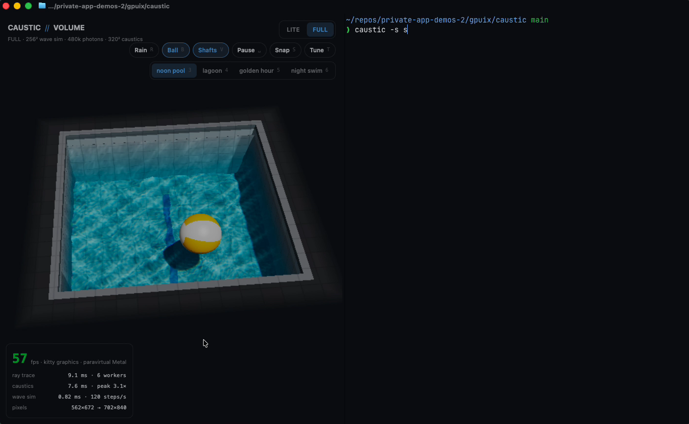

# caustic

Real-time water caustics in your terminal. A CPU wave simulation, a photon-splatting caustics pass and a
multi-threaded ray tracer draw a sunlit pool into a GPUIX ``, and GPUIX paints it inside Ghostty over the kitty
graphics protocol. Drag the water to make ripples, push the beach ball around, orbit, zoom, make it rain, and split
the pane: every `caustic` you start shares its ripples with the others.



Rebuild of prompt 13 of the "15 rebuild prompts" file, *CAUSTIC//VOLUME — real-time water caustics in Three.js*
(inspired by [@ScottieFoxTTV](https://x.com/ScottieFoxTTV/status/2103869371869212740)), as a GPUIX terminal app.

## Run

Needs macOS (Metal), [Bun](https://bun.sh) and Ghostty or kitty. Not tmux or the VS Code/Zed terminals.

```sh
cd gpuix/caustic
bun install
bun link          # puts `caustic` on your PATH (~/.bun/bin)
caustic           # or: bun src/cli.ts
```

```text
caustic [options]
caustic drop [x z] [-n count]   drop ripples into every running caustic
caustic rain on|off             start or stop rain in every running caustic

-q, --quality <lite|full>  start quality (default lite)
-s, --scene <name>         pool | lagoon | sunset | night (default pool)
-r, --rain                 start with rain on
    --no-ball              start without the floating ball
    --sun <deg>            sun elevation, 30-88 (default 64)
-d, --depth <m>            water depth, 0.45-1.6 (default 1.0)
-t, --theme <name>         Ghostty theme to paint with (default: your Ghostty config)
    --workers <n>          ray-trace worker threads (default: half the cores, max 6)
    --solo                 don't share ripples with other caustic panes
-w, --window               open a native window instead of drawing in the terminal
```

| Input | Does |
| --- | --- |
| drag the water | trail of ripples |
| drag the ball | push it through the water (it bobs and drifts on the waves when you let go) |
| drag the deck | orbit the camera |
| scroll | zoom |
| `1` / `2` | LITE / FULL (the waves are resampled, not reset) |
| `r` `b` `v` | rain, ball, light shafts |
| `space` | pause |
| `[` `]` | sun elevation (caustics move and stretch) |
| `-` `=` | water depth (caustics focus and defocus) |
| `s` | snapshot: full-pane-resolution PNG into the current directory |
| `3` `4` `5` `6`, `n` | scene: noon pool, lagoon, golden hour, night swim; `n` cycles |
| `t` | sandbox panel (9 sliders) |
| arrows (sandbox open) | up/down pick a slider, left/right adjust it; drag a slider track with the mouse |
| `h` | key help |
| Ctrl-C | quit, terminal restored |

Every key also has a button in the top bar. Ghostty owns the Cmd shortcuts, so the app uses plain keys only.

### Scenes and the sandbox

Four looks, each its own sun, sky, water colour and floor (`-s, --scene` or keys `3`-`6`):

- **noon pool**: high sun, white tile, sharp cyan caustics.
- **lagoon**: green-turquoise water over procedural sand ripples.
- **golden hour**: low warm sun, long stretched caustics, strong RGB dispersion in FULL.
- **night swim**: moonlight plus two underwater wall lamps that light the floor from below the surface.

`t` opens the sandbox from the original prompt's FULL mode: sun elevation and azimuth, water depth, IOR (1.0 = no
caustics at all, past ~1.4 the ripples focus above the floor), wind swell (directional procedural waves added to the
surface normals on top of the simulation), wave speed, wave life (damping), absorption and light-shaft gain.

### Split panes

Each instance listens on a Unix socket in `$TMPDIR/caustic-link/<pid>.sock`. Ripples you draw in one pane are
replayed in every other pane, so a LITE pane and a FULL pane next to each other show the same waves at two quality
levels. From any shell:

```sh
caustic -q full          # second pane, FULL, linked to the first
caustic drop -n 12       # 12 random drops into every running caustic
caustic drop 0.3 -0.2    # one drop at pool coordinates (x, z in -1..1)
caustic rain on
```

## How it works

```text
 engine worker (Bun Worker)                                     render workers (×N)
 ┌─────────────────────────────────────────────────┐            ┌──────────────────────────┐
 │ Scene.advance(dt)   wave sim at fixed 60/120 Hz │            │ renderRows(frame, rows)  │
 │ Caustics.compute()  P² sun photons → floor tex  │──frame k──▶│ camera ray per pixel     │
 │ snapshot waves + caustics into buffer k&1       │            │ → BGRA SharedArrayBuffer │
 │ (meanwhile frame k-1 is being traced)           │◀──done─────│ interleaved row bands    │
 └─────────────────────────────────────────────────┘            └──────────────────────────┘
                 │ postMessage(frame bytes)
                 ▼
 UI thread:  .setImagePixels(w, h, bgra, { format: 'bgra' })  →  GPUIX  →  kitty graphics  →  Ghostty
```

- `src/water.ts` is the height field: each step pulls every cell's velocity toward the average of its 4 neighbours,
  damps it and integrates. Steps are fixed-rate and scaled with the grid size so waves travel at the same speed in
  LITE (128²) and FULL (256²). Normals come from central differences.
- `src/caustics.ts` casts a P×P grid of sun rays at the surface, refracts each through the interpolated normal
  (Snell, IOR 1.333; FULL uses 1.31/1.333/1.36 for R/G/B, exaggerated so the fringes read at terminal size), and splats where it hits the floor. The ball shadows rays
  both above and below the surface, and the deck rim shadows the walls' side of the floor.
- `src/render.ts` traces one camera ray per pixel: deck, walls, ball, and the water surface. At the surface it mixes a
  procedural sky reflection with the refracted view by Fresnel (Schlick), then shades the tiled floor and walls with
  the caustic texture, attenuated by Beer–Lambert absorption along the underwater path. FULL adds light shafts: a short
  raymarch of the underwater ray that looks up the caustic each sample's sun ray would land on, weighted by a
  Henyey–Greenstein phase function (g = 0.55). ACES tone mapping finishes it, and the deck fades into the terminal background.
- `src/engine.ts` pipelines it: while the workers trace frame *k*, the engine steps the sim and casts caustics for
  frame *k+1* into the other half of a double buffer, so a frame costs `max(sim + caustics, trace)`, not the sum.
  The image is traced at 0.7× (LITE) or 0.8× (FULL) of the pane's pixel size and GPUIX scales it up.

### The caustics math

```text
          sun ──▶  ↘ ↘ ↘ ↘ ↘ ↘ ↘        P × P parallel rays, one per light-space cell of area A₀
                    ╲ ╲ ╲ ╲ ╲ ╲ ╲
      water  ~~~~~~~~╲~╲~~╲~╲╲~╲~╲~~~~  height h(x,z), normal n = normalize(-∂h/∂x, 1, -∂h/∂z)
                      ╲ ╲  ╲│╱  ╲ ╲      refract:  t = η·l + (η·cosθᵢ − √(1 − η²(1 − cosθᵢ²)))·n,  η = 1/1.333
                       ╲ ╲  │  ╱  ╲ ╲
      floor  ═══════════╲═╲═█═══╲══╲══  each ray deposits A₀ onto the floor cell it lands in
                             ▲
                  bright caustic: many rays, small area
```

The brightness of a floor patch is how much sunlight lands on it divided by its area. A ray bundle that covered area
A₀ at the surface lands on area A₁ on the floor, so its irradiance there is `E = A₀ / A₁`. The WebGL original measures
A₁ per triangle with `dFdx/dFdy` of the refracted positions. On the CPU it is simpler to count: shoot P² photons,
each carrying `(C/P)²` of energy into a C² floor texture, and bilinearly splat them. Flat water gives exactly 1.0
everywhere; a convex bump focuses its photons into a smaller patch (E > 1, the bright web) and leaves dark gaps
(E < 1) between. Depth matters because refracted rays diverge linearly with distance: in shallow water the bundle has
not converged yet, so the pattern is soft, and as you deepen the pool (`=`) the same ripple focuses into sharp lines
until, past the focal distance, it spreads out again. A 1-2-1 blur in each direction removes splat noise. The tests
check each of these: flat water ≈ 1, ripples raise the peak, deeper water raises it further, and dispersion
separates R from B.

## What was adapted, and what was cut

| Original (Three.js / WebGL2) | Here (GPUIX in Ghostty, CPU) |
| --- | --- |
| GPU ping-pong height field, 256² LITE / 1024² FULL | CPU height field, 128² LITE / 256² FULL |
| light-space mesh warp, area ratio via `dFdx/dFdy`, 128² / 512² grids | photon splatting with the same area-ratio result: 288² / 400² photons into 192² / 320² textures |
| caustics projected on floor and walls, depth attenuation, FULL dispersion | floor caustics, depth focusing, Beer–Lambert, FULL RGB dispersion that follows the IOR slider (walls get light and shadow, not caustics) |
| raymarched volumetric shafts at half res + bilateral upsample | short raymarch per underwater pixel in FULL, no separate pass |
| Fresnel reflection of an HDRI / cubemap + screen-space refraction | Fresnel reflection of a procedural sky, refraction traced directly |
| ACES, bloom, vignette, film grain | ACES (LUT); the deck fades into the terminal background |
| lil-gui sandbox: light angle/colour, absorption, wave speed, IOR, pool shape | in-app sandbox: sun elevation/azimuth, depth, IOR, wind swell, wave speed, wave life, absorption, shaft gain; 4 scene presets set light colour and water colour (no cylinder pool) |
| auto GPU benchmark picks LITE/FULL | starts LITE; `-q full` or `2` |
| drag-to-orbit, rain toggle, screenshot button, perf overlay | all kept (snapshot writes a PNG, the HUD shows fps and per-stage ms) |
| static site on GitHub Pages | a CLI, `caustic`, that draws in your terminal; split panes share ripples |

Cut: WebGPU path, cylinder pool, light colour/absorption/IOR sliders, bloom, grain and vignette, wall caustics, the GPU
auto-benchmark. The 60 fps-on-an-RTX-3070-at-1440p acceptance criterion doesn't apply: everything runs on the CPU,
and GPUIX only composites the finished image.

## Performance (honest numbers)

This was built and measured on a macOS VM with the **Apple Paravirtual** Metal device and 12 vCPUs. GPUIX
composites through paravirtual Metal and sends frames to Ghostty over the kitty graphics protocol (shared memory).
The HUD says `kitty graphics · paravirtual Metal` and shows live numbers. Typical readings in a 157×42 Ghostty
window (1413×840 pane pixels), 6 render workers:

| | traced at | ray trace | caustics | fps in Ghostty |
| --- | --- | --- | --- | --- |
| LITE | 989×588 | ~5-9 ms | ~2 ms | 53-60 |
| FULL | 1130×672 | ~16 ms | ~6-7 ms | 60-63 (noon pool and night swim, second pass) |
| split, both panes | 491×588 + 562×672 | 3 + 4 ms | 2 + 8 ms | 59 + 60 |

Headless (no terminal) the pipelined engine measured 60.7 fps LITE and 59.5 fps FULL. The frame loop is capped near
60 fps. A real Mac with more cores will have headroom; a laptop with 4 cores will drop FULL first.

## GPUIX findings (0.11.0, terminal mode)

- `` + `setImagePixels(w, h, bytes, { format: 'bgra' })` is fast enough to push ~1 MP at 60 fps from a worker's
  `SharedArrayBuffer`. Tracing below pane resolution with `objectFit="fill"` is a cheap quality knob.
- Keys arrive twice if both a focused root `<div onKeyDown>` and a window-level handler listen. Toggles flipped
  twice and looked dead (`r` did nothing) until the root handler called `stopPropagation()`.
- In terminal mode letters can arrive as `key: "space"` with the real character in `keyChar`; `keyName()` in
  `src/app.tsx` normalizes both (and is unit-tested).
- The left mouse button is `0`; drag code must check `!== undefined`, not truthiness.
- A node with `onMouseDown` + `onMouseMove` keeps receiving moves while the button is held, even outside it, which
  makes drag-to-orbit and ball dragging simple. Overlays (HUD, toasts) need `pointerEvents: 'none'`.
- Held INFO/WARN logs print under the prompt after Ctrl-C unless `RUST_LOG` is set before the native module loads,
  so `cli.ts` re-execs itself once with `RUST_LOG=error` (override with `CAUSTIC_LOG=info`).
- Workers: `new Worker(new URL('./render-worker.ts', import.meta.url).href)` works under Bun with the GPUIX app
  running on the main thread; the engine itself runs in a worker so a slow trace never blocks input.
- `@gpuix/react/testing` + `connectTest` drives clicks and drags in the GPU test renderer; `mouse.drag` sends a move
  to the start point before the press, so assert on the `down` event, not the first event.

## Tests

```sh
bun test          # 14 tests: wave propagation/damping/volume, Snell + total internal reflection, caustic focusing
                  # with ripples and depth, dispersion, picking, ball physics, renderer, engine pipeline, and the UI
                  # in the GPU test renderer (quality toggle, pills, keys, drag → pointer messages, HUD, split width)
bun run typecheck
```

`tools/input.swift` is the CGEvent driver used to record the demo with real mouse drags, scrolls and keys
(`swiftc -O tools/input.swift -o /tmp/input`).

MIT licensed.
