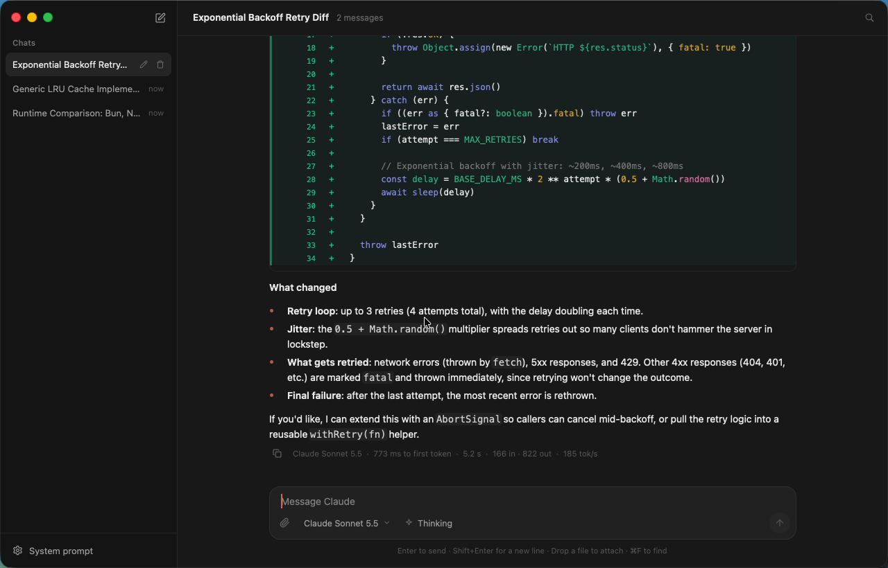

# Claude Desk

A native Mac chat client for Claude, built with [GPUIX](https://github.com/remorses/gpuix) 0.11.0 (React on Zed's GPUI, painted with Metal). There's no Electron and no web view. Replies stream token by token from the real Anthropic Messages API. Markdown, tables, syntax-highlighted code and diffs are all drawn by GPUIX's native text elements.



Demo (real time, real mouse and keyboard input): [`media/demo.mp4`](media/demo.mp4)

## What it does

- **Streaming chat.** Uses `POST /v1/messages` with `stream: true` and parses the SSE stream by hand (`src/anthropic.ts`). Text and thinking deltas are batched into React state, so the transcript grows as tokens arrive.
- **Threads sidebar.** Create (⌘N), rename (double-click or the pencil), delete, and switch threads. Everything is saved to `~/Library/Application Support/Claude Desk/threads.json`, written atomically through a temp file and rename. After the first reply, Haiku picks a short title for the thread.
- **Rich replies.** Uses GPUIX `<markdown>` for headings, lists, GFM tables, inline code and fenced code with native syntax highlighting. A closed ```` ```diff ```` fence becomes a native `<diff wordDiff>` with gutters and word-level highlights.
- **Composer.** A native `<textarea>` that grows from 1 to 8 rows. Enter sends and Shift+Enter adds a new line. A Stop button (or ⌘.) aborts the request and keeps the partial reply, marked "stopped".
- **Model picker.** A headless `Select` with Sonnet 5.5 (the default, the newest Sonnet the API lists), Opus 5.5, Haiku 5.5 and Sonnet 4.5. A Thinking toggle maps to the right `thinking` parameter for each model family (Sonnet 5.x needs `between_tools` to turn thinking off, Opus 5.x always thinks, and 4.x uses a token budget). The streamed thinking summary shows up in a collapsible "Thought for N s" block.
- **System prompt.** Set it in a headless `Dialog` with a native textarea. It's saved with the settings.
- **Per-reply readout.** Shows the model, time to first token, total time, input/output tokens, tokens per second and the stop reason.
- **Find in thread.** ⌘F opens a find bar. It counts matches, highlights them in the transcript, and Enter/↑/↓ step through them. `renderer.scrollToItem()` brings each match into view.
- **Copy and select.** Each message has a copy button (clipboard), and all text is selectable.
- **Attachments.** Drag text or code files onto the window (`onFileDrop`), or use the paperclip (`renderer.promptForPaths()`). Each file can be up to 256 KB of UTF-8 text, and binary files are rejected. File contents go to the API as `<file name="…">` blocks and show as chips on the message.
- **Chat tail.** The transcript is a `<virtual-list alignment="bottom" followTail>`. It sticks to the bottom while a reply streams, stops following when you scroll up, and starts again when you return to the bottom.

## GPUIX features used

`render()` window options (transparent titlebar, traffic-light inset, min size, `focus: false` under `GPUIX_BACKGROUND=1`), `<virtual-list>` with bottom alignment and follow-tail, `<markdown>` (GFM tables and code highlighting), `<diff>`, `<textarea>` (`onSubmit`, `minRows`/`maxRows`, chat theme), `<input>`, `Select`, `Dialog`, `<svg>` icons (Lucide paths), `motion` opacity animations, `onFileDrop`, `renderer.promptForPaths()`, `renderer.scrollToItem()`, the clipboard, element refs with `focus()`, window `onKeyDown` shortcuts, `debugFrameOverlay`, `@gpuix/react/testing`, and `@gpuix/react/automation`.

## Run it

Requires macOS on Apple Silicon, Bun, and `ANTHROPIC_API_KEY` set in your environment. The key is only read from the environment and is never logged or saved.

```sh
bun install
bun run dev          # bun --hot app.tsx
bun run test         # vitest + GPUIX native test renderer (mock streamer, no network)
bun run typecheck
```

Optional environment variables: `CLAUDE_DESK_DATA_DIR` (store location), `CLAUDE_DESK_DEBUG_OVERLAY=1` (frame-time overlay), `CLAUDE_DESK_LOG_STARTUP=1`, and `GPUIX_BACKGROUND=1` (don't steal focus).

## Tests

`app.test.tsx` mounts the real `<ClaudeDesk>` component in GPUIX's native test renderer with a deterministic streamer. It drives the UI through `@gpuix/react/automation` locators (`fill`, `press('Enter')`, `click`) and checks:

1. Enter sends. The streamed markdown, table and diff appear, the readout shows tokens, and the thread is written to `threads.json`.
2. Stop aborts a stream that never finishes and keeps the partial text.
3. Renaming and deleting threads updates the sidebar and the saved file.
4. ⌘F finds matches, shows "1 of N", and steps to the next match.
5. Changing the model and saving a system prompt both reach the streamer request.

## Performance

These numbers come from a macOS 26 VM with an **Apple Paravirtual Metal GPU**, which is slower than real M-series hardware.

| Metric | Value |
| --- | --- |
| `render()` → window mounted | ~280 ms (cold `bun app.tsx` to first paint, about 1 s) |
| Memory (RSS), idle with 6 threads | ~150 MB |
| Memory while streaming a long reply | ~185 MB, ~215 MB after a 700-token reply |
| CPU while streaming | ~45 % of one core (~4 % idle) |
| Frame time while streaming and scrolling (debug overlay) | current 3.4 ms, 10 % worst 5.2 ms, 1 % worst 6.7 ms, max 13.8 ms |

Streaming flushes deltas into React about every 24 ms. Even on the paravirtual GPU, frames stay well under the 16.7 ms budget while markdown re-lays out every flush. Time to first token depends on the model: Sonnet 5.5 with thinking off showed 0.5–1.0 s in the UI, while Opus 5.5 always thinks first.

## GPUIX findings (0.11.0)

- **Textarea stops submitting after a layout swap.** Repro: start with an empty state that contains the `<textarea>`, send a message so the empty state is replaced by the `<virtual-list>` transcript (the composer stays mounted), then click the composer, type, and press Enter. The text shows up, but `onSubmit` never fires, and clicking the field doesn't fix it. The same thing happened after picking an item from a `Select` popover. Workaround: call `ref.focus()` on the composer from an effect after those changes (`focusComposer` in `src/ClaudeDesk.tsx`). With that, Enter has worked in every manual and automated run since.
- **One keystroke reaches both handlers.** A shortcut fires the root element's `onKeyDown` and then the window-level `render({ onKeyDown })` for the same keystroke, so ⌘N created two threads. Workaround: drop a repeat of the same key combo that arrives within 40 ms. (README says `stopPropagation()` skips the window handler. Here, the root handler also has to cover the case where nothing inside the tree has focus.)
- **Mouse clicks bubble to ancestors.** A click on a row's trash `IconButton` also runs the row's `onClick`, which re-selected the deleted thread. README doesn't document a mouse `stopPropagation`, so `selectThread` ignores ids that no longer exist.
- **`motion` has no keyframe arrays or `repeat`.** A pulsing "Thinking…" dot needs a React timer that flips a scalar `opacity` target (`Pulse` in `ClaudeDesk.tsx`).
- **Duplicate system font warnings.** Every launch prints `WARN gpui_macos::text_system skipping duplicate font "System Font Bold"…` (harmless).
- **Synthetic input note.** With `cliclick -w <ms> t:"…"` (typing with a delay between keys), the next Enter was sometimes dropped. Typing without `-w`, or clicking Send, always worked. The cause is unclear (cliclick event flags or GPUIX key handling), so the demo clicks Send for its last long prompt.
