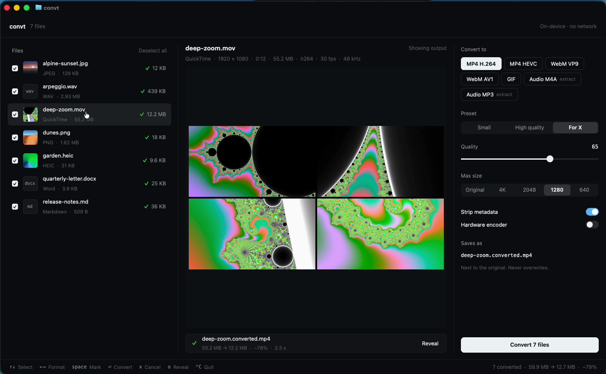

# convt

A local file converter that runs as a GPU-rendered GUI **inside Ghostty**. Point it at files or folders; it sniffs each file by its magic bytes, offers only the formats that make sense for it, shows a live before/after preview, and converts everything beside the originals with local engines (FFmpeg, `sips`, `cwebp`, Pandoc + Typst, `textutil`). Nothing is uploaded and no network calls are made.



Demo: [`media/demo.mp4`](media/demo.mp4) · split pane: [`media/screenshot-split.png`](media/screenshot-split.png)

Built with [GPUIX](https://github.com/remorses/gpuix) 0.11.0 (React → GPUI/Metal). In terminal mode GPUIX paints the same React tree into the terminal over the Kitty graphics protocol, so the app follows Ghostty's splits and resizes like any other terminal program.

## Run

```sh
brew install ffmpeg webp pandoc typst   # sips and textutil ship with macOS
bun install
bun run fixtures                        # procedural sample files in demo/ and demo-more/
bun link                                # puts `convt` on PATH
convt demo -w                           # open the folder and watch it for new files
```

Run it in **Ghostty or kitty** (the Kitty graphics protocol is required; tmux and the VS Code/Zed terminals stay blank). `convt --window` opens a native window instead.

```
Usage: convt [options] <file|dir>...

  -t, --to <fmt>       preselect a target format (webp, mp4, mp3, pdf, ...)
  -q, --quality <n>    quality 1-100
  -j, --jobs <n>       parallel conversions (default: CPU cores - 1)
  -w, --watch          pick up files added to the folders later
  -y, --yes            convert everything immediately on launch
      --theme <name>   Ghostty theme to blend with (default: your Ghostty config)
      --window         open a native window instead of rendering in the terminal
  -h, --help / -v, --version
```

Keys (Ghostty owns most Cmd shortcuts, so everything is a plain key):

| Key | Action |
| --- | --- |
| ↑ ↓ / j k | move between files |
| ← → / tab | cycle target format |
| − / = | quality down / up |
| 1 2 3 | presets: Small, High quality, X ready |
| m | cycle max size |
| s | toggle metadata stripping |
| v | toggle the VideoToolbox hardware encoder |
| space / a | select one / all |
| enter | convert the selection (or the focused file) |
| x / esc | cancel the focused job / all jobs |
| o | reveal the output in Finder |
| Ctrl-C | quit and restore the terminal |

Everything is clickable too: files, format buttons, presets, the quality slider (drag it), toggles, Convert, Cancel and Reveal. Mouse wheel scrolls the file list.

## What it does

- **Magic-byte sniffing** (`src/sniff.ts`): PNG, JPEG, GIF, WebP, AVIF, HEIC, TIFF, BMP, ICO, MP4/MOV/M4A (ISO-BMFF brands), WebM/MKV, WAV, AIFF, FLAC, Ogg/Opus, MP3, PDF, DOCX/ODT/EPUB (zip directory), RTF, HTML, Markdown. A JPEG with no extension or a wrong one is still a JPEG.
- **Conversion matrix** (`src/formats.ts`):
  - Images → WebP, JPEG, AVIF, HEIC, PNG, TIFF, GIF, ICO, PDF, with quality, max dimension and metadata stripping.
  - Video → MP4 H.264 / HEVC, WebM VP9 / AV1, MOV, GIF (palette-optimised), and audio extraction to M4A/MP3. Presets: Small for sharing, High quality, X ready (H.264 ≤1280px, 30 fps, AAC). Optional VideoToolbox encoder when detected.
  - Audio → MP3, M4A (AAC), Opus, OGG, FLAC, WAV.
  - Documents → Markdown/HTML/DOCX/RTF/TXT to PDF (Pandoc + Typst), DOCX, HTML, Markdown, RTF, TXT.
  - PDF → PNG/JPEG/TIFF of page 1.
  - Targets are dimmed with a reason when an engine is missing ("needs cwebp") or the input can't support them ("no audio track").
- **Live preview**: a 1:1 crop of the source next to the same crop actually encoded with the current settings, plus a size estimate. Video shows a 2×2 frame grid, audio a waveform, documents their text.
- **Progress**: FFmpeg runs with `-progress pipe:1`; per-file bars show percent and speed. Cancel kills the process and removes the partial output.
- **Batch**: a queue with `cores − 1` workers (`-j` to override).
- **Output naming**: `name.converted.ext` beside the input, then `name.converted-2.ext`, ...; never overwrites.
- **Zero network**: every FFmpeg call is pinned to `-protocol_whitelist file,pipe`, and a test asserts that no planned command contains a URL.
- **Reflow**: three columns when the pane is wide, a stacked list over preview/settings at half width, and no preview in thin panes.
- **Theme**: reads your Ghostty theme (GitHub Dark High Contrast by default) so the app blends into the terminal.

## Tests

```sh
bun run typecheck
bun test
```

- `tests/logic.test.ts`: sniffing, the target matrix, output naming, command plans, the no-network guarantee, progress parsing, layout breakpoints and key normalisation.
- `tests/engines.test.ts`: integration; runs every available engine on generated fixtures and validates the outputs with `ffprobe` and the sniffer.
- `tests/app.test.tsx`: the GPUIX GPU test renderer; renders the app, clicks Convert, checks the output file and the UI, and checks the three layouts.

`tools/record-demo.sh` drives the demo with real CGEvents (`tools/input.swift`, compile with `swiftc -O tools/input.swift -o ~/bin/cginput`).

## Adapted from the original prompt

The prompt asked for a Tauri 2 desktop app with a Finder/Explorer right-click "Convert to…" menu and a floating progress HUD. This version keeps the conversion core and the UX (format menu filtered by sniffed type, presets, quality, progress, cancel, reveal, safe naming, local-only) and moves it into the terminal:

- **Right-click menu → the shell.** `convt <files>` is the entry point; `-w` watches a folder so files you drop or `cp` in show up live, and `-t webp -y` converts in one shot. A Finder Quick Action that calls `convt --window "$@"` would be the next step; it isn't included.
- **Tauri web UI → GPUIX.** The UI is React rendered natively by GPUI, in the terminal or a window.
- **Engines.** Uses what's installed instead of bundled sidecars: FFmpeg for audio/video/GIF/ICO/AVIF/HEIC, `cwebp` for WebP, `sips` for HEIC decode and PDF rasterising, Pandoc + Typst for documents, `textutil` for Word/RTF/HTML. libvips, LibreOffice and qpdf weren't used.
- **Cut:** Windows/Linux shell extensions, signing/notarisation/MSIX, DOCX↔PDF via LibreOffice (PDF → DOCX isn't offered), PDF compression and multi-page PDF → PNG (page 1 only), images → a single merged PDF (each image becomes its own PDF), JPEG XL.

### FFmpeg licensing

convt doesn't bundle FFmpeg; it calls whatever `ffmpeg` is on PATH. Homebrew's build is configured with `--enable-gpl` (libx264/libx265), which is fine for a separate process that convt only invokes. If you redistribute convt with an FFmpeg binary, ship an LGPL build (no `--enable-gpl`/`--enable-nonfree`) or follow the GPL, include its license and source offer, and keep it a separate executable. convt's own code is MIT.

## GPUIX findings (0.11.0, terminal mode in Ghostty)

- Every `<text>` needs an explicit `color`, and `<div>` isn't flex until you set `display: 'flex'`.
- Multiple children in one `<text>` (`{n} files`, `→ {label}`) become separate runs that GPUI wraps between, even with `whiteSpace: 'nowrap'`. Joining them into one string (and using no-break spaces) fixes it; see `nb()` in `src/app.tsx`.
- In terminal mode, letter keys arrive as `key: "space"` with the real character in `keyChar`; `keyName()` in `src/layout.ts` normalises both.
- The left mouse button is `0`, so `if (!e.button)` is wrong.
- Overlays need `pointerEvents: 'none'` or they eat the parent's mouse events.
- A focusable root (`tabIndex={-1}`, `autoFocus`, `onKeyDown`) is needed for arrows and Esc.
- After a mouse drag (the quality slider), keys stopped reaching the root's `onKeyDown` in Ghostty. A window-level `onKeyDown` passed to `render()` catches them; `start()` in `src/app.tsx` uses it as a fallback and skips keys the root already handled.
- GPUIX holds INFO/WARN logs until exit and prints them under the restored prompt; `src/cli.ts` re-execs itself with `RUST_LOG=error`.
- `` with local file paths works well for thumbnails; changing the path is enough to swap the preview (outputs are written to a cache dir with unique names).
- `<virtual-list>` leaks native memory when `itemCount` changes often, so the file list is a plain scroll container.
- Don't pipe anything into the app's stdin; a pipe switches GPUIX to its automation protocol.
- Ghostty's `unfocused-split-opacity` dims the app when the other split has focus, which reads well; splits, divider drags and window resizes all reflow live.
- Performance on this macOS VM (Apple Paravirtual GPU): interaction is smooth, but this is a paravirtual GPU, so treat any fps as a lower bound for real hardware.
