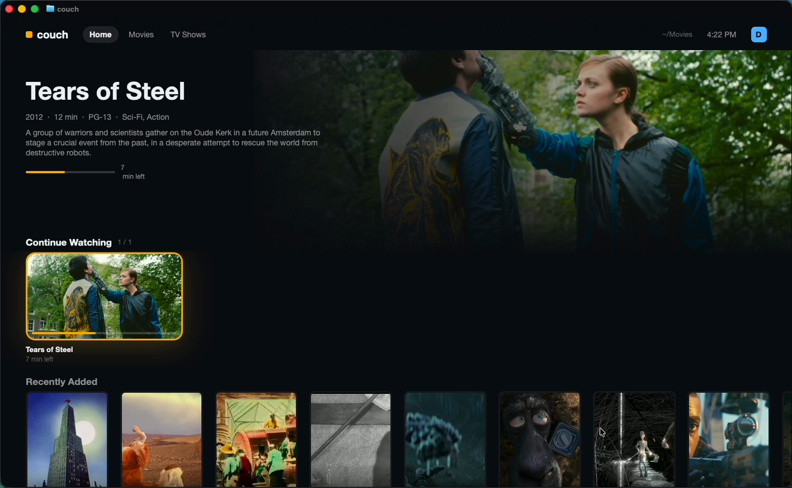

# couch

A fast 10-foot media center that paints inside your terminal. Profiles, Plex-style home shelves, a poster grid, details pages with seasons and episodes, remote-style navigation, and a player whose frames are decoded by ffmpeg and pushed straight into a GPUIX `` with `setImagePixels`. Built with [GPUIX](https://github.com/remorses/gpuix) 0.11.0 (React → GPUI/Metal), rendered in Ghostty over the kitty graphics protocol.

```sh
couch ~/Movies
```



## Run

Needs macOS (Metal), [Bun](https://bun.sh), `ffmpeg`, and Ghostty or kitty.

```sh
brew install ffmpeg
cd gpuix/couch
bun install
bun link                 # puts `couch` on your PATH
couch fetch              # optional: ~1.9 GB of open movies into ~/Movies/Couch
couch ~/Movies
```

| | |
|---|---|
| `couch [folder]` | browse and play a library (default `~/Movies`) |
| `couch -p <name>` | skip the profile picker |
| `couch remote` | on-screen remote for a running couch (run it in a split) |
| `couch remote down right ok` · `couch remote status` · `couch remote open sintel` | drive / inspect it from scripts |
| `couch --plex <url> --token <t>` | browse a Plex Media Server through its HTTP API instead |
| `--mute`, `--hud`, `--theme <name>`, `--window` | video only · open the perf HUD · paint with another Ghostty theme · native window |

Keys: arrows or WASD move, Enter selects, Esc/Backspace goes back, Space plays/pauses, ←/→ scrub 10 s in the player (`[` `]` 30 s), `1` `2` `3` switch tabs, `g` home, `h` perf HUD, `n`/`p` next/previous episode, Ctrl-C quits and restores the terminal. The mouse works everywhere: hover to focus, click to open, wheel to scroll shelves, drag or hover the progress bar to scrub with thumbnails.

Library layout follows Plex naming: `Movies/Title (Year)/Title (Year).mp4` and `Shows/Name/Season 01/Name - S01E01 - Episode.mp4`. Optional `info.json` / `show.json` sidecars add summary, genres, cast, rating, licence and the artwork timestamps. Drop a file into the folder while couch runs and it shows up in Recently Added.

## How it works

- **Scan**: one recursive walk (≈8 ms for the sample library), then ffprobe for codec/resolution/audio, six at a time, cached by size + mtime in `~/Library/Caches/couch`, so warm starts spawn nothing.
- **Artwork**: posters, backdrops and thumbs are cut from the videos with ffmpeg at the exact tile size (`scale … crop`, letterbox crop when the sidecar gives one), cached as JPEG and loaded by ``.
- **Player**: `ffmpeg -re -ss T -i file -f rawvideo -pix_fmt bgra pipe:1` at up to 960×540; the stream is re-chunked into whole frames and handed to `img.setImagePixels(w, h, bytes, { format: 'bgra' })` with no React re-render per frame. Audio runs as its own ffmpeg (`audiotoolbox`) so a machine without an output device still plays video. Seeking restarts the decoder at the new time.
- **Scrubbing**: a keyframe-only pass builds 192×108 BGRA trickplay thumbnails in memory, shown above the progress bar while you scrub.
- **Profiles and resume**: per-profile Continue Watching, watched ticks and resume positions in `~/.config/couch/state.json`; the Kids profile only sees G/PG titles.
- **Remote**: the running app listens on a Unix socket; `couch remote` is a second GPUIX app (a D-pad) or a one-shot CLI, which is how the demo drives it from a Ghostty split.
- **Theme**: reads the Ghostty theme you have configured (GitHub Dark High Contrast in the demo) and paints the background, accents and focus rings from its palette.

## Perf HUD (`h`)

Cold start (process start → first painted frame), scan and ffprobe counts, artwork queue, GPUIX paint time (p90), frames, decode fps vs the file's fps, ffmpeg spawns, audio state, RSS and renderer. Measured on this macOS VM (Apple **paravirtual** Metal GPU, slower than a real Mac): profile picker paints in under a second on a warm cache; the player decodes 720p/1080p sources at 23–24 fps of 24 into 960×540 frames. These are VM numbers, not a TV.

## Adapted from the original prompt

The prompt was a native Plex client for an LG webOS TV (C/Rust, custom OpenGL UI, 3 s cold start, 60 fps, 4K/Dolby Vision/Atmos). There is no TV or Plex server here, so this keeps the soul (a fast, remote-first 10-foot UI that starts instantly) and moves it into the terminal:

- **Local library first.** The demo uses public-domain and Creative Commons films (Blender Foundation open movies, Internet Archive public-domain titles) downloaded by `couch fetch` into `~/Movies/Couch`; nothing is bundled in the repo.
- **Plex API is optional**: `--plex <url> --token <t>` maps `/library/sections`, `/all` and `/allLeaves` onto the same model, uses `/photo/:/transcode` for exact-size artwork, and streams parts with direct play. It is covered by a unit test with a fake server, but **not tested against a real Plex Media Server**. No plex.tv PIN sign-in, server discovery, timeline reporting or managed users.
- **Cut**: webOS packaging, Developer Mode install, HDR10/Dolby Vision, Atmos passthrough, subtitles and audio-track selection, server transcoding. Audio plays through `audiotoolbox` when an output device exists (this VM has none, so the demo is silent).
- Unofficial; no Plex branding is used.

## GPUIX findings (0.11.0, terminal mode)

- `setImagePixels` is fast enough for 960×540 BGRA video at 24 fps through Ghostty's kitty graphics path on a paravirtual GPU; update the `` through a ref, never through React state.
- Every `<text>` needs a `color` and every `<div>` needs `display: 'flex'`; overlays (scrims, OSD) need `pointerEvents: 'none'` or they swallow the parent's hover/click.
- Terminal key events arrive as `{ key: 'h', keyChar: 'h' }` from Ghostty here, but other paths send printable keys as `key: 'space'` with the real character in `keyChar`; map both.
- A root `<div tabIndex={-1} autoFocus onKeyDown>` is needed for arrows/Esc to arrive. Ghostty owns Cmd shortcuts, so everything has a plain-key alternative.
- GPUIX's native INFO/WARN logs are held and printed under the prompt after Ctrl-C; `couch` re-execs itself with `RUST_LOG=error` before GPUIX loads (`COUCH_LOG=info` to see them).
- Don't pipe into the app's stdin (it switches GPUIX to its automation protocol); `couch` refuses a non-TTY stdin in terminal mode.
- Scanning `~/Movies` touches `TV Library.tvlibrary` and triggers a macOS media-library privacy prompt; couch skips app-managed bundles.
- On this VM, automation gotchas: a standalone `cliclick kp:return` is dropped by Ghostty and `cliclick kd:ctrl` can open Dictation; System Events key codes are reliable.

## Tests

```sh
bun test          # library scan, rows, navigation, controller flows (fake decoder), Plex mapping, theme, GPU test-renderer UI flow
bun run typecheck
```
