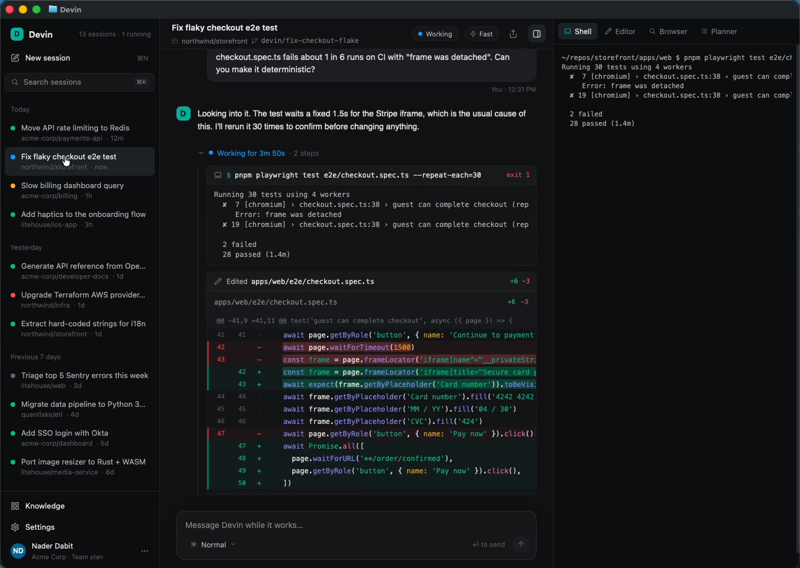

# devin-terminal

The Devin web app (app.devin.ai), rebuilt in React and painted by [GPUIX](https://github.com/remorses/gpuix) (GPUI / Metal), running **inside Ghostty** as a CLI, `devin-tui`. Frames go to the terminal over the **Kitty Graphics protocol**. It talks to the **real Devin API**: your sessions, their live status, the real conversation, and new sessions you start from the terminal are real Devin runs. Light and dark themes, split it into panes, zoom a split, or open the same React tree as a native macOS window.



Demo video: [`media/demo.mp4`](media/demo.mp4), real time and real input, no overlays. Ghostty (`theme = GitHub Dark High Contrast`) opens on the prompt, `devin-tui` loads the account's real sessions sorted by activity (child sessions stay collapsed under their parents), ⌘K search opens the real `TryDevin.ai` session (transcript, PR tabs) and then `Build iPhone Duo Apps`, a new prompt starts a real Devin session whose reply streams in, Cmd-D splits the pane and `devin-tui -t light -s duo` opens a second instance in light mode, the divider is dragged so both reflow, the split is zoomed, and Ctrl-C returns each pane to its prompt.

## Run

```bash
bun install
bun link                 # puts `devin-tui` on your PATH (package.json "bin")
export DEVIN_API_KEY=... # a Devin personal access token (Settings > Devin API > PATs)
export DEVIN_ORG_ID=org-...
devin-tui                # live mode, inside Ghostty or kitty
devin-tui -s dynatrace   # open the first session matching "dynatrace"
devin-tui -m fast -r acme/web "Fix the flaky checkout test"   # start a real session
devin-tui -t light       # light theme (default: follow Ghostty's theme)
devin-tui --demo         # scripted demo data, no API key needed
devin-tui --window       # same app in a native macOS window
bun test && bun run typecheck
```

```
devin-tui [options] [prompt]
  prompt              start a new Devin session with this prompt
  -s, --session <q>   open the first session matching <q> (title or repo)
  -m, --mode <mode>   agent mode for new sessions: normal | fast | ultra
  -r, --repo <repo>   repository for new sessions (owner/name)
  -t, --theme <name>  light | dark | auto (default: follow Ghostty's theme)
      --demo          use scripted demo data instead of the Devin API
  -w, --window        open a native window instead of painting into the terminal
  -h, --help          show this help
```

Credentials come from `DEVIN_API_KEY` + `DEVIN_ORG_ID`, or from `~/.config/devin-tui/config.json` (`{"apiKey": "...", "orgId": "org-..."}`, keep it `chmod 600`). Without them the app falls back to scripted demo data and says "Demo data" in the sidebar footer; live mode says "Live · api.devin.ai".

Don't pipe anything into `devin-tui`: GPUIX 0.11.0 treats a stdin pipe as the automation protocol, and terminal mode needs the TTY. Ctrl-C quits and restores the prompt.

## Live mode (Devin API v3)

`src/api.ts` is a small client for the organization endpoints, authenticated with a bearer token:

| UI | Endpoint |
|---|---|
| Sidebar: up to 20 pages (2,000 sessions) once at launch (cursor pagination), then the newest page every 9 s; sorted by `updated_at`, "Load more…" shows 40 more | `GET /v3/organizations/{org}/sessions?first=100&after=…` |
| Open session: status, ACUs, PRs (polled every 3 s) | `GET /v3/organizations/{org}/sessions/{id}` |
| Transcript (polled every 3 s, cursor pagination) | `GET /v3/organizations/{org}/sessions/{id}/messages` |
| Composer on the home view | `POST /v3/organizations/{org}/sessions` (`prompt`, `devin_mode`, `repos`, tag `devin-tui`) |
| Composer inside a session | `POST /v3/organizations/{org}/sessions/{id}/messages` |

- Sessions nest under their `parent_session_id`, like the web app, collapsed until you click the chevron. The API lists by creation time, so the client sorts by last activity.
- `status` + `status_detail` map to the dots and the footer line: working (blue, pulsing), waiting for user / approval (orange, "Action required"), finished, suspended ("Devin went to sleep"), error.
- The gap between messages becomes a "Worked for 46s" row, and a running session ends with a live "Working for …" timer. New Devin messages type in as they arrive.
- The web app's inline markup is cleaned up: `<ref_file>` / `<ref_snippet>` become `file.ts:3-9`, `ATTACHMENT:{...}` payloads become links.
- The right panel shows the session's details (status, mode, ACUs, link, child sessions) and one tab per PR with its state and an "Open on GitHub" button.
- The messages API returns the conversation, not Devin's shell/editor/browser steps, so live sessions show messages and work durations. The scripted demo data (`--demo`) still shows the shell, diff, browser, plan and PR cards.

## Design

Laid out after the current web app: org header with search/notifications, New session (⇧⌘O), Automations, Security, Review, Customize, More, then Sessions with search (⌘K), nested sessions and "Load more…". The home view is the Devin mark with the Agent/Ask toggle over the big composer (+, slash commands, settings, repository, mode, mic, voice, split send button). Sessions get a branch/title/PR-count header with a status chip, the transcript, the status line and the composer. Inter is bundled (`assets/fonts`) and registered with `registerFont()`.

Two palettes live in `src/theme.ts`. Dark uses Ghostty's GitHub Dark High Contrast background (`#0a0c10`) so the GUI blends into the terminal. Light is the web app's white. `auto` (the default) reads `~/.config/ghostty/config` and picks light for a light Ghostty theme. The sun/moon button (or ⇧⌘L) flips it at runtime.

## Ghostty setup used for the demo

```
# ~/.config/ghostty/config
theme = GitHub Dark High Contrast
font-size = 15
window-padding-x = 10
window-padding-y = 8
keybind = super+k=unbind   # let the app own Cmd-K (search) and Cmd-N (new session)
keybind = super+n=unbind
```

## Splits and reflow

The app follows the terminal's size through `useWindowSize()`:

- **≥ 1080 px**: full layout (288 px sidebar, transcript, 400 px right panel).
- **600–1080 px** (a half split): 232 px sidebar, no right panel, trimmed header.
- **< 600 px** (a narrow split): transcript and composer only.

Splitting with Cmd-D, dragging the divider, or zooming a split (Cmd-Shift-Enter) reflows it live, and each pane is its own independent app.

Env flags: `GPUIX_WINDOW=1` (same as `--window`), `GPUIX_BACKGROUND=1` (don't steal focus), `GPUIX_DEBUG_OVERLAY=1` (GPUI frame-time overlay), `DEVIN_TUI_NAME` (name in the org header).

## GPUIX features used

`render(..., { terminal: true })`, `isTerminal()`, `registerFont()`, `<markdown>`, `<code>`, `<diff>`, `<textarea>`, `<input>`, `<svg>` (Lucide icons and the Devin mark as text imports), `<motion.div>` native animations, headless `Select`, `<virtual-list>` (`followTail`), focus APIs (`focusElement`, `blur`, `getFocusedElementId`, `tabIndex`, `autoFocus`), window `onKeyDown`, `debugFrameOverlay`, the native test renderer and the automation client.

## Test

- `api.test.ts`: the client hits the right v3 URLs with the bearer token, follows message pages, sends the right create/message bodies and surfaces HTTP errors; status mapping, message cleanup, work-gap rows, config loading (env beats file) and theme resolution.
- `app.test.tsx` (GPUIX native test renderer + automation client):
  1. Demo data: switching sessions, New session + Ultra + prompt creates a streaming session that finishes with all PR checks green, ↑/↓, ⌘K search and Esc.
  2. 700 px wide (a half split) with the CLI's prompt: compact layout, no right panel, sidebar still switches sessions.
  3. Live mode against a fake `DevinApi`: sessions load and nest (the waiting child shows "Waiting for you"), opening one polls its messages, a message added server-side appears on the next poll, the composer calls `sendMessage`, New session + Fast calls `createSession` and the new session takes over the header, and the theme toggle switches to light and back.

```
(pass) Devin API client > calls the v3 org endpoints with the bearer token and follows message pages
(pass) Devin API client > maps statuses, messages and config
(pass) devin-terminal > switches sessions, changes agent mode, and streams a new session to a finished PR
(pass) devin-terminal > reflows into a narrow split and starts the CLI prompt as a new session
(pass) devin-terminal > live mode: lists real-shaped sessions, polls messages, sends, creates, and toggles light mode
 5 pass  0 fail
```

## Performance (Apple Paravirtual Metal VM, not real Apple Silicon)

| Metric | Value |
|---|---|
| Process start → first mount (`[gpuix] mount complete`) | ~0.3 s (warm), native window |
| Draw time, GPUI debug overlay (idle, full transcript + panel) | CUR 5.1 ms, 10% 5.3 ms, 1% 5.4–7.1 ms |
| Worst frame (first paint, includes font/layout warm-up) | ~37 ms |
| RSS (bun + native renderer) | ~177 MB at start, ~195 MB after a streamed run |
| CPU while idle / streaming | ~2–4 % |
| Terminal mode in Ghostty | frames sent via kitty graphics shared memory; clicks and keys respond within a frame or two in a 1442×928 Ghostty window, including two instances side by side |
| Over SSH (`ssh -t localhost devin-tui`) | frames sent inline (zlib + base64); first frame appeared well under 1 s after Enter in the recording, clicks still responsive |

Paravirtual Metal is slower than an M-series GPU, so expect better numbers on real hardware.

## GPUIX findings (v0.11.0, `@gpuix/react` + `@gpuix/native`, macOS arm64, Ghostty 1.x)

1. **Window `onKeyDown` needs a focused element.** With nothing focused, ↑/↓/Esc never reach the `render({ onKeyDown })` handler, in both the native window and terminal mode. Workaround: a root `<div tabIndex={-1} autoFocus onKeyDown>` that forwards to the same handler. ⌘K works either way.
2. **Text color does not inherit.** Every `<text>` sets `color`; otherwise it paints black on the dark theme.
3. **Shadow fields** are `blurRadius` / `spreadRadius` / `offsetX` / `offsetY` (not CSS shorthand); `testId` is not accepted on `motion.div` (put it on a child).
4. **Markdown width.** A `<markdown>` block inside a flex column overflows unless the column has `width: '100%'` and `minWidth: 0`.
5. **Terminal launch logs.** Terminal mode holds stdout/stderr until exit, then dumps native `INFO`/`WARN` logs (e.g. `gpui_macos::text_system` duplicate-font warnings) onto the restored prompt. Workaround: the `app.tsx` shebang sets `RUST_LOG=error` and `[gpuix]` JS logs are filtered unless `GPUIX_VERBOSE=1`.
6. **`simulateInput` is not on the test renderer** in 0.11.0; `simulateKeystrokes('t e r r a f o r m')` works for typing into a focused `<input>`.
7. **Ghostty splits work, tmux doesn't.** Each Ghostty split gets its own kitty-graphics surface, so two GPUIX apps side by side, divider drags and split zoom all reflow cleanly. tmux is unsupported, as the README says.
8. **SSH works** (`ssh -t localhost devin-tui`): the remote app paints and takes clicks; `-t` is required for the TTY.
9. **`<markdown>` text is invisible to automation.** `getAllText()` and `textContent()` don't include `<markdown>` content in 0.11.0 (the README says `getAllText()` only sees `<text>` nodes), so the live-mode test asserts that each message element appears instead of reading its text.
