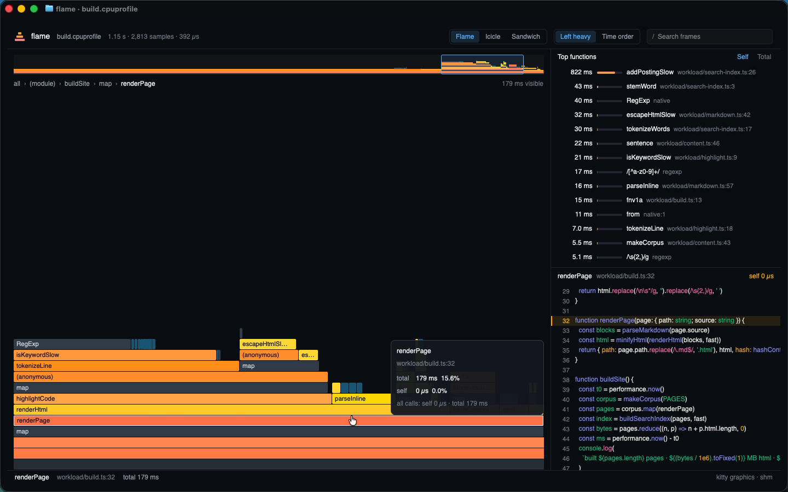

# flame

An interactive CPU-profile flamegraph viewer that runs **inside your terminal**. It's written in React + TypeScript with [GPUIX](https://github.com/remorses/gpuix) 0.11.0, painted by GPUI on the GPU, and streamed into Ghostty (or kitty) with the Kitty Graphics protocol.

Create GUIs. Use them as TUIs.

```bash
flame profile.cpuprofile
```



Demo (Ghostty, GitHub Dark High Contrast, real mouse and keyboard): [media/demo.mp4](media/demo.mp4)

## What it does

- Opens a real V8/Bun `.cpuprofile` (the format `bun --cpu-prof` and `node --cpu-prof` write).
- **Flame / Icicle / Sandwich** views. Sandwich shows callers above and callees below the selected function.
- **Left heavy** (merged stacks, heaviest first) or **Time order** (the real call timeline).
- **Click to zoom** with an animated transition (GPUIX `motion.div`), breadcrumbs, Esc to go back, and scroll-wheel zoom around the cursor.
- **Hover tooltips** with total and self time, percentages, all-call totals and `file:line`.
- **Search** (`/`) highlights matching frames and sums the matched time.
- **Top functions** table (`<virtual-list>`), sortable by self or total time. Clicking a row selects it and opens sandwich view.
- **Source panel**: the selected frame's file opens in a `<code>` panel, syntax-highlighted, scrolled to the line.
- **Minimap**: an overview of the whole profile drawn into an `` with `setImagePixels`. Drag it to pan.
- **Watches the file.** When the profiler rewrites it, flame reloads in place, keeps your selection, and shows a toast like `Reloaded · 1.15 s → 194 ms (−83%)`.
- **Reflows with the pane.** Under 1000 px the sidebar (top functions and source) goes and the flamegraph takes the whole width; under 820 px the toolbar drops the layout toggle (`t` still works). Ghostty splits and divider drags resize it live.

## Run it

Needs macOS (arm64), [Bun](https://bun.sh), and Ghostty or kitty for terminal mode.

```bash
cd gpuix/flame
bun install
bun link                       # puts `flame` on your PATH
flame examples/before.cpuprofile
```

Or without linking: `bun src/cli.tsx examples/before.cpuprofile`.

```
flame [options] <profile.cpuprofile>

  -v, --view <flame|icicle|sandwich>   start view (default flame)
  -o, --order <heavy|time>             left-heavy merge or time order (default heavy)
  -s, --search <text>                  highlight matching frames
  -w, --window                         open a native macOS window instead
  -t, --terminal                       force terminal mode (kitty graphics protocol)
  -h, --help                           show this help
```

Keys: click zoom, scroll zoom, `Esc` back, `r`/`0` reset, `/` search, `f`/`i`/`s` view, `t` order, `Ctrl-C` quit (restores the terminal).

flame takes a **file path**, never stdin. A GPUIX app treats a stdin pipe as its automation protocol, and terminal mode needs the TTY, so `cat x | flame` is rejected with a clear error.

## The split-pane workflow

Run flame in one pane and profile in another. flame reloads every time the file changes:

```bash
# pane 1
flame build.cpuprofile

# pane 2 (Cmd-D in Ghostty)
bun --cpu-prof --cpu-prof-name=build.cpuprofile workload/build.ts          # slow path, ~1.15 s
bun --cpu-prof --cpu-prof-name=build.cpuprofile workload/build.ts --fast   # optimized, ~0.2 s
```

`workload/` is a small static-site build (1,200 generated pages: markdown, syntax highlighting, search index). The slow path has the usual mistakes: a regex built per call, uncached stemming, array posting lists with `includes`. `--fast` fixes them. `bun run profiles` regenerates `examples/before.cpuprofile` and `examples/after.cpuprofile`.

You can also open both side by side, `flame examples/before.cpuprofile` next to `flame examples/after.cpuprofile`, which the demo ends on.

## How it uses GPUIX

| Feature | Where |
| --- | --- |
| Terminal mode (`render(..., { terminal })`, `isTerminal()`) | `src/cli.tsx`, `src/app.tsx` |
| `useWindowSize()` for pane-width breakpoints | `src/app.tsx` |
| `motion.div` animated zoom | `Graph` in `src/app.tsx` |
| `<virtual-list>` | top-functions table |
| `<code>` with syntax highlighting | `SourcePanel` |
| `` + `setImagePixels` | `Minimap` |
| `<input>` with focus/keys | search box |
| mouse move/down/up, scroll wheel, key events | graph, minimap, global keys |
| `@gpuix/react/testing` (GPU test renderer) | `src/app.test.tsx` |

Colors come from Ghostty's `GitHub Dark High Contrast` theme (`#0a0c10` background, `#71b7ff` blue, `#26cd4d` green), so the app blends into the terminal. Frame colors are warm hues per source file, grey for native/GC, and teal for regex/runtime frames.

## Tests

```bash
bun test          # 10 tests: profile model + GPU test renderer driving the real UI
bun run typecheck
```

`src/profile.test.ts` covers parsing, time deltas, left-heavy merge, time-order layout, sandwich, search and top functions. `src/app.test.tsx` mounts the app on the GPU test renderer with the real example profiles. It hovers for the tooltip, clicks to zoom and checks the breadcrumbs, checks the source panel paints the right code, searches, switches to sandwich and time order, reloads the file and checks the toast, and resizes to split-pane width.

## Performance

Measured on this macOS 26 VM with an **Apple Paravirtual** GPU, which is much slower than a real M-series Mac:

- Parsing and laying out the 1.15 s / 2,813-sample profile: parse 1.5 ms, left-heavy 0.2 ms (89 cells), time order 0.7 ms (1,799 cells).
- `flame` process in Ghostty: about 135 MB RSS idle at 0.5% CPU. Sweeping the mouse across the graph (tooltip and hover redraw on every move) uses 13–28% of one core and about 170 MB.

## GPUIX findings (0.11.0)

- **Logs land in the restored shell.** `@gpuix/react` `console.log`s `[gpuix] created native window` and `mount complete`. In terminal mode stdout is held until exit, so those lines print after Ctrl-C. `gpui-terminal` also logs `sending frames through shared memory` at info level via `env_logger`. Setting `process.env.RUST_LOG` from JS before the import doesn't reach the native logger (Bun doesn't seem to propagate it to the C environment in time), so flame's shebang is `#!/usr/bin/env -S RUST_LOG=warn bun`, and the CLI filters the `[gpuix]` lines.
- **Painted children block hover on their parent.** A label `<div>` painted over a hit area takes the mouse unless it has `pointerEvents: 'none'`. Easy to miss with tooltips, which then flicker as they steal hover from the thing they describe.
- **Frame identity across reloads is up to you.** Not a bug, but a reload that replaces the data can leave a selected index pointing at nothing. flame keys frames by `name|url|line|column` and remaps the selection.
- **Only Ghostty and kitty display frames.** VS Code, Zed and Codex terminals aren't in the README's supported list for 0.11.0, so this demo doesn't claim them. tmux is unsupported too.
- **`<code>` text isn't in `getAllText()`.** Tests have to read it with `getPaintedText()`.
