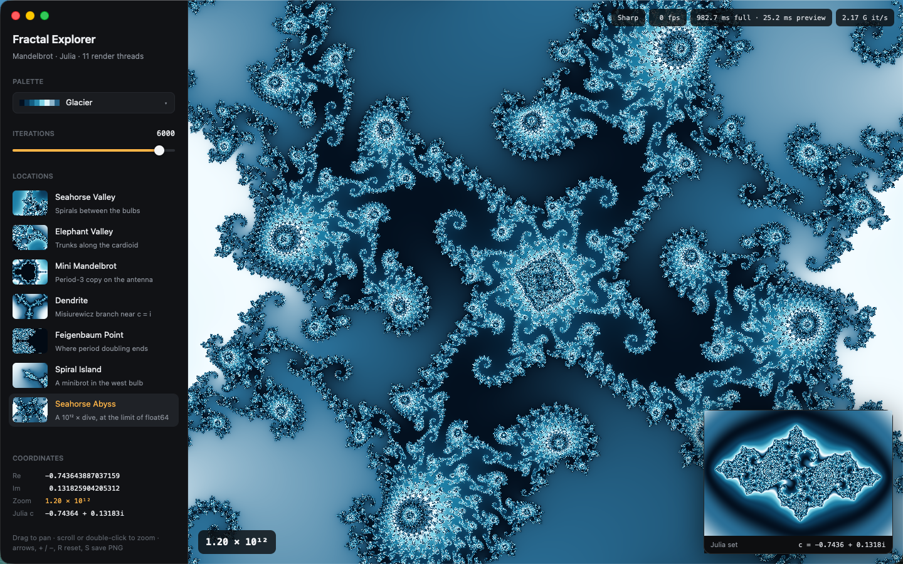

# Fractal Explorer (GPUIX)

A native macOS Mandelbrot explorer with a live Julia-set inset, written in React + TypeScript and painted by
[GPUIX](https://github.com/remorses/gpuix) (GPUI + Metal). No Electron, no web view.



Demo (60 s, real time, real mouse and keyboard input): [`media/demo.mp4`](media/demo.mp4)

## What it does

- **Mandelbrot viewport** rendered by a pool of Bun Workers (one per core minus one, 11 on the test VM).
  Each frame is split into 64×64 tiles, scheduled centre-first, written straight into a
  `SharedArrayBuffer` as packed BGRA, and pushed to an `` ref with
  `setImagePixels(w, h, pixels, { format: 'bgra' })`.
- **Progressive refinement**: when a frame would blow the frame budget, a 1/2–1/10 resolution preview goes up first, then the
  full-resolution pass streams in tile by tile (partial uploads every ~33 ms). Stale passes are cancelled via a
  shared generation counter, so fast input never queues work.
- **Pan reuses pixels**: whole-pixel drags shift the existing buffer and only render the exposed strips.
- **Live Julia inset**: hovering the Mandelbrot sets the inset's `c` to the complex number under the pointer
  (rendered on a separate, higher-priority worker slot).
- **Input**: scroll zooms under the pointer (smoothed), drag pans (mouse capture: `onMouseDown/Move/Up` on the same
  element), double-click zooms 3× (shift+double-click zooms out), arrows pan, `+`/`-` zoom, `R` flies home,
  `S` saves a full-resolution PNG to `~/Desktop`.
- **Side panel**: palette `Select` (Classic, Ember, Glacier, Citrus, Coral Reef, Graphite; smooth LUTs, no purple),
  a log-scale iteration slider (50–10 000), seven bookmarks with live thumbnails (Seahorse Valley, Elephant Valley,
  Mini Mandelbrot, Dendrite, Feigenbaum Point, Spiral Island, Seahorse Abyss) that fly the camera there along a
  van Wijk smooth zoom path, a coordinate readout, and an fps / render-time / G-iterations-per-second HUD.
- **Seahorse Abyss** is a 10¹² × dive, about as deep as float64 goes.

## GPUIX features used

`` ref + `setImagePixels` (BGRA, `SharedArrayBuffer`-backed views), mouse capture, `onScroll` (precise and line
wheels), `clickCount` double-click, `onLayout`, root `tabIndex` + `autoFocus` + `onKeyDown` for global shortcuts,
headless `Select` / `SelectTrigger` / `SelectContent` / `SelectItem`, function styles (`hover`, open/highlighted state),
`keyboardFocusDim`, transparent titlebar with traffic-light offsets, `focus: false` under `GPUIX_BACKGROUND=1`,
and the test stack (`@gpuix/react/testing` `createTestRoot` + `@gpuix/react/automation` `connectTest` locators).

## Run

```bash
bun install
bun run dev        # bun --hot app.tsx
bun run test       # bun test: math + native test-renderer UI tests
bun run typecheck  # tsc --noEmit
```

`FRACTAL_SAVE_DIR=/some/dir` overrides where `S` writes PNGs; `GPUIX_FRAME_OVERLAY=1` shows GPUIX's debug frame overlay.

## Tests

`tests/explorer.test.tsx` (15 tests, ~6 s) mounts the real `FractalApp` in GPUIX's native test renderer and drives it
through automation locators:

- bookmark click → camera animates and lands exactly on the bookmark; readouts and iteration count update
- `dragBy(120, -40)` pans by exactly 120 × 40 pixels in the complex plane
- hover sets the Julia `c` to the complex point under the pointer and the readout shows it
- wheel zooms in; `=` halves the width; `R` flies home and the zoom readout returns to `1.00×`
- palette Select switches the colour map (screenshots differ)
- `S` writes a PNG of the view (checks IHDR width/height) and shows the toast
- after picking a palette, a raw `up` keystroke pans the camera and does not reopen the Select
- dragging the slider knob itself changes the iteration count
- pure math: interior/exterior colouring, tile coverage, slider log mapping, PNG signature, and finite camera paths
  between 10¹² zoom and home (regression test for the NaN bug below)

## Performance (Apple Paravirtual Metal VM, 12 vCPU arm64, 1140×900 viewport)

These are VM numbers, not an M-series Mac. The HUD fps counts frames actually uploaded per second.

Measured with `scripts/probe.ts` (same worker pool, second pass, warm JIT):

| Scene | Full-res pass | Iterations | Throughput |
| --- | --- | --- | --- |
| Home view, 600 it | 8.8 ms | 96 M | ~11 G it/s (cardioid/bulb rejection skips the interior) |
| Seahorse Valley, 1 200 it | 80 ms | 145 M | ~1.8 G it/s |
| Elephant Valley, 1 200 it | 74 ms | 108 M | ~1.5 G it/s |
| Seahorse Abyss (10¹² ×), 6 000 it | 951 ms | 2 134 M | ~2.2 G it/s |

In the app, the abyss shows a ~23–25 ms preview first, so flights stay interactive even though a sharp frame takes ~1 s.

- Bookmark flights and wheel zooms ran at **40–65 uploaded frames/s** in the HUD (previews during motion,
  full-res once still).
- Startup to `mount complete`: **0.43 s**. Resident memory: **~210 MB** idle at launch, **~290 MB** after a long session.

## GPUIX findings (@gpuix/react 0.11.0, @gpuix/native 0.11.0)

1. **`onLayout` never fires in the test renderer unless you call `renderer.dispatchNativeEvents()`.** `connectTest`
   locators and `renderer.flush()` don't do it, so a component that sizes itself from `onLayout` stays at 0×0 in tests.
   Workaround: pump `flush()` + `dispatchNativeEvents()` in the test's wait loop.
2. **Global shortcuts dim the rest of the UI.** A root `<div tabIndex={0} autoFocus onKeyDown>` (the natural way to get
   app-wide keys) takes keyboard focus on the first key press, and the default keyboard-focus dim then renders every
   other focusable element (here the palette `SelectTrigger`) at 40 % opacity until the mouse moves 8 px or more.
   Workaround: `keyboardFocusDim: false` on the trigger. Note that `StateStyleDesc` omits `keyboardFocusDim`, but
   returning it from a function style still typechecks and works.
3. **Line-based wheels report `deltaY: 20` per notch with `precise: false`** (pixels, not lines), so code that
   treats non-precise deltas as line counts zooms ~20× too fast. Scale non-precise deltas like pixels.
4. `StyleDesc` has no `letterSpacing`, and `left` / `top` percentage strings are rejected by the types (numbers only).
5. The scroll event includes window `x`/`y`, which is the right anchor for zoom-under-pointer. You don't need to track
   the last hover position.

Bugs the testing-agent run found, now fixed with regression tests (both tests fail on the old code):

- **Slider knob ate the press.** The filled knob and fill bar are positioned children, so they blocked the
  slider's `onMouseDown`, and dragging the knob did nothing. They now use `pointerEvents: 'none'`, as the README
  advises for switch thumbs.
- **Up arrow reopened the palette.** A closed `Select` keeps keyboard focus, and arrow keys open it again (while
  the root shortcut still panned). `onOpenChange(false)` now hands focus back to the root with
  `renderer.focusElement(rootRef.current.id)`.

Another app bug found and fixed along the way: the van Wijk path used `log(sqrt(b² + 1) − b)`, which cancels to `log(0)` when
flying out from 10¹² zoom and turned the camera into NaN. It now uses the stable `−asinh(b)`, and `Explorer` falls
back to home if the camera is ever non-finite.

## Layout

```
app.tsx            window + render()
src/app.tsx        UI (sidebar, viewport, HUD, Julia inset)
src/engine.ts      Explorer: camera, progressive scheduling, uploads, PNG save
src/pool.ts        worker pool, tiles, generation-counter cancellation
src/worker.ts      Bun Worker: renders tiles into SharedArrayBuffer
src/fractal.ts     Mandelbrot/Julia kernels, palettes, BGRA LUTs
src/camera.ts      bookmarks, van Wijk zoom path, formatting
src/png.ts         dependency-free PNG encoder
scripts/drive.swift  CGEvent driver used to record the demo with real input
scripts/probe.ts     headless renderer for checking locations
tests/             bun test suite
```
