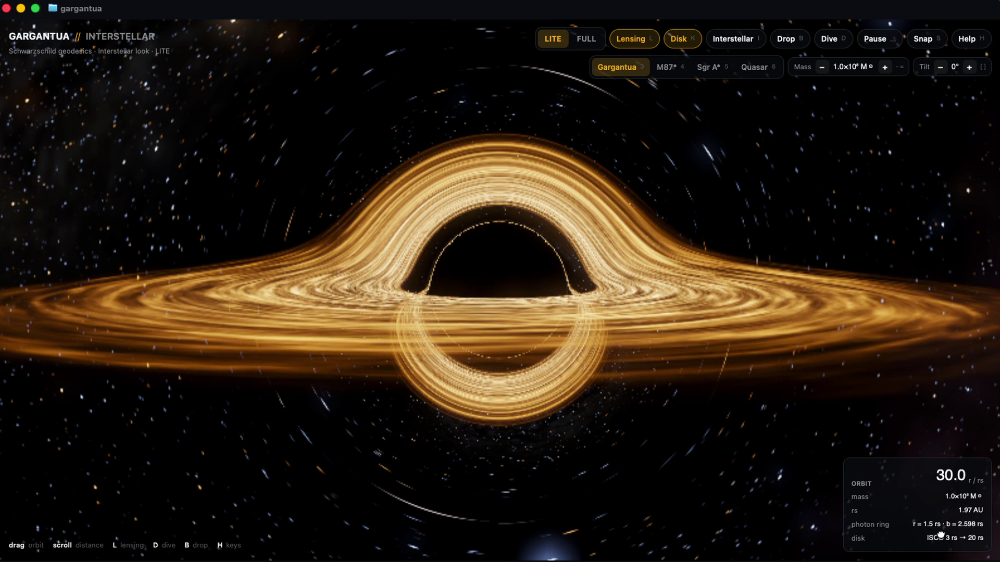
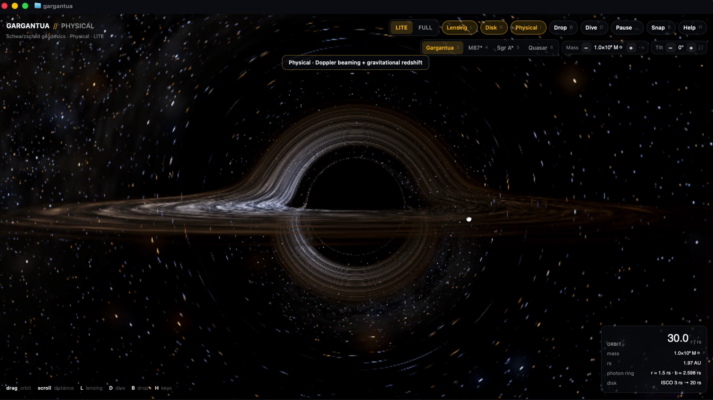
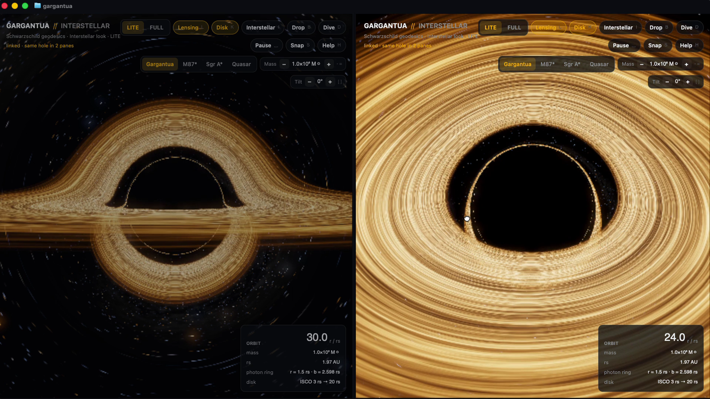
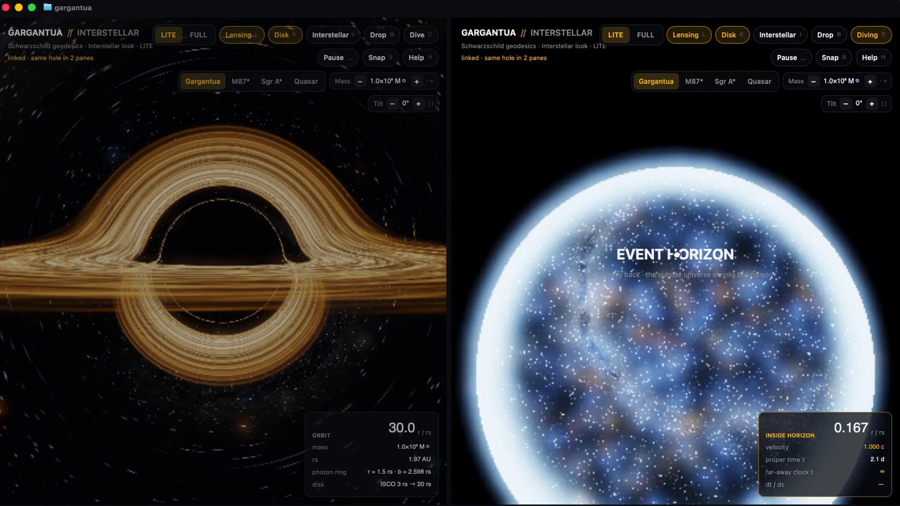

# gargantua

A real-time relativistic black hole in your terminal. CPU workers ray trace a Schwarzschild black hole, real
null-geodesic lensing included, into a GPUIX ``, and GPUIX paints it inside Ghostty over the kitty graphics
protocol. Orbit it, flip spacetime flat and back, switch between the Interstellar look and the physically correct
Doppler-beamed disk, throw probes in from another pane and watch them spaghettify, or free-fall through the horizon.



| Physical look: Doppler beaming + redshift | Two linked panes, a probe spaghettifying in both |
| --- | --- |
|  |  |

[Demo video](media/demo.mp4) (real time, 60 fps, LITE).

## Run

Needs macOS (Metal), [Bun](https://bun.sh) and Ghostty or kitty. Not tmux or the VS Code/Zed terminals.

```sh
cd gpuix/gargantua
bun install
bun link          # puts `gargantua` on your PATH (~/.bun/bin)
gargantua         # or: bun src/cli.ts
```

```text
gargantua [options]
gargantua drop [-n count]   throw probes into every running gargantua

-q, --quality <lite|full>  start quality (default lite)
-s, --scene <name>         gargantua | m87 | sgr-a | quasar (default gargantua)
-l, --look <name>          physical | interstellar (default: the scene's)
    --no-lens              start with lensing off (flat space)
    --no-disk              start without the accretion disk
    --dist <rs>            camera distance in Schwarzschild radii, 6-120
    --pitch <deg>          camera elevation above the disk, -80-80
-t, --theme <name>         Ghostty theme for the HUD (default: your Ghostty config)
    --workers <n>          ray-trace worker threads (default: cores − 3, max 8)
    --solo                 don't share probes with other gargantua panes
-w, --window               open a native window instead of drawing in the terminal
```

The CLI re-execs itself once with `RUST_LOG=error` and swallows GPUIX's own console output, so nothing is dumped
under your prompt on exit (`GARGANTUA_LOG=info` to see it). Ctrl-C restores the terminal.

## Controls

| Input | Does |
| --- | --- |
| drag | orbit the camera (fling it: it keeps turning and eases out) |
| scroll | camera distance, log scale, 6-120 rs |
| `l` | lensing on/off: curved vs. flat space, same disk and sky |
| `k` | accretion disk on/off |
| `i` | Physical (Doppler beaming + gravitational redshift) / Interstellar look (symmetric warm disk) |
| `1` / `2` | LITE / FULL |
| `3` `4` `5` `6` | scene: Gargantua, M87\*, Sgr A\*, Quasar |
| `b` | drop a probe (into every linked pane) |
| `d` | Dive: free-fall radially through the horizon; `e` ejects back to orbit |
| `[` `]` | disk tilt |
| `-` `=` | black-hole mass (rescales rs, orbital periods and the HUD's physical units) |
| `space` | pause |
| `s` | snapshot: full-pane-resolution PNG into the current directory |
| `r` | reset camera |
| `g` | perf overlay (fps, geodesic/post timings, workers, render size) |
| `h` | key help |
| Ctrl-C | quit, terminal restored |

Every key also has a button in the top bar (the bar wraps to two rows in a 50/50 split). Ghostty owns the Cmd
shortcuts, so the app uses plain keys only.

### Split panes

Each instance listens on a Unix socket in `$TMPDIR/gargantua-link/<pid>.sock`. A probe dropped in any pane, or by
`gargantua drop` from any shell, is broadcast with its full initial conditions and a shared start time, so every pane
integrates the same orbit and shows the same probe falling in from its own camera.



## How the physics works

Units are rs = 2GM/c² = 1. Light around a Schwarzschild hole moves in a plane through the hole, and its path depends
only on the impact parameter b (angular momentum / energy). With u = 1/r and φ the angle in that plane, the orbit
equation is

```text
u'' = -u + 3/2 u²        (rs = 1)
```

- **Geodesic table** (`src/geodesic.ts`). For the camera's radius r₀ the app integrates that ODE with RK4 for 640
  (LITE) or 1536 (FULL) rays spanning the view angle, from the camera outward, and stores u(φ) on a fixed φ grid, whether the ray is
  captured (b < b_crit = 3√3/2 ≈ 2.598), and for escaping rays the final direction. Rays just above b_crit wind
  around the photon sphere at r = 1.5 several times, which is where the photon ring comes from. The table is rebuilt
  only when r₀ changes (zoom or Dive), in workers.
- **Per pixel** (`src/render.ts`). The pixel's direction and the camera position define the ray's orbital plane and
  its angle to the hole; one table lookup gives b, u(φ) and the escape direction, which is rotated back out of the
  plane to sample the sky. The disk plane cuts the ray's orbital plane along a line, so the ray crosses the disk at
  φ₀, φ₀ + π, φ₀ + 2π…: the 1st, 2nd and 3rd images (the far side of the disk bent over the top, under the bottom, and
  thin rings at the shadow's edge). Each crossing with 3 ≤ r ≤ 20 is shaded and composited front to back.
- **Disk** (`src/disk.ts`, `src/physics.ts`). Thin disk from the ISCO (3 rs) to 20 rs with a Novikov-Thorne-style
  temperature profile and procedural turbulence (fBm + ridged noise, sheared by the orbit) that rotates at the
  Keplerian Ω = √(1/2r³), inner rings faster. In the Physical look each crossing gets the redshift
  g = 1 / (uᵗ(1 - Ωλ)) · √(observer), with λ the photon's angular momentum about the disk axis: one side
  is blueshifted and brightened (∝ g⁴ times a visible-band term), the other dimmed and reddened, and the
  temperature shifts by g before the blackbody → sRGB lookup. ACES tone mapping and a bloom pass finish it.
- **Sky** (`src/sky.ts`). A procedural Milky Way band, dust lanes, nebulae and analytic stars, sampled with the
  lensed escape direction: the band bends into an Einstein ring and a second inverted image hugs the shadow.
- **Dive** (`src/dive.ts`). Radial free fall from rest at r₀ is the cycloid r = r₀/2 (1 + cos η) with proper time
  τ = √(r₀³/4)(η + sin η); the HUD shows r/rs, the local speed v = √((1/r - 1/r₀)/(1 - 1/r₀)) measured by
  static observers, as a fraction of c,
  τ and the far-away coordinate time t (which diverges at the horizon). The camera's view is aberrated into the
  falling frame, so the sky crowds forward and blueshifts; inside the horizon the outside universe shrinks to a
  bright disc until r → 0. `e` ejects at any point.
- **Probes** (`src/probe.ts`, `src/lensing.ts`). Each probe is a timelike geodesic (energy E, angular momentum L)
  integrated in proper time and drawn at its primary and secondary lensed images. It is stretched along the radial
  direction by the tidal acceleration ∝ 1/r³ and dimmed and reddened by its redshift √(1 - 1/r) as it nears r = 1.

## Performance

Measured in a full-size Ghostty window (≈1600×1000 pt) on the macOS VM's paravirtual Metal, 8 workers: LITE holds
about 40-45 fps (render ≈ 800×500, geodesics ≈ 19 ms, bloom + tone ≈ 3 ms). While you orbit the render resolution
drops and it refines when the camera is still; FULL renders at a higher scale and runs slower. `g` shows the live numbers.

## Tests

```sh
bun test           # geodesics vs. b_crit, weak-field 2/b deflection, photon sphere, disk image orders, Doppler
                   # factor, Dive time dilation, drop protocol between two processes, app keys/buttons/help/drag
bunx tsc --noEmit
```
