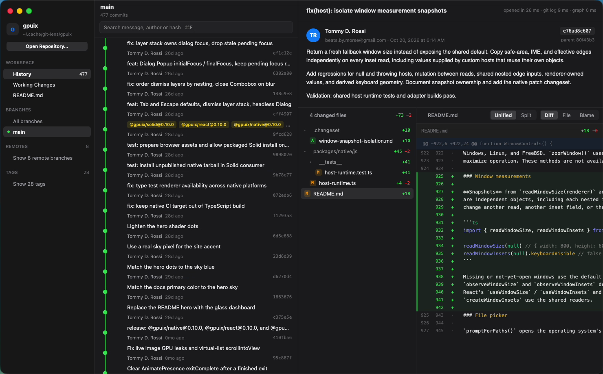

# git-lens

A native Git history and diff reviewer for macOS, built with [GPUIX](https://github.com/remorses/gpuix) (React rendered natively through Zed's GPUI and Metal). No Electron, no web view: every row, graph lane, diff line and text field is painted by GPUI.



Demo (real time, real mouse and keyboard input): [`media/demo.mp4`](media/demo.mp4)

## What it does

Everything runs real `git` through `child_process.execFile`; nothing is mocked.

- **Open any repo.** Defaults to a clone of `remorses/gpuix` (cloned to `~/.cache/git-lens/gpuix` on first launch). **Open Repository…** / ⌘O uses the native macOS folder picker (`renderer.promptForPaths`).
- **Branches, remotes, tags** in the sidebar; picking one reloads history for that ref.
- **History**: a `<virtual-list>` of every commit with author, relative time, subject, short hash, ref badges and a commit graph (lanes drawn with divs + `<svg>` curves, merge nodes hollow).
- **Search** (⌘F) filters by message, author, email or hash prefix as you type.
- **Commit detail**: author avatar, date, parents, and the commit body rendered with `<markdown>`.
- **Changed-file tree** with folders compressed, status badges and +/- counts.
- **Viewer**: native `<diff>` (unified, word-level highlights) or a Split view, full file at that commit in `<code>` with syntax highlighting, and **Blame** (author/hash/age per line from `git blame --porcelain`).
- **README.md** of the repo rendered with `<markdown>`.
- **Working Changes**: staged/unstaged lists, per-hunk **Stage hunk / Unstage hunk** (`git apply --cached [-R]` on a single hunk), whole-file Stage/Unstage, Stage all / Unstage all, and a commit box that runs a real `git commit`.
- **Keyboard**: `j`/`k` (or arrows) move through commits/files/changes, Tab cycles panes, ⌘F search, ⌘1/2/3 History/Changes/README, `d`/`f`/`b` diff/file/blame, `s` split/unified, Space stages/unstages the selected change, ⌘↩ commits, ⌘O open repo.

## Run it

```sh
bun install
bun run dev                      # bun --hot app.tsx, opens the gpuix clone
bun app.tsx ~/code/some-repo     # or GIT_LENS_REPO=~/code/some-repo
bun run scratch ~/scratch-demo   # makes a small repo with a merge + 2 unstaged hunks to stage/commit
bun run typecheck
bun test
bun run perf                     # writes perf/results.json
```

Requires macOS arm64 (`@gpuix/native-darwin-arm64`), Bun, and git. Packages are pinned: `@gpuix/react@0.11.0`, `@gpuix/native@0.11.0`, React 19.

## GPUIX features used

`render()` window options (transparent titlebar, traffic-light offset, min size, `focus: false` under `GPUIX_BACKGROUND=1`), window-level `onKeyDown`, `<virtual-list>` + `renderer.scrollToItem`, `<diff>` (`scroll`, `wordDiff`, `theme`), `<code>` with `language`, `<markdown>`, `<input>` and `<textarea>` with `renderer.focusElement` / `getFocusedElementId` / `blur`, `<svg source>` with `color` tint, hover styles, `renderer.promptForPaths`, the debug frame stats (`getDebugFrameOverlayStats`), and `@gpuix/react/automation` for tests.

## Tests

- `test/git.test.ts` builds a real scratch repo (branch + merge + edits) and checks history parsing, merge parents, graph lane transitions, search filtering, commit detail, patch/split rows, file tree, blame, staging a single hunk, unstaging it, staging a file and making a real commit.
- `test/app.test.ts` launches the actual native window with `@gpuix/react/automation` (`GPUIX_BACKGROUND=1`), types into search, clicks commits and files, opens Blame, switches to Working Changes, stages a hunk and a file, types a message, clicks Commit, and asserts the toast and `git log` show the new commit.

## Performance

macOS arm64 VM with an **Apple Paravirtual Metal GPU** (slower than real Apple silicon). Raw numbers: [`perf/results.json`](perf/results.json), script: `perf/measure.ts`.

| Scenario | Result |
| --- | --- |
| Open `expressjs/express` (6,182 commits): `git log` + parse | 36–38 ms |
| Build commit graph for 6,182 commits | 3 ms |
| Repo open total (refs + log + graph + first render state) | 62–65 ms |
| Window creation to first painted history row | 348–381 ms |
| RSS with 6,182 commits loaded | 121–128 MB |
| Scroll a 5,007-line native `<diff>` (160 wheel events) | frame p90 6.7 ms, p99 10.1 ms, max 16.5 ms (339 frames) |
| RSS while showing the 5k-line diff | 109 MB |

The demo video was captured at 60 fps with ffmpeg/avfoundation while the app ran.

## GPUIX findings (0.11.0)

- **`<diff>` is unified-only.** There is no split/side-by-side mode, so the Split toggle here is a custom two-column row renderer fed from the parsed patch (`toSplitRows` in `src/format.ts`). A `mode="split"` prop on `<diff>` would remove ~80 lines.
- **`<diff>` always draws its file header.** When rendering one hunk per card (Working Changes), each card repeats the file path and hunk header; there is no prop to hide the header row.
- **Automation reads can precede paint.** Right after a state change, `getByTestId(id).textContent()` returns `""` and a locator for a just-mounted element can throw `Locator did not match any element`; the test polls (`waitForText`) and calls `locator.waitFor()` first.
- **Single-letter shortcuts need a focus guard.** The window-level `onKeyDown` handler checks `renderer.getFocusedElementId()` against the search/commit-message refs before treating `j`, `s` or Space as shortcuts; a React `onFocus`/`onBlur` flag alone was stale inside the handler and once swallowed ⌘2.
- Not GPUIX, but useful on this VM: `cliclick kp:space` never reaches the GPUI window (`cliclick "t: "` and System Events key code 49 do), and `screencapture -v` hung without writing a file once, so the demo was recorded with `ffmpeg -f avfoundation`.

## Known limitations

- History loads the full log for the selected ref in one `git log` (fine for tens of thousands of commits; very large monorepos would want paging).
