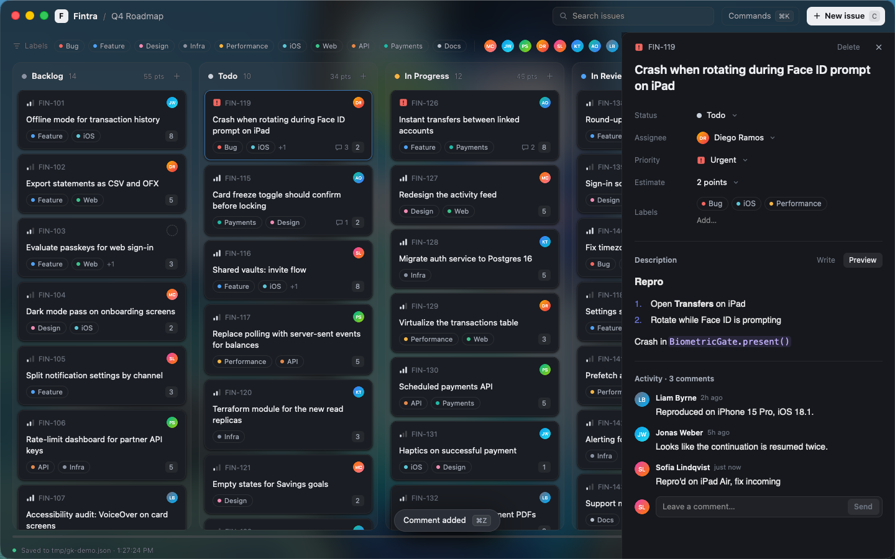

# Glass Kanban

A Linear-meets-Trello project board for a fake fintech product team ("Fintra"), built with
[GPUIX](https://github.com/remorses/gpuix) 0.11.0. It's a React tree in TypeScript that GPUI paints
natively with Metal: no Electron, no web view.



Demo video (real time, real mouse and keyboard in the native window): [`media/demo.mp4`](media/demo.mp4)

## What it does

- **Board**: five lanes (Backlog, Todo, In Progress, In Review, Done) of 60 seeded issues. Each card
  shows its ID, title, labels, an assignee avatar (``), an SVG priority icon, a comment count, and
  an estimate. Lane headers show the count and total points.
- **Drag and drop**: cards within and between lanes, and whole lanes by their header. The dragged card
  lifts with a shadow and follows the pointer, the other cards slide apart to open a gap, and on release
  the card animates into its slot. Dragging near either edge auto-scrolls the board horizontally.
- **Detail sheet**: click a card and a side sheet slides in with a wrapping title editor, Status /
  Assignee / Priority / Estimate selects, a label Combobox, a markdown description (`<textarea>` in
  Write, `<markdown>` in Preview), comments, and Delete.
- **Keyboard**: `C` quick-adds an issue, `Cmd-K` opens a command palette (move to a lane, assign,
  set priority, filter by label or assignee, clear filters, new issue, delete, undo, redo, reset),
  `Cmd-Z` / `Shift-Cmd-Z` undo and redo every board change, `Esc` closes the sheet.
- **Filter bar**: search, label chips, and assignee avatars.
- **Persistence**: every change is written atomically (temp file + rename) to
  `~/Library/Application Support/Glass Kanban/board.json` (override with `GLASS_KANBAN_DATA`). The
  footer shows the save path and time, and the board comes back exactly as it was after a restart.
- **Window**: frosted-glass window (`windowBackground: 'blurred'`, transparent titlebar, inset
  traffic lights) with crisp opaque cards on top.

## GPUIX features used

`render()` window options (blur, transparent titlebar, traffic-light position, `focus`,
`debugFrameOverlay`), native mouse capture (`onMouseDown`/`onMouseMove`/`onMouseUp`),
`renderer.getElementBounds()` for drop targets, native animations (`motion.div` with
`onMotionComplete`, `AnimatePresence` exit animations), horizontal scrolling, `<input>`,
`<textarea>` with `onSubmit`, `<markdown>`, ``, `<svg>`, headless `Dialog`, `Select` and
`Combobox`, `renderer.focusElement()`, window-level `onKeyDown`, and the test renderer
(`@gpuix/react/testing`) plus automation (`@gpuix/react/automation`).

## Run it

macOS arm64 with [Bun](https://bun.sh):

```sh
bun install
bun run dev          # bun --hot app.tsx
bun test             # native GPU test renderer, real clicks and drags
bun run typecheck
```

Env vars: `GLASS_KANBAN_DATA=/path/board.json` (data file), `GLASS_KANBAN_FPS=1` (GPUIX frame
overlay), `GPUIX_BACKGROUND=1` (open without stealing focus).

`tools/demo.sh` replays the demo with real HID input from `tools/input.swift` (CGEvent mouse drags
at 60 Hz and unicode key events); `tools/screenshot.ts` captures the window via automation.

## Tests

`app.test.tsx` runs on the GPUIX test renderer and drives the real app with native clicks, drags and
key events:

- the seed has 60 cards across five lanes
- clicking a card opens the sheet; editing the title persists to JSON
- dragging a card across lanes moves it; Cmd-Z / Shift-Cmd-Z undo and redo; a fresh mount reads it back
- dragging within a lane reorders it
- dragging a lane header reorders lanes
- Cmd-K moves the selected card to Done and filters by label
- `C` quick-adds a card to the top of Todo

## Performance

Measured on this Mac VM, which has an **Apple Paravirtual** Metal GPU (much slower than real Apple
silicon), 1440x900 window, 60 cards:

| Metric | Value |
| --- | --- |
| Startup (spawn to first mount) | 451 / 487 / 507 ms over 3 cold runs |
| Memory (RSS, idle after start) | ~192 MB |
| Memory (RSS, during / after drags) | ~198 MB / ~232 MB |
| CPU during a card drag | ~10-20 % of one core, one 52 % spike |
| Frame time during a drag (debug overlay) | 19.3 ms current, 24.1 ms 10th-pct worst, 32.7 ms 1 %-worst, 49 ms max (~40-50 fps) |

The demo was captured at 60 fps with `screencapture`; the drag overlay and reflow stay smooth, but
the paravirtual GPU doesn't hold a locked 60 fps while 60 cards reflow.

## GPUIX findings (0.11.0)

1. **Mouse capture only reaches the pressed node.** `onMouseMove`/`onMouseUp` are delivered to the
   element that received `onMouseDown`. With handlers on a wrapper `div` around the card, presses on
   the card body never started a drag. Workaround: spread all three handlers on the exact node that
   gets pressed (`CardFace` takes a `handlers` prop).
2. **`onMotionComplete` doesn't always fire** for a short `left`/`top` tween on an absolutely
   positioned `motion.div` (the drop-settle animation). The drag occasionally stayed in the
   "settling" state. Workaround: a 400 ms fallback timer that finishes the drop.
3. **Text selection during drag.** Dragging across the board selected `<text>` in every card. Fix:
   `userSelect: 'none'` on the root and `userSelect: 'text'` back on `<markdown>`.
4. **`Dialog initialFocus` doesn't reliably focus a native `<input>`** in the palette and quick-add
   dialogs. Workaround: also call `renderer.focusElement(id)` ~60 ms after mount.
5. **`onBlur` isn't delivered when a focused input unmounts** (closing the sheet or a dialog while a
   field has focus), so a focus counter used to suppress global shortcuts while typing went stale and
   `C`/`Cmd-Z` stopped working. Workaround: treat focus as stale when
   `renderer.getFocusedElementId()` returns null.
6. **A single-line `<input>` opens scrolled to the end.** A long title shows its tail ("d freeze
   toggle should confirm before locking") even before it's focused. Workaround: the title is an
   auto-growing `<textarea minRows={1} maxRows={3} onSubmit>`, which wraps and keeps Enter as commit.
7. **Types**: `motion.div` has no `testId` prop and `` has no `width`/`height` props (size
   goes in `style`).

Not GPUIX: `cliclick` takes ~230 ms per mouse event here (45 drag steps took 10.4 s), which made
drags look slow. `tools/input.swift` posts CGEvents at 60 Hz instead.
