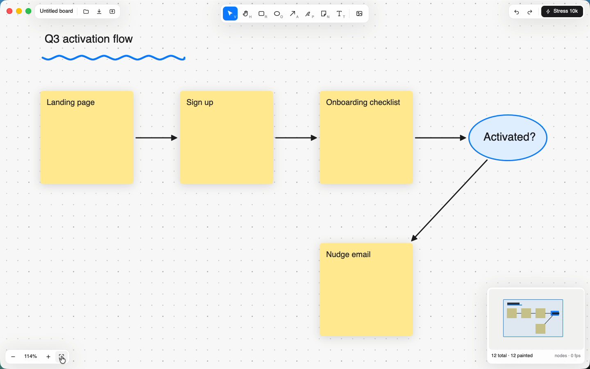
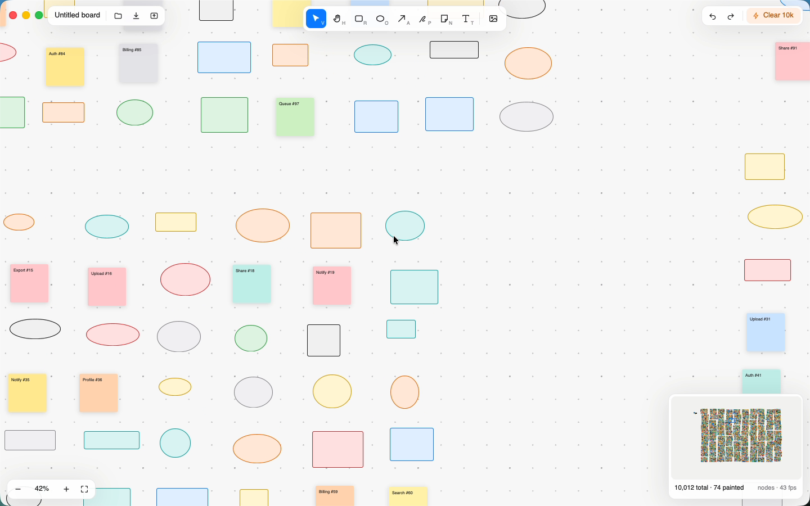

# Canvas: an infinite whiteboard in GPUIX

A FigJam/tldraw-lite whiteboard written as a React tree and painted natively by [GPUIX](https://github.com/remorses/gpuix) (GPUI + Metal). No Electron, no web view.



Demo (real time, driven with real mouse/keyboard input through `cliclick` + a CGEvent scroll tool): [`media/demo.mp4`](media/demo.mp4). It sketches a small activation flowchart with stickies, text, a pen underline and connectors, then spawns the 10,000-shape stress field and flies around it.



## What it does

- **Tools** (toolbar + shortcuts): Select `V`, Hand `H`, Rectangle `R`, Ellipse `O`, Arrow `A`, Pen `P`, Sticky `N`, Text `T`, and an image button (file picker).
- **Connectors stick to shapes**: an arrow that starts or ends over a shape binds to it and re-routes to the shape's edge (ellipses use the true ellipse edge) when the shape moves or resizes.
- **Pen**: points are simplified (Ramer-Douglas-Peucker) and drawn as a smoothed quadratic `<svg>` path.
- **Stickies and text** are editable in place (double-click or Enter; Esc / Cmd-Enter / click away to commit).
- **Images**: drop PNG/JPEG/GIF/WebP files on the window (`onFileDrop`) or pick them with the image button / Cmd-O (`promptForPaths`). Copy/paste (Cmd-C / Cmd-V) works for any selection, images included.
- **Canvas**: wheel / two-finger pan, Cmd- or Ctrl-wheel zooms under the cursor, dot grid that rescales with zoom, marquee multi-select, Shift-click to toggle, move with snapping + alignment guides (edges and centres of nearby shapes), 8 resize handles, z-order (`]` / `[`), duplicate Cmd-D, copy/cut/paste, delete, arrow-key nudge, undo/redo (Cmd-Z / Cmd-Shift-Z), zoom buttons, fit (Shift-1 / button), recolour from the selection panel.
- **Minimap** (bottom-right, rasterised with `setImagePixels`) shows every shape and the viewport; click (animated fly-to) or drag in it to jump.
- **Live counters**: `shapes total · shapes painted`, the render mode (`nodes` or `tiles`), and an fps estimate.
- **Stress 10k** spawns 10,000 deterministic shapes in clustered "neighbourhoods"; press again to remove them.
- **Save/Load**: Cmd-S writes the board (shapes + camera) as JSON, Cmd-O / drop a `.json` loads it. `bun app.tsx board.json` opens one at launch.
- **Export PNG**: Cmd-E (or the export button) renders the board offscreen through the GPUIX Metal test renderer (`createTestRoot` + `captureScreenshot`) into `<board>.png`. Also available as a CLI: `bun run export board.json out.png`.

## How culling works

`src/model.ts` keeps a uniform-grid `SpatialIndex` (512-unit cells). Every camera change queries the viewport (+24 px margin) and only those shapes become GPUIX nodes, as the README's "Pannable surfaces must cull" section asks. Two levels:

1. **nodes**: at zoom >= 30 %, or whenever <= 1,500 shapes are visible, visible shapes are real `<div>`/`<svg>`/`<text>`/`` nodes (stickies get text, shadows and rounded corners).
2. **tiles**: zoomed further out with more than 1,500 shapes on screen, the board is drawn as 320 px raster tiles at a power-of-two world size, rasterised in JS and uploaded once with `setImagePixels`, then cached per `(level, tx, ty, board version)`. Fit-to-10k paints all 10,000 shapes as ~12 tiles.

## GPUIX features used

`render()` window options (transparent titlebar, traffic-light position, min size, `focus`), `useWindowSize`, `useGpuix().renderer` (`promptForPaths`, `focusElement`), mouse capture by putting `onMouseDown/Move/Up` on the same canvas element, `onScroll` with modifiers for zoom, `onFileDrop`, `onKeyDown` with `tabIndex` + `autoFocus`, `<svg>` for arrows/pen/ellipses/icons, `` from files and from raw pixels (`setImagePixels`), `pointerEvents: "none"` overlays, `@gpuix/react/testing` (`createTestRoot`, `nativeSimulateMouseDown/Move/Up`, `nativeSimulateKeystrokes`, `nativeSimulateScrollWheel`, `getAllText`, `findByTestId`, `captureScreenshot`), `debugFrameOverlay`.

## Run

macOS arm64, Bun >= 1.3.

```sh
bun install
bun run dev          # bun --hot app.tsx
bun app.tsx board.json   # open a saved board
bun test             # behaviour tests on the native test renderer
bun run typecheck
bun run bench        # frame-time benchmark of the 10k field
GPUIX_DEBUG=1 bun app.tsx   # GPUIX debug frame overlay
```

`GPUIX_BACKGROUND=1` launches without stealing focus (maps to `focus: false`).

## Tests

`test/canvas.test.tsx` mounts the real `<App>` in the GPUIX test renderer and drives it with simulated native input, asserting state changes:

- zoom-under-cursor keeps the world point under the pointer fixed;
- the culler paints 0 shapes in empty space, exactly 10,000 when fitted (tiles), and fewer than 400 at 100 %;
- board JSON round-trips;
- draw a rectangle (`R` + drag), place a sticky, type into it (text shows up in `getAllText()`), draw an arrow between them, then Cmd-Z / Cmd-Shift-Z change the count back and forth;
- marquee select, Cmd-D duplicates, Delete removes;
- click "Stress 10k", then Cmd-wheel (plain wheel pans without changing zoom): total = 10,000, mode flips from `tiles` to `nodes` and painted drops;
- Cmd-S writes JSON to disk with the right shape count.

## Performance (Apple Paravirtual Metal VM, not a real M-series GPU)

| | measured |
| --- | --- |
| Startup to first frame (window) | ~0.3 s from `bun app.tsx` to `[gpuix] mount complete` (3 runs); 78 ms to mount the empty board in the test renderer |
| Spawn 10,000 shapes + first paint | 19 ms (test renderer) |
| Pan frame time, fitted 10k (tiles, ~9,100 painted) | p50 1.2 ms, p95 9.7 ms |
| Pan frame time, 19 % zoom (nodes, ~400 painted) | p50 7.7 ms, p95 9.0 ms |
| Pan frame time, 42 % zoom (nodes, ~85 painted) | p50 2.1 ms, p95 2.5 ms |
| Pan frame time, 100 % zoom (~12 painted) | p50 1.0 ms, p95 1.1 ms |
| Live window while flying the 10k field with real scroll input | 39-49 fps camera updates (in-app counter), smooth in the 60 fps capture |
| Memory (10k shapes, test renderer) | RSS ~650 MB, JS heap ~91 MB |

Frame times are `bun run bench`: one `nativeSimulateScrollWheel` + full GPUI build/layout/paint (`renderer.flush()`) per sample, 110 samples each. The in-window fps is limited by the paravirtual GPU and by the VM's display path, so a real Mac should do better.

## GPUIX findings (0.11.0)

- **`@gpuix/react` types**: `Instance` (the ref type for host elements) isn't exported, so `ref.setImagePixels(...)` needs a local structural type; `useGpuix().renderer` and its methods (`promptForPaths`, `focusElement`) are typed optional, so every call needs `?.`; with `jsxImportSource: "@gpuix/react"` the global `JSX.Element` namespace isn't available, so components return `ReactElement`.
- **`getDebugFrameOverlayStats()` reports draw time, not fps**: there's no frame-rate counter, so the app measures camera-commit intervals itself for the fps readout.
- **Wheel deltas**: `onScroll` gives line deltas for a mouse wheel and pixel deltas for trackpads (`precise`); the line deltas have to be scaled (x24 here) to feel like a native canvas.
- **Duplicate-font warnings** on every launch on this VM: `[gpui_macos::text_system] skipping duplicate font ...`. Harmless.
- **Stale closures in native handlers**: the tool, selection and edit-draft are mirrored into refs that handlers read, because a key event and the next mouse-down can arrive before React re-renders with new handlers (the real-input demo occasionally used the previous tool before this).
- **Many native nodes are the bottleneck**: ~400 visible shapes at 19 % zoom cost ~8 ms per frame here versus ~1 ms for 12 raster tiles covering 10,000 shapes, so a low-zoom raster LOD (via `setImagePixels`) is worth it beyond ~1,500 visible nodes.
- Not a GPUIX bug, but worth knowing when scripting demos: posting a Cmd-modified `CGEvent` scroll leaves the Command modifier latched for later synthetic key events (a typed `Q` became Cmd-Shift-Q, i.e. Log Out). Post a Command key-up afterwards.
