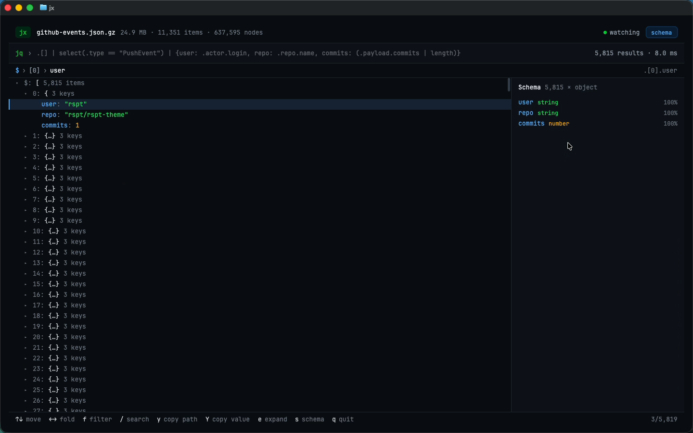

# jx

A JSON explorer that paints with the GPU **inside your terminal**. jx is a [GPUIX](https://github.com/remorses/gpuix) app (React on Zed's GPUI): the same React tree that can open a native Metal window instead renders into Ghostty or kitty over the kitty graphics protocol. It is a GUI you use like a TUI.



Demo: [media/demo.mp4](media/demo.mp4) ([splits frame](media/splits.png)). It runs in Ghostty with the GitHub Dark High Contrast theme. The demo opens a 26 MB GitHub events dump and filters it with jq. It splits the pane and runs a second jx on a live Wikipedia feed, which reloads while `curl` rewrites the file in a third pane. Then it drags the divider and quits with Ctrl-C.

```sh
jx data/github-events.json.gz              # 26 MB, 11,351 events, 637,595 nodes
jx https://api.github.com/repos/remorses/gpuix
jx data/gpuix-react-0.10.0.json data/gpuix-react-0.11.0.json   # side-by-side diff
jx live.json -q '.query.recentchanges[] | {title, user}'
```

## What it does

- **Virtualized collapsible tree.** Rows are colored by type and containers show their counts. Only the rows on screen are mounted, so a 637k-node document scrolls like a 10-node one.
- **jq-style filter bar with live results.** jx ships a small jq in `src/query.ts`. It supports paths, `.[]`, slices, `|`, `,` and `select`/`map`/`has`/`contains`/`test`/`group_by`/`sort_by`/`unique_by`/`min_by`/`max_by`. It also has `keys`, `length`, `type`, `first`/`last`, `sort`, `unique`, `add`, `{…}` construction and `?`. Errors show inline.
- **Breadcrumbs** for the cursor path; click a segment to jump there. The jq path of the current row is shown on the right.
- **Copy** the jq path (`y`) or the pretty-printed value (`Y`). Inside a terminal this goes over OSC 52, so it reaches your clipboard even over SSH.
- **Schema panel.** Field types are merged across array items, with presence % and nullable unions (`string?`). Click a field to filter by it (`.[].payload.commits[].sha`).
- **Search** keys and values (`/`). Matches are highlighted and `⏎` / `n` / `N` step through them, opening collapsed parents.
- **Diff** two documents side by side (`jx a.json b.json`). Unchanged subtrees collapse to one row and `n` jumps to the next change.
- **Live reload.** Files are watched; when one changes, jx reloads it, keeps your expansion and flashes the rows that changed.
- **Built for terminal splits.** The schema panel and hints drop away in narrow panes. `isTerminal()` removes the traffic-light gutter, and the colors come from Ghostty's GitHub Dark High Contrast theme. Text is JetBrains Mono, Ghostty's default font, loaded with `registerFont()`.

Keys: `↑↓`/`jk` move, `←→`/`hl` fold, `⏎`/space toggle, `f` filter, `/` search, `n N` next/previous match, `y Y` copy, `e` expand subtree, `c` collapse all, `s` schema, `q` or Ctrl-C quit.

## Run

macOS (arm64) with Bun, in Ghostty or kitty:

```sh
bun install
bun link            # puts `jx` on your PATH (bin/jx)
jx data/github-events.json.gz
jx --window data/github-events.json.gz   # same app in a native Metal window
bun test            # query/schema/diff + the real <App> through the GPUIX Metal test renderer
bun run typecheck
bun run bench
```

`jx --help` lists all options. Don't pipe JSON into jx's stdin: a GPUIX app treats a stdin pipe as its automation channel, and terminal mode needs the TTY. Pass a path or a URL instead.

## GPUIX features used

`render({ terminal })` (kitty graphics protocol, shared memory locally), `isTerminal()`, `useWindowSize()` for reflow on split/resize, `registerFont()`, `<input>` with `onChange`/`onSubmit` and a themed caret, and `highlight={{ query }}` for search. It also uses `onScroll` for wheel and trackpad, `onMouseDown`/`clickCount`/`onMouseEnter`, `focusElement`/`getFocusedElementId` for keyboard routing, and the test renderer (`createTestRoot`, `nativeSimulateKeystrokes`, `captureScreenshot`).

## Performance

Measured on this VM's **Apple Paravirtual Metal** GPU, which is slower than a real M-series Mac. Run `bun run bench`:

| | |
|---|---|
| read + gunzip 24.9 MB | 47 ms |
| `JSON.parse` | 30 ms |
| count 637,595 nodes | 7 ms |
| schema inference (sampled) | 10 ms |
| filter `.[] \| select(.type == "PushEvent") \| .repo.name` (5,815 results) | 5 ms |
| filter `.[] \| .payload.commits[]? \| .author.name` (10,109 results) | 10 ms |
| first render (mount + layout + paint, test renderer) | 131 ms |
| cursor move + repaint | p50 14.8 ms, p95 17.4 ms |
| memory with the 26 MB document loaded | RSS 266 MB, JS heap 93 MB |

In Ghostty, `jx data/github-events.json.gz` paints its first frame in about a second from Enter, including Bun startup.

## GPUIX findings (0.11.0)

- **Held logs replay over the restored prompt.** Terminal mode holds stdout and stderr and prints them on quit. That includes the renderer's own `[gpuix] created native window` / `mount complete` lines and the native `INFO gpui_terminal::kitty] sending frames through shared memory` line, so after Ctrl-C the shell shows log noise above the prompt. jx filters the `[gpuix]` lines out of `console.log`. The INFO line follows `RUST_LOG`, and some shells export `RUST_LOG=info`, so `bin/jx` is a 3-line shell wrapper that pins `RUST_LOG=error` before Bun starts.
- **`process.env` writes don't reach the native addon.** Setting `process.env.RUST_LOG` before a dynamic `import('@gpuix/react')` had no effect, and calling libc `setenv` through `bun:ffi` didn't either. Only the environment the process started with counts, hence the wrapper.
- **No clipboard write API.** The README says copy uses OSC 52 in a terminal, but that covers the built-in text editing only. There is no `renderer.writeClipboard()`, so jx writes `ESC ] 52 ; c ; <base64> BEL` to `/dev/tty` itself in terminal mode and uses `pbcopy` in a window.
- **Enter in an `<input>`** reaches the root `onKeyDown` in the live terminal, but fires the input's `onSubmit` in the test renderer. jx routes both into one handler and drops the duplicate within 80 ms.
- **Test renderer:** `getAllText()` takes no element argument, so tests collect a subtree's text by walking `getElement(id).children`. `nativeSimulateKeystrokes('shift-y')` does deliver `shift`.
- **Not GPUIX bugs, but worth knowing when driving a terminal app on macOS:**
  - cliclick's arrow keys carry the Fn flag. After them, a typed `f` became Fn-F (full screen), and the Globe key opened the emoji picker. jx's demo drives arrows with System Events key codes and sets `AppleFnUsageType = 0`.
  - The Codex desktop app (`brew install --cask codex-app`) opens straight to a "Sign in with ChatGPT" screen, so its built-in terminal couldn't be reached without an account, and the Codex embedding was skipped. The README lists only kitty and Ghostty for 0.11.0.

## Data

- `data/github-events.json.gz`: 11,351 public GitHub events from 2015-01-01, taken from the [json-iterator test data](https://github.com/json-iterator/test-data). jx reads `.gz` directly.
- `data/gpuix-react-0.10.0.json`, `data/gpuix-react-0.11.0.json`: npm registry metadata for two releases, used for the diff demo.
