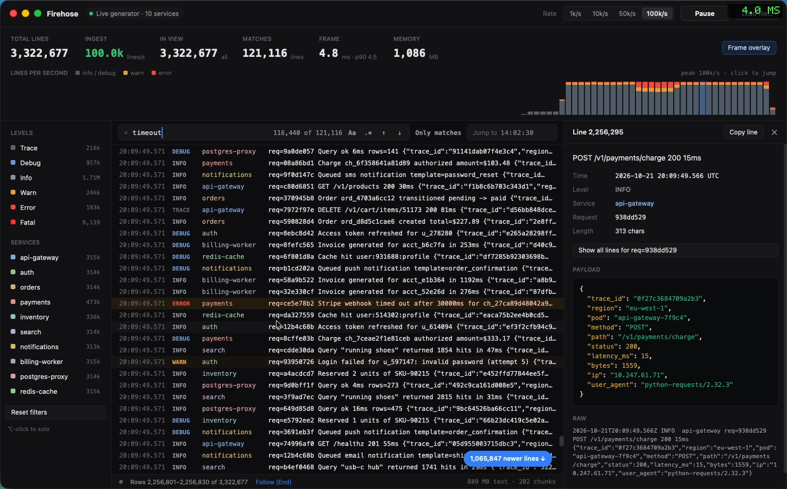

# Firehose: a million-line live log explorer on GPUIX

A native macOS log explorer written in React and painted by [GPUIX](https://github.com/remorses/gpuix) (GPUI + Metal). No Electron, no web view. It streams realistic structured logs at up to 100k lines/s and keeps scrolling, filtering and searching instant past **5 million lines**. It also opens a real 2M-line, 529 MB log file through the native file picker.



Demo (real time, real mouse and keyboard input, 81 s): [`media/demo.mp4`](media/demo.mp4), scaled to 1110 px wide to stay under 25 MB. It was recorded at 1480×920, 60 fps, with `screencapture -v`.

## What it does

- **Live generator**: 10 services (gateway, auth, orders, payments, inventory, search, notifications, billing worker, postgres proxy, redis), six levels, correlated request ids, log-normal latencies, JSON payloads, stack traces, and an "incident" every 15–30 s that spikes one service's errors. Rates are 1k / 10k / 50k / 100k lines/s, with Pause/Resume.
- **Load file…** opens any log through the native macOS picker (`promptForPaths`). Drag-and-drop onto the window works too (`onFileDrop`). `bun run sample` writes a 2M-line, 529 MB sample.
- **Tail-follow** with chat-tail behaviour: the list follows new lines; a wheel up pauses following and keeps the reader anchored while lines keep arriving; a "N newer lines ↓" pill, the End key or "Follow" resumes it.
- **Filters**: level and service toggles in the sidebar with live counts; ⌥-click solos one.
- **Search**: text or regex (`.*`), case toggle, live match highlighting on visible rows (`highlight` ranges), a match count, ↑/↓ and ⌘G/⇧⌘G next/prev, ⌘F to focus, and **Only matches**, which turns the search into a filter. Streamed lines are searched as they arrive.
- **Inspector**: click a line to see its fields, its pretty-printed JSON payload in a `<code>` block, its stack trace, and a "Show all lines for req=…" button that filters to one request across services.
- **Rate histogram**: lines per second, stacked by severity, painted into an `` with `setImagePixels` (BGRA, 2x). It shows the last 120 s live, or the whole file in buckets. Hover shows counts, a click jumps to that second, and the blue band marks the rows on screen.
- **Jump to time**: `HH:MM[:SS[.mmm]]` binary-searches the timestamps.
- **Selection and copy**: drag to select any text, ⌘C copies it, and the status bar shows the selection size. "Copy line" (or ⌘C with nothing selected) copies the clicked line.
- **Live counters**: total lines, ingest lines/s, rows in view, matches (with scan progress), frame time (GPUI draw time, p90), RSS. The "Frame overlay" button toggles GPUI's native debug overlay.

## GPUIX features used

`<virtual-list>` with `itemCount` / `windowStart` / `estimatedItemHeight` / `followTail` / `alignment="bottom"` / `onVisibleRange`, `scrollToItem` with a pixel offset and `getListScrollTop`; the `highlight` prop with explicit ranges and `activeIndex`; native `<input>` with `onSubmit`; `<code language="json">` with a theme; `` + `setImagePixels`; `promptForPaths`; `onFileDrop`; text selection with window `onSelectionChange` and `getSelectedText`; window `onKeyDown` and `focusElement`; `getDebugFrameOverlayStats` and the debug frame overlay; a transparent titlebar with traffic-light placement; `focus: false` under `GPUIX_BACKGROUND=1`; the GPU test renderer (`createTestRoot`, `connectTest` locators, `getPaintedHighlights`, `getPaintedText`, `captureScreenshot`).

## How it stays fast

- **Text lives in chunk strings.** Every 16,384 lines are joined into one string, and the per-line metadata (timestamp, level, service, offsets) sits in typed arrays, 22 bytes per line. A search is one native regex pass per chunk. After a hit, the scan jumps to the next line, so its cost follows the text size rather than the match count.
- **The filter view is an index.** With no filter the view is the identity and costs nothing. A filter builds a `Uint32Array` of line numbers, and new lines are appended to it as they stream in.
- **React mounts 120 rows.** They are keyed by `position % 120`, so a scroll or a streamed frame updates text in place instead of remounting. Rows are `memo`ized.
- **The virtual list scrolls a 20k-row page.** The app moves the page when the reader nears an edge, which works around the leak below.
- **Ingest runs on an 8 ms timer and notifies React at most every 15 ms.** Searches over history are time-sliced at 6 ms per tick.

## Performance

Measured on this VM: **Apple Paravirtual GPU (Metal)**, 12 vCPU, 16 GB. That is slower than a real M-series Mac. The frame numbers are GPUI's own draw-time stats (`getDebugFrameOverlayStats`), not wall-clock fps.

| Scenario | Result |
|---|---|
| Startup, process to first mount | ~400 ms (390–445 ms over 3 runs) |
| Live 50k lines/s, 1.2M lines, tail-follow | frame **p90 5.1 ms**, p99 6.1 ms, RSS 470 MB |
| Live 100k lines/s, up to **5.5M lines** (demo run) | frame p90 4.5–4.9 ms, p99 ≤ 5.8 ms, RSS 1.65 GB at 5.5M |
| Load the 2M-line / 529 MB sample (`bench/data-bench.ts`) | 449 ms, RSS 735 MB |
| Search the 2M-line file: `timeout` / `pool exhausted` / `req=923ac401` / regex `ord_[0-9a-f]{4}e` | 66 / 29 / 53 / 84 ms |
| Level filter (ERROR only) / service filter (payments) over 2M | 6.3 / 7.5 ms |
| Generator throughput (headless) | ~960k lines/s |
| Streaming frame on the GPU test renderer (833 lines/frame = 50k/s at 60 Hz) | native flush p50 ~4 ms |

Before the paging workaround, the same 50k lines/s run sat at **47–53 ms frames and 1.7 GB RSS after 10 s**.

## GPUIX findings (v0.11.0, `@gpuix/react@0.11.0` + `@gpuix/native@0.11.0`, macOS arm64)

1. **`<virtual-list itemCount>` leaks native memory in proportion to `itemCount` whenever `itemCount` (and, to a lesser degree, `windowStart`) changes.** The flush stays cheap, but RSS grows by about 13 bytes per row per change and is never returned. Repro: [`bench/text-churn-repro.tsx`](bench/text-churn-repro.tsx), 40 rows, 300 frames:

   | Mode | RSS growth over 300 frames |
   |---|---|
   | plain `<div>` rows, changing text (`text`) | +36 MB |
   | `itemCount` constant, rows change (`STEP=0 vlist`) | +106 MB |
   | `itemCount` 20k, +833/frame (`BASE=20000 vlist`) | +125 MB |
   | `itemCount` 200k, +833/frame (`vlist`) | **+1,442 MB** |
   | `itemCount` 2M, +833/frame (`BASE=2000000 vlist`) | **+7,975 MB** (~26 MB/frame) |
   | `itemCount` 2M constant, `windowStart` moving (`BASE=2000000 STEP=0 vlist-scroll`) | +565 MB |
   | `itemCount` 20k constant, `windowStart` moving | +74 MB |

   In the real app it also showed up as 28 ms native flushes (presumably page faults on the leaked memory). The workaround is to keep `itemCount` bounded: the list scrolls a 20k-row page of the view, and the app re-pages near the edges (`showPos` in `src/app.tsx`). The cost is a scrollbar thumb that describes the page rather than the whole log, so the status bar and the histogram band show the global position.
2. **A row in a `<virtual-list>` takes the intrinsic width of its `nowrap` text** unless the row has `width: '100%'` and the text column has `flexBasis: 0`. Without that, `textOverflow: 'ellipsis'` never applies, and the automation `click()` targets the centre of a 3,198 px-wide row, off the window. A browser would size a block row to the list width.
3. **`onVisibleRange` does not always fire after a programmatic `scrollToItem`.** The app also polls `getListScrollTop` twice a second to keep the "Rows x–y" readout correct.
4. **Synthetic Return keys from `cliclick` don't reach the macOS open panel**, though typing does; `osascript … key code 36` and a mouse down/up with a short delay do. This matters only when you script the native file picker for demos, and it is not GPUIX's fault.

## Run

```bash
bun install
bun run dev                   # bun --hot app.tsx, live stream at 10k lines/s
bun run sample                # writes sample-2m.log (2M lines, 529 MB, gitignored)
FIREHOSE_FILE=sample-2m.log bun app.tsx   # open a file at startup
FIREHOSE_RATE=50000 FIREHOSE_PERF=1 bun app.tsx   # start at 50k/s, print perf JSON every 0.5 s
bun run test                  # bun test: data layer + GPU test-renderer app tests
bun run typecheck
bun run bench                 # data-layer timings on sample-2m.log
bun bench/frame-bench.tsx     # streaming frame cost on the GPU test renderer
```

Other environment variables: `FIREHOSE_PAUSED=1` starts paused, `FIREHOSE_OVERLAY=1` turns on the frame overlay, and `GPUIX_BACKGROUND=1` opens the window without focus.

Keys: ⌘F search · Enter / ⌘G next · ⇧⌘G previous · ↑/↓ move the selected line · End follow the tail · Esc clear the selection or close the inspector · ⌘C copy.

## Tests

- `tests/data.test.ts`: store chunking, ISO and clock parsing, the incremental search agreeing with a naive scan (including streamed lines), filters, next/prev wraparound, jump to time, and chunked file loading.
- `tests/app.test.tsx`: drives the real app on the Metal test renderer with 200k lines. It ⌥-clicks to solo ERROR (exact row count), types into the native search `<input>`, turns on Only matches (every row is an ERROR containing the query), checks the highlight quads cover exactly the query text, clicks next (`1 of N`), opens the inspector (painted JSON includes `"code": "40P01"`, plus the stack trace), and jumps to `14:00:12`. A second test streams 50k lines/s worth of frames, asserts that the newest line is on screen, and checks frame cost.
