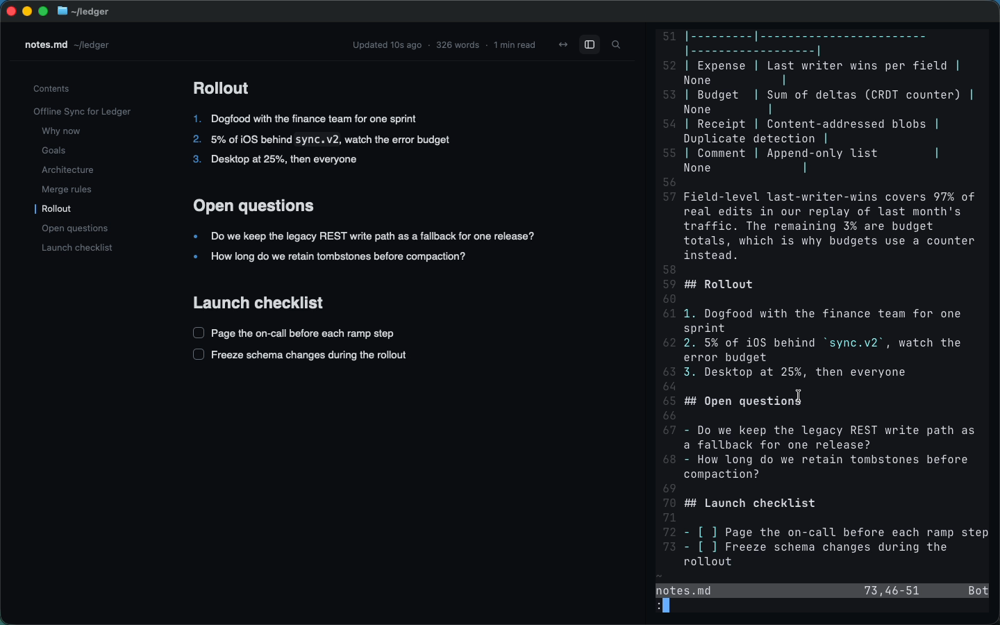

# mdlive

A live GitHub-flavoured Markdown preview that renders **inside your terminal**. Run `mdlive notes.md` in Ghostty or kitty and a real GPUI surface paints in the pane: crisp proportional type, syntax-highlighted code, tables, images and clickable checkboxes. Edit the file in nvim in the next split and every save re-renders and scrolls to the block you just changed.

It is a [GPUIX](https://github.com/remorses/gpuix) app (React for Zed's GPUI, Metal on macOS) running in GPUIX terminal mode, where frames reach the terminal over the kitty graphics protocol.



Demo (real time, real input in Ghostty): [`media/demo.mp4`](media/demo.mp4)

## Features

- **Live reload**: watches the file's directory, so both in-place writes and editor atomic-rename saves (nvim, VS Code) are picked up. A status dot and "Updated just now" confirm each save.
- **Follow edits**: on each save mdlive diffs the parsed blocks, scrolls to the first changed block and flashes a green bar next to it. Toggle with `f`.
- **GFM**: headings, emphasis, blockquotes, lists, tables, fenced code with syntax highlighting (`<code>`), local images (``, path resolved next to the file), task lists.
- **Task lists you can click**: checkboxes toggle `[ ]` / `[x]` in the source file itself, so nvim sees the change too.
- **Contents sidebar** with the active section highlighted as you scroll. Click to jump, or `[` / `]` for previous/next section. It hides itself when the pane gets narrow (a split) and comes back when you widen it.
- **Find in page** (`/`): live match count, `Enter` / `Shift-Enter` to step through matches, `Esc` to close.
- **Reading modes**: a narrow 760 px column or wide full-pane layout (`w`, or `-w` on the command line).
- **Word count and reading time** in the header, sections and code-block counts in the footer.
- **Theme from Ghostty**: the background, text and accents come from the active Ghostty theme file (default `GitHub Dark High Contrast`), so the app blends into the terminal instead of sitting in a box.

## Run it

Requires macOS (arm64), [Bun](https://bun.sh) and a kitty-graphics terminal: **Ghostty** or **kitty**.

```sh
cd gpuix/mdlive
bun install
bun link            # puts `mdlive` on your PATH
mdlive README.md
```

Or without linking: `bun mdlive.tsx examples/notes.md`.

```
usage
  mdlive [file.md] [options]

options
  -w, --wide       wide reading mode (default: narrow column)
      --no-toc     hide the table of contents
      --no-follow  don't scroll to the block you just edited
      --window     open a native macOS window instead of the terminal
  -h, --help       show this help
  -v, --version    print version

keys
  /  find      w  wide/narrow   t  contents   f  follow edits
  j k  scroll  space  page      [ ]  prev/next section   ^C  quit
```

The split workflow from the demo: start `mdlive notes.md`, press **Cmd-D** in Ghostty, run `nvim notes.md` in the new pane, and save with `:w`.

Ghostty config used for the demo (`~/.config/ghostty/config`):

```
theme = GitHub Dark High Contrast
font-size = 16
window-padding-x = 14
window-padding-y = 10
```

## Tests

```sh
bun test           # 7 tests, GPU test renderer (@gpuix/react/testing)
bun run typecheck
```

The tests mount the real `<App>` with `createTestRoot` and drive it with native simulated input:

- Markdown parsing: blocks, headings, code language, image paths, word count, reading time, changed-block detection.
- CLI argument parsing, `--help`, unknown options.
- Live reload: an atomic rename of a temp file over the watched file shows the new heading, a higher word count and "Updated just now".
- Clicking a contents entry scrolls the document to that section; `]` / `[` step through sections.
- Find: typing `budget` reports the match count, `Enter` advances, a nonsense query shows "No results".
- Wide/narrow mode changes the column width; a narrow root hides the sidebar.
- Clicking a task checkbox rewrites `[ ]` to `[x]` in the file on disk, and back.

`examples/notes.md` + `examples/sync-diagram.png` are the fixture (the PNG is drawn by `tools/make-diagram.swift`). `tools/input.swift` is the CGEvent helper used to drive Ghostty with real keystrokes, clicks, drags and scrolls when recording.

## GPUIX features used

Terminal mode (`render(..., { terminal: true })`, `isTerminal()`), `<markdown>`, `<code>` with a custom syntax theme, `` sized to the column, `<svg source>`, `useTextSearch` + `findRanges`, a single-owner scroll container with `renderer.scrollTo` / `getScrollOffset` and element bounds for section tracking, `onLayout` for responsive reflow, global `onKeyDown`, `GpuixTheme`, and the `@gpuix/react/testing` GPU test renderer.

## Performance (Apple Paravirtual GPU on a macOS VM)

- Memory: about 136 MB RSS for the UI process plus about 19 MB for the small launcher process (measured with `ps` while showing the 310-word fixture in a 1440x900 Ghostty window).
- Startup: the first frame paints in the terminal about 1 s after pressing Enter (Bun start, GPUI init, font load, first parse).
- Re-render on save is effectively instant for this document size: parsing is a single pass over lines and unchanged blocks keep their React keys.
- Full-pane frames go through shared memory locally, so scrolling and split resizes keep up on this paravirtual GPU, though a resize drag shows a brief stale frame at the old size before the new one lands.

## GPUIX findings (0.11.0)

1. **Native log lines land in the shell after exit.** In terminal mode GPUIX holds stderr and replays it when the app quits, and the native logger prints `INFO gpui_terminal::kitty sending frames through shared memory` and several `WARN gpui_macos::text_system skipping duplicate font ".SFNS-..."` lines on every start. `RUST_LOG=error` does not silence them. Repro: any `render(<App/>, { terminal: true })`, Ctrl-C, and the lines appear above the prompt. Workaround: `mdlive` re-spawns itself as a child with stderr redirected to a temp log, prints the log only if the child fails, and deletes it.
2. **`useTextSearch` doesn't know about matches outside one text node.** When the searchable text is spread over many blocks (markdown + code + tasks), `total` stays 0 unless you compute the matches yourself (`findRanges` per block) and pass `matches: { total, indexOffset }`.
3. **Nested vertical scrolling isn't supported**, so the document is one scroll owner and the contents sidebar is a plain column; long TOCs would need the sidebar to be the only scroller.
4. **Text colour doesn't inherit.** Every `<text>` needs an explicit `color`, including inside rows that already set a colour.
5. **`GpuixTheme['syntax']` rejects a plain object literal** (`Types of property 'constructor' are incompatible`) and needs a cast.
6. **No `letterSpacing` in `StyleDesc`**, so small-caps section labels can't be tracked out.
7. **Test renderer needs pumping.** After `nativeSimulateClick` / key events in `@gpuix/react/testing`, state-driven assertions only settle after `renderer.flush()` + `renderer.dispatchNativeEvents()` in the polling loop.
8. **No VS Code integrated terminal.** Tried with VS Code 1.143.0 from `brew install --cask visual-studio-code`: `mdlive notes.md` in the integrated terminal starts (the tab title switches to `bun`) but the panel stays blank, because xterm.js's image addon speaks Sixel and the iTerm protocol, not the kitty graphics protocol that GPUIX 0.11.0 emits. Ctrl-C quits, though zsh then shows a stray `execute: 3u_` line, presumably a keyboard-protocol reset sequence xterm.js does not understand. So the embed demo is Ghostty-only; the README's kitty/Ghostty support list is accurate.
9. **Terminal mode reports letter keys as `space`.** In Ghostty, pressing `w` delivers `onKeyDown` with `key: "space"` and `keyChar: "w"` (same for every printable letter), while the native window reports `key: "w"`. An app that switches on `e.key` treats every letter as a page-down. Repro: `render(<App/>, { terminal: true, onKeyDown: (e) => console.error(e.key, e.keyChar) })`, press a letter. Workaround: `keyName()` in `src/App.tsx` prefers a printable `keyChar`. Also, a focused root `div` with its own `onKeyDown` gets the same event as the global `render({ onKeyDown })`, so a key could be handled twice; mdlive now handles keys in one place only.
