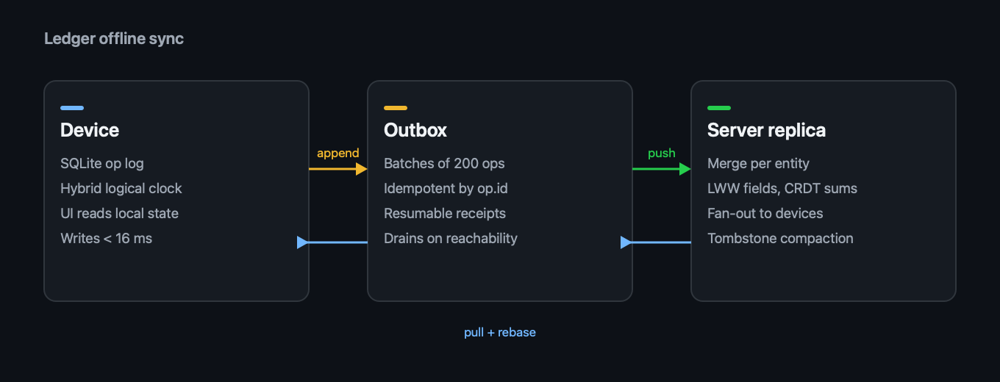

# Offline Sync for Ledger

Design notes for the **offline-first sync engine** behind Ledger's iOS and desktop apps. Status: _in review_, target release **4.2**.

> Goal: every screen works on a plane. Writes land locally in under 16 ms and reconcile in the background without the user ever seeing a spinner.

## Why now

Support tickets tagged `offline` tripled after the travel-mode launch. Most come from three flows: approving expenses, editing budgets, and attaching receipts. All three fail hard today when the network drops mid-request.

- 38% of weekly actives open the app with no connection at least once
- Median reconnect gap on mobile is **4 minutes**
- Receipt uploads retry from zero after every drop

## Goals

- [x] Local writes never block on the network
- [x] Deterministic merge for concurrent edits
- [ ] Receipts upload in resumable 1 MB chunks
- [ ] Conflict UI for the rare non-mergeable case
- [ ] Ship behind the `sync.v2` flag to 5% of iOS

## Architecture

Every mutation becomes an **operation** appended to a local log. The log is the source of truth on the device; the server is just another replica.



The outbox drains whenever the reachability monitor reports a route. Each batch is idempotent, so a retry after a timeout is always safe.

```ts
type Op = {
  id: string          // ulid, sortable by creation time
  entity: 'expense' | 'budget' | 'receipt'
  field: string
  value: unknown
  clock: HybridClock  // wall time + logical counter
}

export async function drain(outbox: Outbox, api: SyncApi) {
  for (const batch of outbox.batches({ max: 200 })) {
    const ack = await api.push(batch)   // idempotent by op.id
    await outbox.commit(ack.lastId)
  }
}
```

## Merge rules

| Entity  | Strategy               | Conflict surface |
|---------|------------------------|------------------|
| Expense | Last writer wins per field | None          |
| Budget  | Sum of deltas (CRDT counter) | None        |
| Receipt | Content-addressed blobs | Duplicate detection |
| Comment | Append-only list        | None             |

Field-level last-writer-wins covers 97% of real edits in our replay of last month's traffic. The remaining 3% are budget totals, which is why budgets use a counter instead.

## Rollout

1. Dogfood with the finance team for one sprint
2. 5% of iOS behind `sync.v2`, watch the error budget
3. Desktop at 25%, then everyone

## Open questions

- Do we keep the legacy REST write path as a fallback for one release?
- How long do we retain tombstones before compaction?
