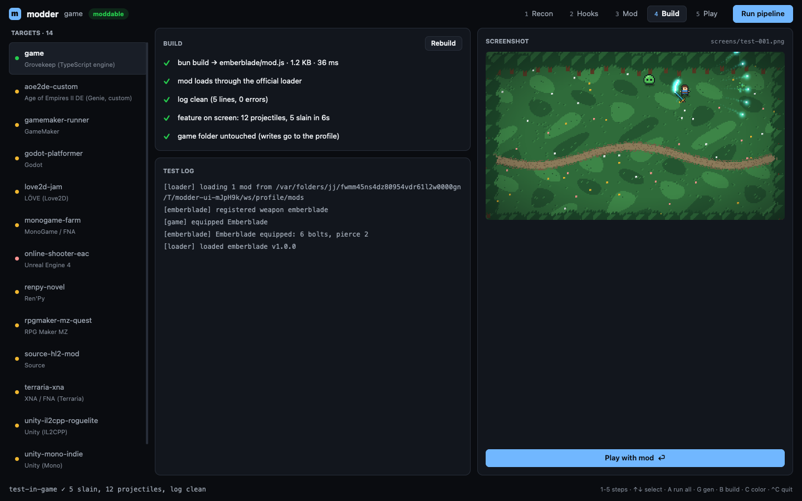

# modder

A mod workbench for single-player games you own, built with [GPUIX](https://github.com/remorses/gpuix) and rendered **inside Ghostty** over the Kitty graphics protocol.

```sh
modder ./game ./fixtures
```

It runs the whole universal-modder loop on screen: **recon** (engine + modding route) → **hooks** (where a mod can attach) → **write-mod** (from a template, with a palette-matched sprite) → **build** → **test-in-game** (real engine + loader, clean log, screenshot) → **play**, with the game running the mod in a Ghostty split next to it.



## Run

```sh
cd gpuix/modder
bun install
bun link                  # puts `modder` and `grovekeep` on PATH (~/.bun/bin)
modder ./game ./fixtures  # in Ghostty or kitty
```

In another pane (Cmd-D in Ghostty):

```sh
grovekeep -p .modder/game/profile
```

The workbench sees the game start (`live · pid …`), tails its log, and every rebuild hot-reloads into it.

| key | action |
|---|---|
| `1`–`5` | Recon / Hooks / Mod / Build / Play |
| `↑` `↓` / `j` `k` | pick a target (or a hook) |
| `A` | run the whole pipeline |
| `R` `H` `G` `B` | recon, hooks, generate, build + test |
| `T` / `C` | cycle template / color |
| `+` `-`, `]` `[` | projectile count, pierce |
| Play: `WASD` `space` `Q` `E` `P` | move, swing, weapon, spawn, autopilot |
| `Ctrl-C` | quit, prompt restored |

Everything is also mouse-driven (tabs, targets, templates, swatches, steppers, buttons, scrolling lists).

Headless subcommands:

```sh
modder recon <game>... [--json]   # recon.json
modder hooks <game>               # hooks.md
modder new <game> -t sword|hud|unit --name N --color '#hex'
modder build <game>               # bundle into the profile
modder test <game>                # headless test-in-game + screenshot PNG
modder install <game> --yes       # copy into the game's own mods/ (refused without --yes)
```

Options: `-o/--workspace` (default `./.modder/<game>`, never inside the game folder), `-y/--yes`, `-w/--window` (native window instead of the terminal), `--json`.

## Rules

- Single-player or officially mod-supported games only. Never touch anti-cheat, online/multiplayer code, DRM or license checks. Refuse games whose EULA forbids modding.
- Prefer the official or community-standard mod framework over binary patching. Decompilation is only for reading code locally; decompiled code is never redistributed.
- Mods are separate files loaded by the framework. Original game files are never modified or redistributed.
- **No tool writes into the original game directory without `--yes`.** Every write goes through `src/guard.ts` (`safeWrite`/`safeCopy`/`safeMkdir`), which resolves symlinks and `..` and throws `GuardError`. `tests/workbench.test.ts` snapshots the game folder before and after the full pipeline and checks `install` refuses without `--yes`.
- Recon refuses installs with anti-cheat markers (EasyAntiCheat, BattlEye, vgk, PunkBuster): `risk: refuse`, no plan.

## The target game: Grovekeep

`game/` is a tiny single-player arena game written for this demo (MIT, all art procedural), so the end-to-end loop can run honestly on this machine. It has what a real moddable game has:

- `modding.json`: engine id, version, mod API version, `single_player: true`, `network: false`.
- `modapi.ts`: the official, typed mod API (`registerWeapon`, `registerEnemy`, `on('swing'|'hit'|'kill'|…)`, `give`, `spawn`, `setHud`, `log`).
- `modloader.ts`: loads `<profile>/mods/<id>/manifest.json` + `mod.js`, hot-reloads on change, writes `<profile>/logs/latest.log`, and a debug console (`give`, `spawn`, `reload` lines appended to `<profile>/console.in`).
- `engine.ts` + `fb.ts`: simulation and a 320×180 CPU framebuffer renderer, painted into a GPUIX `` with `setImagePixels`.

`grovekeep -p <profile>` runs it in the terminal; `--give`, `--spawn`, `--autopilot`, `--window` are there for testing.

## Supported engines (recon)

| engine | evidence | route |
|---|---|---|
| Grovekeep | `modding.json` engine `grovekeep` | official mod API (end to end) |
| Unity Mono | `*_Data/Managed/Assembly-CSharp.dll` | BepInEx 5 + Harmony |
| Unity IL2CPP | `GameAssembly.dll` + `global-metadata.dat` | BepInEx 6 / MelonLoader |
| Unreal 4/5 | `Paks/*.pak`, `*-Win64-Shipping.exe` | UE4SS Lua/Blueprint, pak mods |
| XNA/FNA (Terraria) | `Terraria.exe` | tModLoader |
| MonoGame / FNA | `MonoGame.Framework.dll` / `FNA.dll` | Harmony via a loader |
| Godot | `*.pck` or `project.godot` | GDRE tools (inspect), Godot Mod Loader |
| RPG Maker MV/MZ | `www/js` or `js/plugins.js` | JS plugin |
| Ren'Py | `renpy/` or `*.rpa` | `.rpy` overrides |
| GameMaker | `data.win` | UndertaleModTool, in a copy |
| Source / GoldSrc | `gameinfo.txt` or `*.vpk` | addon/custom folder (GoldSrc: mod folder + `liblist.gam`) |
| Age of Empires II DE | `AoE2DE_s.exe` | official mods folder (data mods) |
| LÖVE | `*.love` or `main.lua` + `conf.lua` | Lua source mod in a copy |

`fixtures/` holds fake installs for each one (regenerate with `bun tools/make-fixtures.ts`); `tests/recon.test.ts` checks every classification. Only Grovekeep is `supported` (every step runs here); for the rest modder writes `recon.json` and shows the setup/explore/write plan.

### Adding an engine adapter

1. Add an entry to `ADAPTERS` in `src/recon.ts`. `detect(ix)` gets an `Index` of relative paths (`ix.has(re)`, `ix.find(re)`, `ix.read(path)`) and returns `null` or the recon fields: `engine`, `engineId`, `version`, `runtime`, `framework`, `route`, `data`, `saves`, `evidence`, `supported`, `plan`. Put more specific adapters first.
2. Add a fake install to `FIXTURES` in `tools/make-fixtures.ts` with the expected `engineId`, run `bun tools/make-fixtures.ts`, and `bun test`.
3. If you can run it end to end, add a hook scanner in `src/hooks.ts` and templates in `src/templates.ts`, and set `supported: true`.

## Agent skills

`skills/<name>/SKILL.md`: `recon`, `setup-framework`, `explore-code`, `write-mod`, `assets`, `test-in-game`, `showcase`. Each starts with the rules and points at the CLI subcommand that does the work.

## What was adapted from the original prompt

- **Real Terraria/tModLoader, Unity/BepInEx and AoE2 installs → Grovekeep.** I don't own those games on this VM and can't redistribute them, so the three reference walkthroughs became the three templates (`sword`: weapon with custom projectile + generated sprite; `hud`: hotkey stats overlay; `unit`: data-mod enemy variant), run end to end against Grovekeep's official mod API. Other engines are recon + plan only.
- **ilspycmd decompilation → reading the official mod API.** For Grovekeep, `explore-code` indexes `emit()` sites, API methods and console commands with file:line. The ilspycmd/GDRE/UE4SS steps are in the plans, not executed.
- **fal.ai asset generation → local procedural sprite** in the palette and resolution sampled from `assets/sprites.json` (no API key, nothing third party).
- **OS screenshot of the game window → the engine's own framebuffer** captured during the headless test run (PNG in `<workspace>/screens/`).
- **Showcase with drawtext title cards → none.** The requester wants these demos without labels.

## Tests

```sh
bun test            # recon fixtures, guard, full pipeline on a copy of the game, GPU test-renderer UI
bun run typecheck
```

`tests/ui.test.tsx` uses `@gpuix/react/testing` + `connectTest` to click through recon → mod → build on the real Metal test renderer, checks every build/test checkmark, and renders a 700 px split-pane layout. Screenshots land in `screens/` (gitignored).

## GPUIX findings (0.11.0)

- Terminal mode in Ghostty works well for this: resizes from Cmd-D splits arrive immediately and the layout reflows; keys, mouse, scroll and Ctrl-C all behave. Frame rate of the CPU-rendered game is capped at 30 fps by the app; the VM GPU is Apple Paravirtual, so treat timings as paravirtual.
- `setImagePixels` in the test renderer can throw `Unknown element id` when called in a layout effect on the ``'s first commit. Calling it from `useEffect` and retrying on the next tick fixes it.
- With `createTestRoot`, `connectTest` locators see nothing until the renderer has flushed a few times; flush + short sleeps before the first query.
- `<code>` contents don't show up in `textContent()`; use `renderer.getPaintedText()` to assert on painted code.
- Integer-scaled pixel art in a fixed `` box leaves lots of empty space in large panes. Render at `ceil(scale)` and let `objectFit="fill"` scale to the exact fractional size: still crisp at these sizes and it fills the pane.
- Known issues from the brief confirmed here: `<text>` needs an explicit `color`, `<div>` needs `display:'flex'`, letter keys can arrive as `space` with the real char in `keyChar`, held INFO logs print after exit unless `RUST_LOG=error` (both CLIs re-exec with it), and HUD overlays need `pointerEvents:'none'`.
