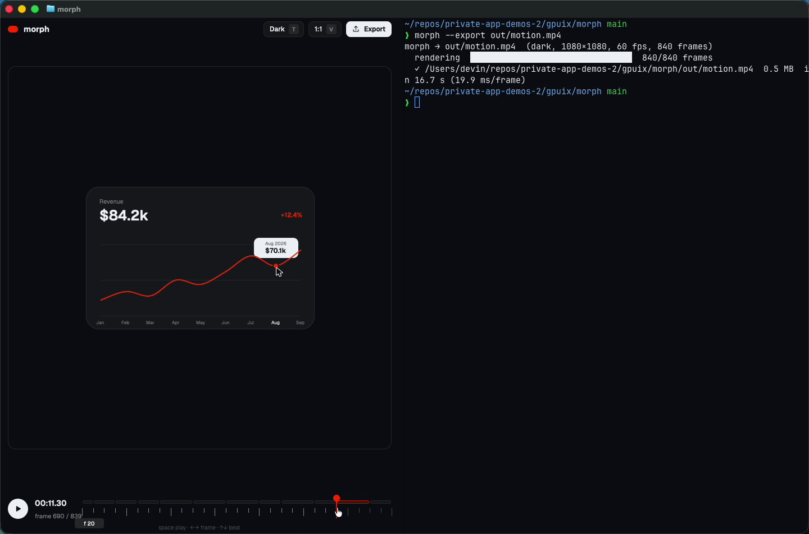

# morph

**One shape that never cuts**: a 14-second, code-only UI motion piece where a single rounded rectangle morphs through eleven UI states on a 120 BPM grid. GPUIX paints it live inside Ghostty over the Kitty Graphics protocol, with a timeline you can scrub, and exports it frame-exact to MP4.



[Demo video](media/demo.mp4)

## Run it

Needs macOS, [Bun](https://bun.sh) and [Ghostty](https://ghostty.org) (or kitty). `ffmpeg` is only needed for export.

```sh
cd gpuix/morph
bun install
bun link            # puts `morph` on your PATH
morph               # play it in this terminal
morph --export out.mp4
morph --check       # beat map + timing and loop checks
```

Without `bun link`: `bun src/cli.ts [options]`.

```
-e, --export <file>    frame-exact export (H.264, CRF 18, 60 fps, 840 frames)
-p, --palette <name>   dark (your Ghostty theme, default) or light (#EDEBE8 canvas from the brief)
-V, --vertical         1080x1350 instead of 1080x1080
-s, --size <px>        export width (default 1080)
-f, --frame <n>        start at frame n
    --paused           start paused
-t, --theme <name>     Ghostty theme to paint with (default: from ~/.config/ghostty/config)
-w, --window           native window instead of the terminal
-h, --help
```

| Input | Action |
| --- | --- |
| `space` / `k`, click the artboard or ▶ | play / pause |
| `←` `→` (`shift` ×10), scroll | step frames |
| `↑` `↓` / `]` `[` | jump a beat (30 frames) |
| click or drag the timeline | scrub (hover shows the frame) |
| `0` / `home`, `end` | first / last frame |
| `T` or the chip | terminal palette ↔ light #EDEBE8 palette |
| `V` or the chip | 1:1 ↔ 4:5 artboard |
| `E` or **Export MP4** | export in the background with live progress (to `./out/`) |
| `ctrl-c` | quit, prompt restored |

### Ghostty

`~/.config/ghostty/config` with `theme = GitHub Dark High Contrast`. morph reads the active theme's `background`/`foreground` (from the config, `~/.config/ghostty/themes`, or the themes inside Ghostty.app) and paints the app with them, so it blends into the terminal. Split a pane (Cmd-D) and run `morph --export out.mp4` next to it, or a second `morph -p light`; the app reflows to the narrower pane.

## The piece

| Beat | Frame | State | Cursor |
| --- | --- | --- | --- |
| 0 | 0 | Button "Get started" | press |
| 1 | 30 | Loader (rotating arc) | – |
| 3 | 90 | Checkmark (stroke draws on) | – |
| 5 | 150 | Dynamic Island (now playing + equalizer) | click |
| 7 | 210 | Music player, play → pause icon morph | click |
| 10 | 300 | Progress scrubber | drag |
| 13 | 390 | Volume slider, rubber-bands past max | drag past max |
| 16 | 480 | Toggle | click |
| 18 | 540 | Tab bar, liquid indicator | clicks |
| 21 | 630 | Line chart draws on, tooltip on hover | hover |
| 23 | 690 | Command palette, "exp" types out, results filter | type, click |
| 26 | 780 | Back to the button | – |

`morph --check` prints the full 28-beat map and verifies it: all 12 state changes land exactly on their beat (±0 frames), every beat has an event, and frames 0 and 839 render pixel-identical (seamless loop).

## How it works

- `src/lib/beats.ts`: the timeline, `{ beat, state?, cursor: [...], note }` for all 28 beats.
- `src/lib/spring.ts`: a deterministic, frame-based damped spring (pre-integrated, ≤4 % overshoot) used for every morph.
- `src/scene.ts`: `sceneAt(frame, palette)` is a pure function from a frame number to everything on screen: the shape's width/height/radius/fill, the camera scale, the outgoing and incoming content layers (a 7-frame opacity + scale crossfade), the cursor and per-state parameters. Nothing depends on wall-clock time, so the live view, the scrubber and the export all show the same frame.
- `src/lib/cursor.ts`: compiles the cursor actions into eased, slightly bowed paths and press windows (scale 0.96).
- `src/lib/raster.ts`: a small CPU rasterizer (anti-aliased strokes) for the loader arc, check stroke, play/pause path tween and chart line, uploaded with `setImagePixels`.
- `src/stage.tsx`: GPUIX elements for the shape and each state's content; `src/app.tsx`: top bar, artboard, timeline; `src/controller.ts`: playback + keys.
- `src/export.tsx`: renders all 840 frames offscreen with `@gpuix/react/testing` (`captureScreenshot`) and encodes them with ffmpeg.

## Adapted from the original prompt

The brief asked for Remotion rendered to MP4. Here:

- **Remotion → GPUIX.** The composition is a GPUIX React tree. Instead of Remotion Studio, the preview is the live app in the terminal with its own timeline, play/pause, frame stepping and scrubbing. Instead of `remotion render`, `morph --export` renders every frame with the GPUIX test renderer and pipes PNGs to ffmpeg (H.264, CRF 18, `yuv420p`, 60 fps). `-V` gives the 1080×1350 vertical variant.
- **Remotion `spring()` → own frame-based spring** with the same knobs (mass/damping/stiffness).
- **flubber → own path tween**: the play triangle and the two pause bars are both sampled as polylines and interpolated point by point.
- **Blur crossfade → opacity + scale crossfade.** GPUIX 0.11 has no blur filter.
- **Palette.** Default is the terminal palette (the Ghostty theme's background with white/black components and #FF4D00) so it sits in the terminal; `-p light` / `T` gives the brief's warm-gray #EDEBE8 canvas with black/white components.
- **Font.** Geist, bundled in `assets/fonts` (SIL OFL, see `OFL.txt`) and registered with the renderer.

## Cut

- **No music track.** No royalty-free track was supplied, and audio playback isn't part of GPUIX. The timing is checked against the 120 BPM grid instead (`morph --check`, `bun test`), and the beat ticks are drawn on the timeline.
- No Remotion Studio and no `@remotion/google-fonts`.
- Gradients, glows and particles are banned by the brief, so none.

## Tests

```sh
bun test            # timing engine, scene continuity, loop, controller, layout, plus the app in the GPU test renderer
bun run typecheck
morph --check
```

The GPU test drives the real app through `@gpuix/react/automation`: clicks ▶, plays three seconds, steps with keys, toggles the palette, clicks the timeline, then reflows to a half-split width and checks the controls still respond.

## Performance (Apple Paravirtual Metal, this macOS VM)

- Export: 840 frames at 1080×1080 in about 17–41 s (20–49 ms per frame including PNG writes and ffmpeg), depending on what else the VM is doing.
- Live in Ghostty (full 1440×900 window): about 30–35 distinct frames per second reach the screen while playing, counted from a 60 fps screen recording. The clock is frame-exact regardless (a dropped paint skips ahead, it never slows the timeline). This is a paravirtual GPU; a real Mac is faster.

## GPUIX findings (0.11.0)

- `createTestRoot()` captures `height − 27` px (the hidden titlebar), and the native test window is clamped to the display height (1080 total on this VM). Frames taller than that are rendered as 600 px bands (the same stage shifted up) and stacked with ffmpeg `vstack`.
- `<svg>` is tinted by `style.color` (it's monochrome), so a two-color cursor is two stacked SVGs (outline + fill).
- `setImagePixels` with straight-alpha RGBA through an `` is fast enough to re-upload several layers every frame.
- Terminal key events can arrive as `key: "space"` with the real character in `keyChar`; the controller checks `keyChar` first.
- The left mouse button is `0` (`pressedButton != null` is the drag test). A single element with `onMouseDown` + `onMouseMove` + `onMouseUp` keeps receiving moves while you drag outside it, which makes the scrubber easy.
- Positioned overlays need `pointerEvents: 'none'`; every `<text>` needs an explicit `color`; `<div>` needs `display: 'flex'`.
- Ghostty sets `RUST_LOG`, and GPUIX prints held native logs after exit; `cli.ts` re-execs itself with `RUST_LOG=error`.
- Doing a React render per pointer event let a fast drag queue renders faster than terminal frames could go out, so the picture froze until the drag ended. Pointer moves now only record the latest x and the 60 Hz tick applies it, with one paint in flight at a time.
- Text is selectable by default; `userSelect: 'none'` on the root keeps drags on the timeline from selecting the chrome.
- Don't pipe into stdin: a stdin pipe switches GPUIX to its automation protocol, so the in-app export runs `morph --export` as a child with `stdin: 'ignore'`.
