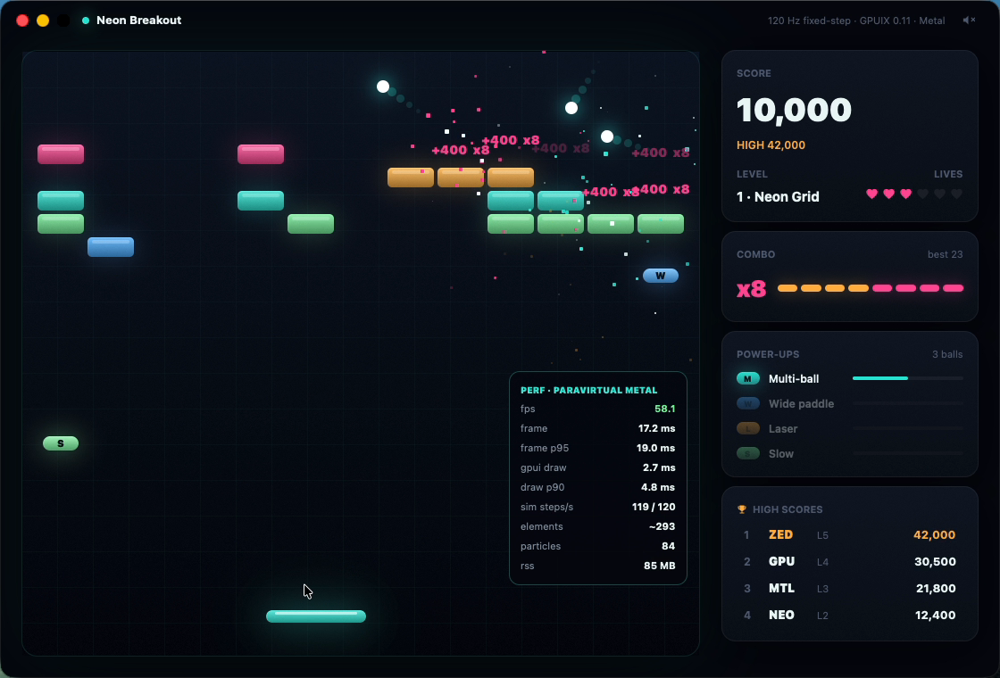

# Neon Breakout

A Breakout / Arkanoid arcade game where every brick, ball, particle, capsule and HUD panel is a GPUIX element. React describes the frame, GPUIX paints it natively with Metal. No canvas library, no web view, no Electron.



Demo (real time, real mouse and keyboard input on the native window): [`media/demo.mp4`](media/demo.mp4)

## What's in the game

- **Fixed-step physics at 120 Hz**, decoupled from rendering. `Controller.advance()` accumulates wall time and steps the deterministic `Game` sim (`src/sim/sim.ts`) in 1/120 s ticks; React reads the sim and redraws at ~60 Hz.
- **Paddle control by mouse or keyboard** (mouse, ←/→ or A/D). Where the ball hits the paddle sets the bounce angle (up to 62°).
- **Five designed levels**: Neon Grid, Pyramid, Fortress, Invaders, Prism Gate. Levels use **multi-hit bricks** (2 and 3 hits, with damage dots) and **indestructible steel**.
- **Power-ups**: multi-ball, wide paddle, laser (click/Space fires), slow ball, and a rare extra life.
- **Particles, flashes, score popups and screen shake** on brick breaks; **combo scoring** (each brick before the ball returns to the paddle multiplies points, up to x8).
- **Lives, title screen with an attract-mode autopilot, pause menu** (Esc/P: Resume, Restart, Sound, Quit), **game-over screen** with a native `<input>` for initials and a **persisted high-score table** (`~/Library/Application Support/Neon Breakout/scores.json`, override with `NEON_BREAKOUT_SCORES`).
- **Synthesized sound**: short WAVs generated at first launch (`~/Library/Caches/neon-breakout`), played with non-blocking `afplay`. `M` toggles; tests run muted.
- **Perf HUD** (`F`): fps, frame time + p95, GPUIX draw time + p90 (from the debug frame overlay stats), sim steps/s, element count, particles, RSS.

## GPUIX features used

- `<div>` with absolute positioning for every game object, two-stop `linear-gradient` backgrounds, rounded corners and layered structured `boxShadow`s for the neon glow.
- `<svg>` for the icons (hearts, trophy, sound), `<text>` with explicit colors everywhere.
- Native `<input>` (autoFocus, `onChange`, `onSubmit`, caret `theme`) for high-score initials.
- Window-level `onKeyDown` / `onKeyUp` in `render()` for game controls; `onMouseMove` + `onMouseDown` on a transparent top layer for the paddle (down + move arm GPUI's window-level capture).
- `render()` window options: fixed size, transparent titlebar with repositioned traffic lights, `appName`, `focus: false` under `GPUIX_BACKGROUND=1`.
- `renderer.getDebugFrameOverlayStats()` for the HUD's draw-time numbers.
- `@gpuix/react/testing` (`createTestRoot`, `nativeSimulateMouseMove`, `nativeSimulateClick`, `simulateKeystrokes`, `getAllText`, `captureScreenshot`) + `connectTest` from `@gpuix/react/automation` (`getByTestId().click()` / `.fill()`).
- The app icon is painted by GPUIX too: `scripts/icon.tsx` renders it in the test renderer and writes the PNG.

## Run

```bash
bun install
bun run dev          # bun --hot src/app.tsx
bun test             # deterministic sim tests + GPU test-renderer flow
bun run typecheck    # tsc --noEmit
bun run build        # standalone binary: dist/neon-breakout
bun run package      # build + cargo-packager → bundle/Neon Breakout.app
```

Controls: mouse or ←/→ to move, click or Space to launch / fire lasers, Esc or P to pause, F perf HUD, M sound, T toggles the autopilot.

## Tests

- `tests/sim.test.ts` runs the 120 Hz sim headless and deterministically: bricks break and score rises under the autopilot, same seed gives the same game, paddle hit point sets the bounce angle, armored and steel bricks, combo math, each power-up, life loss → game over, level clear → next layout.
- `tests/app.test.tsx` mounts the real `<App>` in the GPU test renderer: native click on Play, native mouse move steers the paddle, native click launches, 25 s of sim breaks bricks and the HUD shows the new score, `F` shows the perf HUD, `Esc` pauses (sim frozen) and the Resume button resumes, game over offers initials, `fill()` + Save writes the score to disk and a fresh controller reads it back. It also captures a PNG.

## Performance (Apple Paravirtual Metal VM, not a real M-series GPU)

Measured on this macOS 26.6 arm64 VM, whose GPU is Apple's paravirtual Metal device. Real hardware will be faster.

| Metric | Value |
|---|---|
| Frame rate during play (perf HUD, demo run) | 56-59 fps, frame 17.1-17.4 ms, p95 ~19 ms |
| GPUIX draw time | 2.7-5.2 ms per frame (p90 4.6-5.2 ms) |
| Elements per frame | ~180-390 (bricks, balls + trails, particles, HUD) |
| Sim | 120 steps/s held during play |
| Memory | 84-88 MB RSS |
| Standalone binary (`bun build --compile --minify`) | 95.8 MB (95,795,570 bytes) |
| `.app` bundle | 93 MB on disk |
| Cold start to first painted frame | 0.71 s first launch, 0.26-0.30 s warm (`NEON_COLD_START=1` exits on frame 2) |

The frame time is pinned near 16.7 ms by the 60 Hz redraw loop; the draw-time column is the headroom GPUIX leaves on this VM.

## GPUIX findings (0.11.0, macOS arm64)

1. **`bun build --compile` binaries can't find the native addon when the app imports `@gpuix/react`.** The ESM loader in `@gpuix/native/index.js` uses `createRequire(import.meta.url)`, which Bun's bundler can't follow, so the `.node` file isn't embedded and the binary dies with `Cannot find native binding` / `Cannot find module '@gpuix/native-darwin-arm64'`. Repro: `bun build --compile src/app.tsx --outfile x && ./x`. Workaround in `src/main.ts`: import the addon with `with { type: 'file' }` so Bun embeds it, set `NAPI_RS_NATIVE_LIBRARY_PATH` to it, then dynamically import the app.
2. **Return was unreliable with synthesized key events.** Return posted with `cliclick kp:return` or a raw CGEvent (keycode 36) reached neither `render({ onKeyDown })` nor a focused `<input>`'s `onSubmit`, while Space, Esc, Tab and letters from the same tools arrived fine. Return sent by Devin's computer tool did submit the `<input>`. In the test renderer, `simulateKeystrokes('enter')` fires `onSubmit`. Workaround: the game-over screen also has a Save button, and the title screen advertises Space.
3. **README's cargo-packager config fails with `--config`.** `cargo packager --release --config packager.json` (cargo-packager 0.11.8) errors with `I/O Error (.../packager.json): Not a directory`. Adding `"name": "neon-breakout"` fixes it.
4. **`<input value>` doesn't reject edits like a React controlled input.** If `onChange` cleans the text (here: A-Z/0-9, max 3) and the cleaned value equals the previous prop, GPUIX keeps showing the raw edit (`QA1!z`). Workaround in `GameOver`: echo the raw value for one render, then set the cleaned value so the prop changes and replaces the native text.
5. **Mouse handlers on the playfield container were unreliable with real clicks** once bricks, balls and banners were drawn inside it (the native click did not launch the ball). Fix: a transparent, absolutely positioned top layer (`pointer-pad`) owns `onMouseDown`/`onMouseMove`.
6. Only two-stop linear gradients are supported (radial gradients are not), so glows are built from layered `boxShadow`s and translucent bars instead.
7. The test renderer has no alpha channel, so `scripts/icon.tsx` paints a matching mask and merges it with ffmpeg to get transparent icon corners.
8. Every launch logs a burst of `WARN gpui_macos::text_system skipping duplicate font` lines on this VM. Harmless.

## Layout

```
src/main.ts         standalone-binary entry (embeds the native addon)
src/app.tsx         window, frame loop, perf HUD
src/controller.ts   modes, fixed-step accumulator, input mapping
src/sim/            deterministic game: constants, levels, sim, autopilot, rng
src/ui/             Field (playfield), Sidebar, Overlays, theme
src/audio.ts        WAV synthesis + afplay
src/scores.ts       high-score persistence
scripts/icon.tsx    paints the app icon with GPUIX
scripts/demo/       CGEvent input driver used to record media/demo.mp4
```

`scripts/demo/drive.swift` posts real mouse and keyboard events to the window. While "tracking" it reads `NEON_TELEMETRY` (the autopilot's aim point, written only when that env var is set) and moves the OS pointer there, so the paddle in the demo is driven by real mouse input. Keyboard segments hold real arrow keys.
