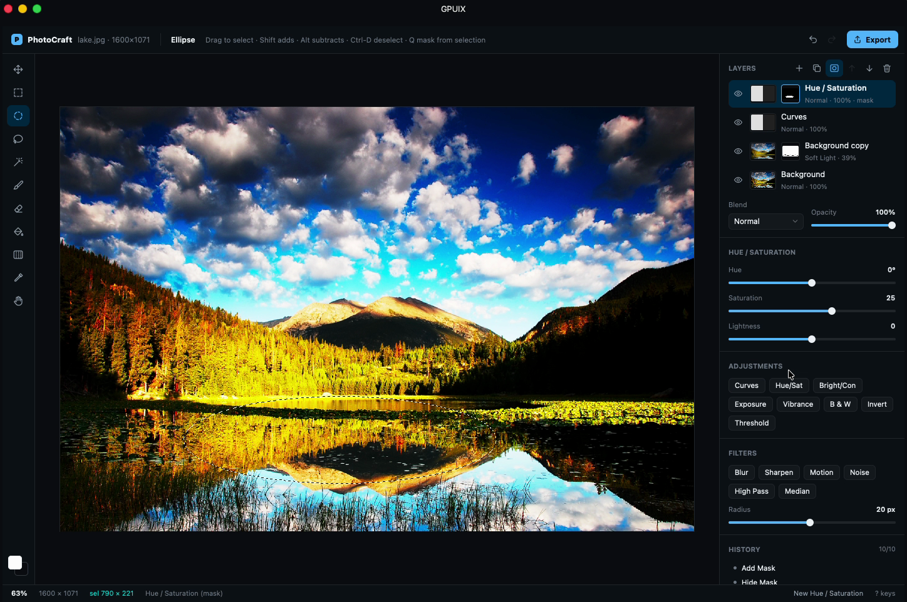

# PhotoCraft (GPUIX in Ghostty)

A layered, Photoshop-style raster image editor written in TypeScript with [GPUIX](https://github.com/remorses/gpuix). It paints inside Ghostty (or kitty) over the Kitty Graphics protocol, so it behaves like a TUI: launch it from the prompt, split the pane next to it, Ctrl-C back to your shell.



Demo: [`media/demo.mp4`](media/demo.mp4) (real-time, real input, no edits besides trimming).

> PhotoCraft is an independent, clean-room project. It is not affiliated with, endorsed by, or derived from Adobe or Photoshop. No Adobe code, assets, icons, SDKs or trade dress are used. Code is dual-licensed MIT OR Apache-2.0.

## Run

Requires macOS (Metal), [Bun](https://bun.sh) and Ghostty or kitty. The Ghostty demo config uses `theme = GitHub Dark High Contrast`; the app paints its chrome from that theme so it blends into the terminal.

```bash
cd gpuix/photocraft
bun install
bun link                      # puts `photocraft` on your PATH (~/.bun/bin)
photocraft samples/lake.jpg   # or: bun bin/photocraft.tsx samples/lake.jpg
```

```
Usage: photocraft [image|project.pcraft] [options]

  image               PNG or JPEG (HEIC/WebP/TIFF via macOS sips), or a .pcraft project.
                      Omit it for a blank 1600×1000 canvas.
  -o, --out <file>    export path for Ctrl-E (default: <image>-edit.png next to the image)
  -m, --max <px>      downscale big photos so the long edge fits (default 1600)
  -w, --window        open a native window instead of drawing in the terminal
  -h, --help / -v, --version
```

Try the split from the demo: run the app, press Cmd-D in Ghostty, then in the new pane

```bash
ls -la samples && sips -g pixelWidth -g pixelHeight samples/lake-edit.png   # after Export / Ctrl-E
open samples/lake-edit.png                                                   # or qlmanage -p
```

The editor reflows to the pane: full panel ≥ ~1100 px, compact panel in a half split, canvas-only when narrow. Drag the divider and it follows live.

Tests and typecheck:

```bash
bun test            # 14 tests: core math + GPU test-renderer UI flows
bun run typecheck
```

## Controls

| Input | Action |
|---|---|
| Tool rail / `V M O L W B E K G I H` | move, rect marquee, ellipse, lasso, magic wand, brush, eraser, fill, gradient, eyedropper, hand |
| Scroll on canvas | zoom at cursor · Shift-scroll pans · `F` / Ctrl-0 fit |
| `[` `]` | brush size · top bar sliders for size, hardness, opacity, flow |
| Ctrl-Z / Ctrl-Shift-Z (Ctrl-Y) | undo / redo (also History panel rows) |
| Ctrl-J · Ctrl-Shift-N | duplicate layer · new layer |
| `Q` | add a layer mask / toggle mask editing (brush hides, eraser reveals) |
| `+` / `-` · `1`…`0` | cycle blend mode · opacity 10…100 % |
| Ctrl-A · Ctrl-D / Esc · Ctrl-Shift-I | select all · deselect · invert selection |
| `X` · `D` | swap / reset colours |
| Ctrl-E · Ctrl-Shift-E · Ctrl-S | export PNG · export JPEG · save `.pcraft` |
| `?` | key overlay · Ctrl-C quits and restores the terminal |

Ghostty owns Cmd shortcuts, so every Cmd shortcut has a Ctrl or plain-key equivalent (Cmd also works with `--window`).

## What's in it

- **Document model** (`src/core`, no UI deps): pixel layers and non-destructive adjustment layers, each with visibility, opacity, 16 blend modes and an optional mask.
- **Blend modes**: normal, multiply, screen, overlay, darken, lighten, color dodge, color burn, hard light, soft light, difference, exclusion, hue, saturation, color, luminosity, using the W3C Compositing and Blending formulas.
- **Canvas**: a CPU compositor writes RGBA into a GPUIX `` with `setImagePixels`. Edits mark a dirty rect; only that rect is recomposited and only the matching screen rect is re-rendered (checkerboard, zoom, selection outline, brush ring).
- **Brush/eraser**: Catmull-Rom smoothed stroke engine with fixed spacing, size/hardness/opacity/flow, constrained by the active selection.
- **Selections**: rectangle, ellipse, lasso/polygon, magic wand (tolerance, contiguous), add/subtract with Shift/Alt, invert. Adding an adjustment with a selection active uses the selection as its mask.
- **Adjustments** (non-destructive): curves (draggable spline editor), hue/saturation, brightness/contrast, exposure, vibrance, black & white, invert, threshold.
- **Filters** (destructive, selection-aware): gaussian blur, unsharp mask, noise, motion blur, high-pass, median.
- **History**: command history with 64×64 tile diffs (not full images), byte-capped, merges slider drags into one step.
- **Files**: PNG/JPEG import and export (pngjs, jpeg-js; other formats through macOS `sips`), flattened export, `.pcraft` projects (stored ZIP with a JSON manifest and per-layer PNGs) that reopen identically.

## Adapted from the original prompt

The original prompt asked for a Rust/wgpu/egui workspace. Per the GPUIX-in-Ghostty brief this is TypeScript + GPUIX instead, rendered in the terminal.

Kept: the acceptance flow up to the text step works end to end (open photo → duplicate → gaussian blur → soft light 40 % → mask with brush → curves → export JPEG → save project → reopen identically; covered by a test), the full blend-mode list, the tool rail, tile-diff history, selection math, the curves editor, the layout (tools left, canvas centre, layers/properties/history right, options bar top), keyboard shortcuts for every tool and dark theme.

Cut or changed, honestly:
- **Compositing is CPU, not GPU shaders.** GPUIX has no custom shader hook, so blend modes run in TypeScript over typed arrays and the result is uploaded with `setImagePixels`. Images are downscaled to a 1600 px long edge by default (`--max` to change). No 60 fps on 6000×4000.
- **Not implemented:** text layers, crop tool, levels and color balance, layer groups, lock flags, guides, RGBA16F, the command palette, pressure, a pixel grid above 400 %, WebP/TIFF export, PSD import, golden-image tests and 3-OS CI.
- Filters run on the main thread, so a large blur briefly blocks input (~130 ms for a radius-20 blur at 1600×1071).

## GPUIX findings (0.11.0)

- **Pointer events on a parent with visual children are unreliable.** A slider built as a flex row of track/knob divs with handlers on the row never saw mouse-down in the GPU test renderer. A childless, absolutely positioned hit layer on top of the visuals receives `onMouseDown`/`onMouseMove`/`onMouseUp` reliably. All sliders use that pattern.
- **Use window-level key handlers.** Root `<div autoFocus onKeyDown>` stops getting keys once a click moves GPUI focus elsewhere. Passing `onKeyDown`/`onKeyUp` to `render(…, { terminal: true, onKeyDown })` keeps shortcuts working.
- **Terminal letter keys** can arrive as `key: "space"` with the real letter in `keyChar`; normalise both (`src/ui/keys.ts`).
- **Left button is `0`**: check `pressedButton != null`, never truthiness.
- **Scroll in Ghostty** arrives as `precise` deltas of ±20 per terminal line, about four events per wheel notch. Zoom uses `exp(dy * 0.006)` per event.
- **Held logs**: GPUIX INFO lines print under the prompt after exit. The CLI re-execs itself with `RUST_LOG=error` and filters `[gpuix]` console lines.
- `setImagePixels` wants a `Uint8Array`; pass a view over the `Uint8ClampedArray` buffer instead of copying.
- `<text>` honours `whiteSpace: 'nowrap'` + `textOverflow: 'ellipsis'`, which kept layer names from wrapping in a half-width pane.
- Terminal mode only paints in Ghostty and kitty; VS Code and Zed terminals stay blank.

## Performance (Apple Paravirtual GPU on a macOS VM, not a real Mac)

Measured with Bun on the 1600×1071 sample, 4 layers (blurred soft-light copy + curves + hue/sat over the photo):

| Operation | Time |
|---|---|
| Full recomposite (all layers, whole canvas) | ~295 ms |
| Dirty-rect recomposite for one 96 px brush dab | ~2.6 ms |
| Gaussian blur, radius 20, whole layer | ~130 ms |

Dirty rects are what make painting and slider drags feel interactive; full recomposites happen on open, layer reorder and adjustment changes, so adjustment slider drags on a large canvas visibly lag on this VM.

## Layout

```
bin/photocraft.tsx   CLI, re-exec with RUST_LOG=error, terminal/native render
src/core/            document, blend, composite, history, brush, selection, adjust, filters, io, zip, editor
src/ui/              app.tsx (GPUIX UI), viewport, layout, keys, icons, theme
tests/               core.test.ts (pure logic), app.test.tsx (@gpuix/react/testing, GPU renderer)
tools/shot.tsx       headless screenshot of the UI at any size
samples/             public-domain NPS photos (below)
media/               demo.mp4, screenshot.png
```

## Sample images

Both are US National Park Service photos in the public domain, downscaled:
- `samples/lake.jpg`: [Cub Lake at dawn, Rocky Mountain National Park](https://commons.wikimedia.org/wiki/File:Cub_Lake_at_dawn_in_Rocky_Mountain_National_Park._NPS-Debra_Miller_(18680833532).jpg), NPS / Debra Miller.
- `samples/peak.jpg`: [Stanton Mountain reflected in Lake McDonald](https://commons.wikimedia.org/wiki/File:Stanton_Mountain_reflected_in_Lake_McDonald.jpg), Glacier NPS.

## License

MIT OR Apache-2.0.
