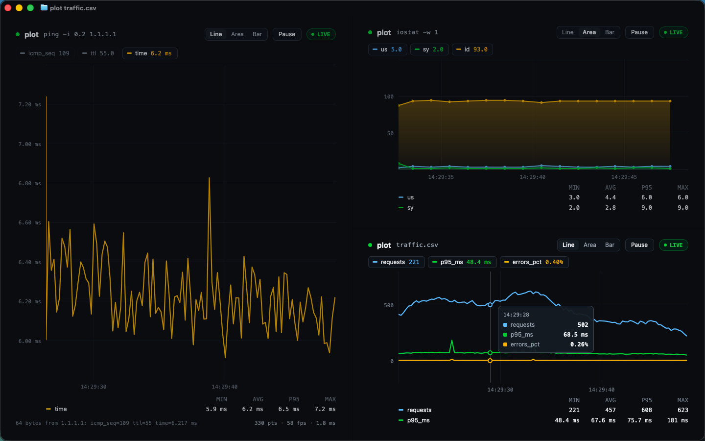

# plot

Live GPU charts in your terminal. `plot -- <command>` runs a command and charts the numbers it prints as they stream in. `plot data.csv` charts a CSV file and follows appends. It is a [GPUIX](https://github.com/remorses/gpuix) app: a React tree painted by Zed's GPUI on Metal, shown **inside Ghostty** through the kitty graphics protocol. There is no web view and no character-cell drawing.



*Three `plot`s in Ghostty splits (theme GitHub Dark High Contrast): ping latency, CPU from `iostat`, and a CSV that a script is appending to.*

```bash
plot -- ping -i 0.2 1.1.1.1          # ping latency, live
plot -c us,sy -- iostat -w 1          # CPU user/system % from iostat
plot -c free,active -- vm_stat 1      # memory pages
plot traffic.csv                      # chart a CSV and follow appends
plot --help
```

## What it does

- **Charts any command's output.** It parses `key=value` / `key: value` pairs, so ping's `time=7.1 ms` becomes a `time` series in ms. Rows of bare numbers become columns named from the latest header row of the same width (iostat, vm_stat, top-style tools), falling back to `col1…colN`. It understands units (`ms`, `%`, `K/M/G`), strips pty control noise and ignores summary lines.
- **Picks the interesting columns.** Constant columns (ping's `ttl`) and counters (`icmp_seq`) start hidden, and at most four series show by default. `-c a,b` picks columns explicitly. Click a legend chip or press `1–9` to toggle a series.
- **CSV / TSV files** with a header row. A `time`/`timestamp`/`ts`/`date` column (epoch s/ms or ISO) becomes the x axis, otherwise it's the row number. Units come from names like `p95_ms` or `errors_pct`. Appends are followed with `fs.watch` plus a 250 ms poll, and a truncated file is re-read.
- **Line, area and bar** styles (`l`/`a`/`b`, `m` cycles, or the segmented control). The y axis eases to its new nice-rounded range instead of jumping.
- **Crosshair readout.** Hover snaps to the nearest real sample and shows every visible series' value and the timestamp.
- **Drag to zoom** into a time range. **Scroll to pan** through history, **⌥/ctrl-scroll** zooms at the pointer, and `←/→` and `↑/↓` do the same from the keyboard. The pill shows `LIVE`, `HISTORY` (click it, double-click the chart or press `r` to go live again) or `PAUSED`.
- **Pause** (`space`) freezes the view while samples keep buffering.
- **Stats** for the visible range: last, min, avg, p95, max. Wide windows show them as cards on the right; narrow splits get a compact table under the chart.
- **PNG export** (`e`) writes `plot-YYYYMMDD-HHMMSS.png` to the current directory. The image has the chart, a title, a legend with min/avg/p95/max, and axis labels drawn with a built-in 5×7 bitmap font, because GPUIX can't screenshot in terminal mode (see findings).
- **Exits like a CLI.** Ctrl-C (or `q`) restores the terminal and prints a per-series summary (`n`, min/avg/p95/max) under your prompt.

## Run

Requires macOS (arm64) or Linux with Bun, inside **Ghostty or kitty**. tmux is not supported by GPUIX terminal mode.

```bash
cd gpuix/plot
bun install
bun link                                # puts `plot` on PATH (~/.bun/bin/plot)
plot -- ping -i 0.2 1.1.1.1

bun bin/plot.tsx -- ping 1.1.1.1        # without linking
bun run dev                             # hot-reload dev run
plot --native -- ping 1.1.1.1           # same app in a native macOS window
bun scripts/traffic.ts traffic.csv      # demo CSV feeder (appends a row every 250 ms)
bun test && bun run typecheck
```

A split dashboard like the screenshot: run `plot -- ping -i 0.2 1.1.1.1`, press **⌘D**, run `plot -c us,sy -- iostat -w 1`, press **⌘⇧D**, then run `(bun scripts/traffic.ts traffic.csv &); plot traffic.csv`.

Don't pipe into `plot` (`cmd | plot`). A GPUIX app treats a stdin pipe as its automation channel, and terminal mode needs the TTY. Pass the command after `--` instead. `plot` refuses a non-TTY stdin with a hint.

## How it works

```
child process (under `script -q /dev/null`, a pty, so it line-buffers)
   │ stdout/stderr lines            fs.watch + poll for CSV files
   ▼                                   ▼
LineParser ──► Store (per-series xs/ys, auto-visibility) ──► Plotter (view: follow / pan / zoom / pause)
                                                                │ 60 Hz frame loop
                                                                ▼
                                Raster: software chart into an opaque BGRA buffer
                                (AA lines via a max-blended coverage buffer, area gradient,
                                 bars, per-column min/max decimation for dense data)
                                                                │ .setImagePixels(w, h, buf, { format: 'bgra' })
                                                                ▼
     GPUIX React tree (header, legend, axes, crosshair, readout, stats) ──► GPUI/Metal ──► kitty graphics ──► Ghostty
```

- `render(<PlotApp />, { terminal: true })`: the app fills the pane and follows Ghostty's resizes, so a split reflows it. The layout switches at 940 px (stats cards vs compact table), 720 px (compact header) and 430 px tall (no footer).
- Colours come from Ghostty's `GitHub Dark High Contrast` theme file (`#0a0c10` background, `#71b7ff` / `#26cd4d` / `#f0b72f` / `#39c5cf` / `#ff9492` series), so the app blends into the terminal.
- The chart is one `` fed raw BGRA pixels every frame. Axis labels, crosshair, dots, selection and tooltip are ordinary GPUIX elements laid over it, so hovering never re-rasterizes.
- The frame loop skips frames whose inputs (view, y range, data version, size, mode) haven't changed. A paused or zoomed chart costs almost nothing. A live chart scrolls smoothly because its right edge is wall-clock time, not the latest sample.
- Files: `bin/plot.tsx` (CLI), `src/parse.ts`, `src/series.ts` (store, stats, ticks, formatting), `src/plotter.ts` (view state), `src/raster.ts`, `src/export.ts` (labelled PNG), `src/sources.ts` (spawn / file follow), `src/app.tsx` (UI).

## Tests

`bun test` runs 17 tests:

- **Parser/store/raster/export unit tests**: ping, iostat, vm_stat with pty noise, CSV time and units, auto-hiding, p95, BGRA pixel output, and the labelled PNG composition.
- **A GPUIX window test** using `@gpuix/react/testing` + `@gpuix/react/automation`. It feeds 150 ping lines into a real GPU-rendered `PlotApp` and asserts:
  - the legend and stats text match the computed stats
  - hovering shows a readout snapped to a real sample
  - `dragBy` zooms (span shrinks, `HISTORY`) and the pill returns to `LIVE`
  - a wheel event pans with the span preserved
  - `space` pauses: the view stays frozen while a new sample is ingested
  - chart style and legend toggles work
  - `e` writes a real PNG

`bun run typecheck` passes (tsc, strict).

## Performance

All numbers are from this VM: macOS 26.6 on **Apple Paravirtual Metal** (slower than a real M-series), Ghostty 1.3.1, Bun 1.4.3.

| | |
|---|---|
| Frame loop, live ping chart, full 1410×650 px chart | **57–58 fps** (in-app counter) |
| Software raster per frame (line / area / bar) | **1.8–3.4 ms** |
| Three `plot`s side by side in splits, each live | 58 fps each, 14–19 % CPU each |
| Memory (RSS) per `plot` | 140–160 MB |
| Launch → first chart frame | ~1 s (bun + GPUIX init + first ping reply) |

Frames reach Ghostty through POSIX shared memory (GPUIX logs `sending frames through shared memory`). The kitty graphics transfer kept up with 60 Hz full-pane uploads in each of three splits at once.

## GPUIX findings (0.11.0)

- **Startup logs land under the prompt after quitting.** Terminal mode holds stdout/stderr and prints them on exit, which includes GPUIX's own `[gpuix] created native window` / `mount complete` `console.log`s and GPUI's Rust `INFO`/`WARN` lines (`skipping duplicate font "System Font Bold"…`). For a CLI that's noise over the restored prompt. Workaround: filter `[gpuix]` lines out of `console.log`, and set `RUST_LOG=error` in the shebang (`#!/usr/bin/env -S RUST_LOG=error bun`). Setting `process.env.RUST_LOG` at runtime before importing `@gpuix/react` is too late. Suggestion: a `quiet` render option, or silence these by default in terminal mode.
- **Clicking a non-focusable element clears keyboard focus** (`getFocusedElementId()` becomes `null`), so root-level `onKeyDown` shortcuts stop after clicking a button `div`. Workaround: re-focus the root (`renderer.focusElement(id)`) when focus is `null`. Repro: root `div` with `tabIndex={0}` + `onKeyDown`, child `div` with only `onClick`; click the child, then press a key.
- **Text in a shrinking flex child doesn't ellipsize.** `textOverflow: 'ellipsis'` + `whiteSpace: 'nowrap'` inside a `flexShrink: 1, minWidth: 0, overflow: 'hidden'` container still paints the full line over its neighbours in narrow splits. Workaround: cut the string to the measured width in JS.
- **Automation can't double-click.** `locator.click()` / `app.mouse.click()` have no click count, and two quick clicks don't arrive as `clickCount: 2`, so double-click handlers can't be tested headlessly. The test covers the same reset through the status pill.
- **`captureScreenshot` fails in terminal mode.** The live `GpuixRenderer` has `captureScreenshot(path)` (it's missing from the `NativeRenderer` type that `useGpuixRequired()` returns, so it needs a cast). In terminal mode it throws `Screenshot capture failed: render_to_image not implemented for this platform`. Workaround: `src/export.ts` composes the PNG itself, blitting the chart's BGRA buffer and drawing the title, legend, stats and axis labels with a 5×7 bitmap font.
- **Spawned commands block-buffer their output** when stdout is a pipe, which is normal libc behaviour but bad for a live chart (iostat arrives in bursts). Running the child under `script -q /dev/null` gives it a pty. `script` echoes `^D\b\b` on start, so the parser strips control characters. Not a GPUIX bug, but every "chart a command" GPUIX app will hit it.
