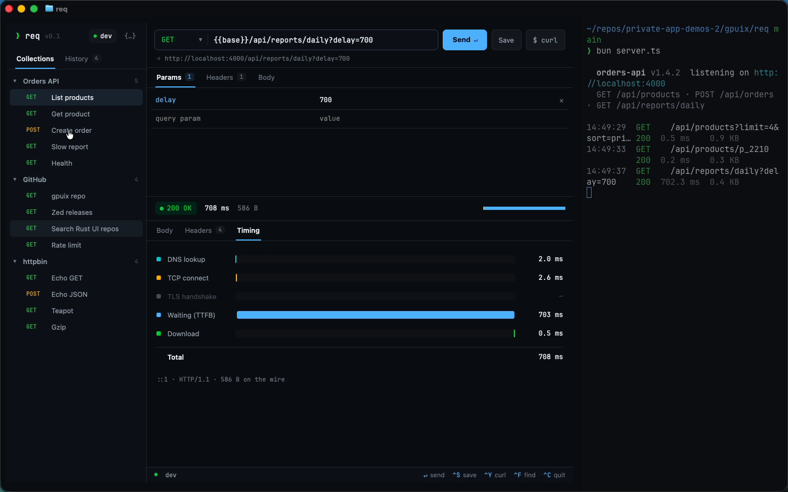

# req

A Postman-style HTTP client that runs **inside your terminal**. It's a GPUIX (React → GPUI) app: Ghostty or kitty
shows each frame through the kitty graphics protocol, so it's a real GUI with real text rendering, hover, clicks
and scrolling, launched like any CLI.

```sh
req https://api.github.com/repos/remorses/gpuix
```



Demo video: [`media/demo.mp4`](media/demo.mp4) (Ghostty with the GitHub Dark High Contrast theme, real input, real requests).

## What it does

- **Request builder**: method picker, URL with `{{variables}}`, params table kept in sync with the query string,
  headers table, and a body editor (JSON with a Format button, or text).
- **Real requests over a hand-rolled transport** (`src/http.ts`: `dns` + `net` + `tls` + `zlib`). Because each
  phase is driven by hand, req can show a true **timing waterfall**: DNS lookup, TCP connect, TLS handshake,
  waiting (TTFB), download and total. It handles gzip/deflate/br decoding, chunked transfer,
  cancellation (Esc), and tries every resolved address (IPv6 → IPv4 fallback).
- **Response view**: status badge, time, size, a **collapsible JSON tree** in a virtual list (Expand/Collapse all,
  per-node toggles, Ctrl-F filter with match count and in-place highlighting), a raw view, and a headers table.
- **Collections and history**: saved to `collections.json` and `history.json` in `~/.config/req`
  (`--data-dir` to change it). Ctrl-S saves the current request into a collection.
- **Environments**: `dev` / `staging` sets of variables (`{{base}}`, `{{api_key}}`, ...). Values can reference shell
  variables such as `$GITHUB_PAT`. These are resolved when the request is sent and never written into the request.
- **Copy as curl** (Ctrl-Y or the `$ curl` button). In the terminal the command goes to the clipboard over **OSC 52**,
  so it also works over SSH. Secrets stay as `$GITHUB_PAT` references in the copied command.
- **Responsive layout**: at 900 px wide or more it shows the sidebar plus request and response side by side. In a
  narrow Ghostty split the sidebar drops away and request and response stack, and it reflows live as you drag the
  divider.
- **`server.ts`**: a small local "orders API" (`/api/products`, `/api/products/:id`, `POST /api/orders` with an
  API-key check, `/api/reports/daily?delay=`) that logs one coloured line per request. The log line fits the pane
  width, so it stays readable in a narrow split.

## Run it

```sh
bun install
bun link            # puts `req` on your PATH (bin → cli.tsx)
req                 # opens the workspace in the current terminal (Ghostty or kitty)
req '{{base}}/api/products?limit=3' -e dev
req -X POST https://httpbin.org/post -d '{"hello":"terminal"}'
req --help

# split the pane (Cmd-D in Ghostty) and run the local API next to it
bun server.ts
```

Without `bun link`, use `bun cli.tsx [url]`. `req --window` opens a native macOS window instead of the terminal.
Ctrl-C quits and gives you back a clean shell prompt.

Scripts: `bun run dev` (terminal mode with hot reload), `bun run test`, `bun run typecheck`, `bun run server`.

### Keys

| key | action |
| --- | --- |
| Enter (in the URL field) | send |
| Esc | cancel in-flight request / clear filter |
| Ctrl-L | focus URL; Ctrl-U clears it |
| Ctrl-S | save to collection |
| Ctrl-Y | copy as curl (OSC 52) |
| Ctrl-F | filter the JSON tree |
| Ctrl-C | quit |

## GPUIX features used

- Terminal mode (`render(<App />, { terminal })`, kitty graphics over shared memory), plus `isTerminal()` to drop
  the traffic-light spacer. The same tree also runs as a native window with `--window`.
- `<input>` / `<textarea>` for the URL, tables and body editor, with programmatic focus.
- `<virtual-list>` for the JSON tree, and `highlight={{ query }}` on a wrapper for in-place search highlighting.
- Hover/active styles, flex layouts, `useWindowSize`-driven responsive breakpoints, window `onKeyDown` shortcuts.
- Custom fonts registered at runtime (JetBrains Mono for code and data, system sans for chrome). Every `<text>` has
  an explicit colour taken from Ghostty's `GitHub Dark High Contrast` theme, so the app blends into the terminal.
- `@gpuix/react/testing` (`createTestRoot`, `nativeSimulateClick`, `getAllText`) for the tests.

## Tests

`bun run test` runs 8 vitest tests (`app.test.tsx`). Five render the real app with the GPU test renderer and drive
it through native clicks and input:

- send a seeded request with resolved `{{base}}`, then check the status, the body and the persisted history file
- collapse, expand and search the JSON tree
- copy as curl, keeping the `$GITHUB_PAT` reference
- save to a collection file
- cancel an in-flight request

The other three are unit tests: real HTTP timing and gzip decoding against a local server, interpolation and curl
generation, and JSON flattening.

## Performance (macOS VM, Apple Paravirtual Metal GPU, Ghostty 1440×900)

- **Frame time** from the GPUIX debug frame overlay (`REQ_DEBUG_OVERLAY=1 req`), scrolling a 3 KB GitHub JSON
  response: current 3.0 ms, 10% low 3.3 ms, 1% low 5.3 ms, max 22.8 ms over 749 frames.
- **Startup**: about 0.3–0.4 s from pressing Enter to the first painted frame in Ghostty, measured on the 60 fps
  screen recording. This includes Bun startup.
- **Memory** (RSS of the Bun process): about 110 MB idle, about 147 MB after loading and scrolling the GitHub response.
- **Requests**, as measured by req's own waterfall: `api.github.com` took about 260–300 ms total (DNS 8 ms, TCP 20 ms,
  TLS 17 ms, TTFB about 215 ms). The local server took 1–7 ms.

## Ghostty notes

- The theme colours are copied from `Ghostty.app/Contents/Resources/ghostty/themes/GitHub Dark High Contrast`.
- Splits (Cmd-D) and divider drags resize the terminal. GPUIX follows the resize and the layout reflows on the next
  frame. In the demo the sidebar disappears below 900 px and comes back when the pane is dragged wider.
- I did not record a VS Code, Zed, Codex or SSH segment for this experiment.

## GPUIX findings (0.11.0)

1. **Held stdout plus a `RUST_LOG` in the environment pollutes the restored prompt.** Terminal mode holds
   stdout/stderr until exit and then replays them. With `RUST_LOG=info` set (it is on this VM), the shell prompt
   that comes back after Ctrl-C starts with `gpui_terminal::kitty sending frames through shared memory` and two
   `skipping duplicate font "System Font …"` warnings, plus the library's own `console.log("[gpuix] created native
   window")`. Setting `process.env.RUST_LOG` from JS before `render()` doesn't help, because `env_logger::try_init()`
   reads the real process environment. Workaround in `cli.tsx`: re-exec once with `RUST_LOG=error`
   (`REQ_DEBUG=1` keeps the logs), and filter `[gpuix]` console lines.
   Repro: `RUST_LOG=info GPUIX_TERMINAL=1 bun app.tsx`, then Ctrl-C.
2. **`highlight` isn't accepted on `<virtual-list>`** (`VirtualListProps` lacks it), although it works on a wrapping
   `<div>`. Workaround: put `highlight` on a flex wrapper around the list.
3. **`useGpuix()` returns `{ renderer }`**, and `registerFont`, `focusElement` and `getFocusedElementId` live on
   `renderer`. The README examples read like they are on the hook result.
4. **Cmd-A in a terminal-mode `<input>`** didn't select the field's text in Ghostty (Cmd is taken by the terminal), so
   req adds Ctrl-U to clear the URL field.
5. `import.meta.dir` is Bun-only. Code that the vitest test renderer imports has to use
   `fileURLToPath(new URL('../fonts', import.meta.url))`. This one is minor and not GPUIX's fault, but it's easy to
   trip over when following the examples.
