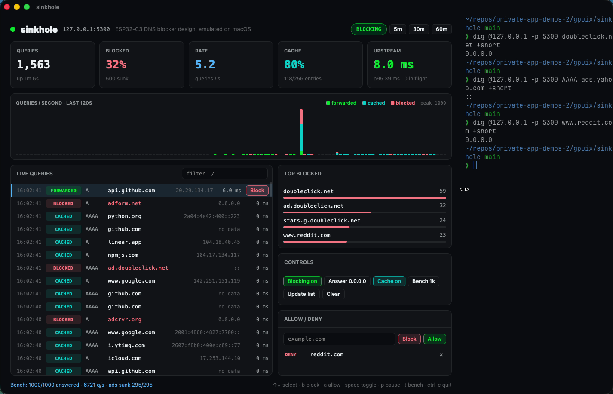

# sinkhole

A network DNS ad and tracker blocker with a live dashboard that renders **inside Ghostty**, built with [GPUIX](https://github.com/remorses/gpuix) 0.11.0.

This is the "$2 ESP32-C3 DNS ad blocker" design **emulated on macOS**. There is no ESP32 here: the same pieces (UDP DNS server, 40-bit hashed blocklist with binary search and a 64 KB bloom filter, upstream forwarding with fallback, a 256-entry TTL cache, a 200-entry query ring, per-domain stats) run as a Bun process on a local port, and the web dashboard is replaced by a GPUIX app painted into the terminal over the Kitty graphics protocol.



## Run it

```bash
bun install
bun link                 # puts `sinkhole` on your PATH (or run `bun src/cli.ts`)
sinkhole update          # download StevenBlack's unified hosts list → ~/.sinkhole/blocklist.bin (5 bytes/domain)
sinkhole                 # serve DNS on 127.0.0.1:5300 and draw the dashboard in this Ghostty pane
```

Then split the pane (Cmd-D) and query it:

```bash
dig @127.0.0.1 -p 5300 doubleclick.net      # → 0.0.0.0
dig @127.0.0.1 -p 5300 AAAA ads.yahoo.com   # → ::
dig @127.0.0.1 -p 5300 github.com           # forwarded to 1.1.1.1, then cached
sinkhole bench -n 1000                      # 1,000 mixed queries: ads must sink, the rest must resolve
```

`sinkhole --help` lists every flag: `--port`, `--host 0.0.0.0` (serve your LAN), `--upstream 1.1.1.1,9.9.9.9`, `--list hosts.txt`, `--nxdomain`, `--cache`, `--theme`, `--headless`, `--window`.

**Port:** the prompt's `sinkhole --port 5353` cannot work on macOS because `mDNSResponder` holds UDP 5353 (Bonjour) exclusively, so the default is **5300**. Port 53 works with `sudo`; then point your Mac or router at the machine's IP (`--host 0.0.0.0`).

Ghostty and kitty only (Kitty graphics protocol). tmux and the VS Code/Zed terminals can't show it; use `--window` for a native window or `--headless` for a log.

### Dashboard

- Cards: total queries, blocked %, queries/s, cache hit rate, upstream p50/p95 and in-flight count.
- 120-second sparkline of queries/second split into forwarded, cached and blocked.
- Live query log, newest first, with a filter. Click a row (or ↑/↓) and Block / Allow it.
- Top blocked domains, controls (blocking on/off, 0.0.0.0 vs NXDOMAIN, cache on/off, run a 1k bench, update the list, clear), and the allow/deny editor.
- Pause blocking for 5/30/60 min from the header; the badge counts down.
- Split the pane and it reflows: below 1000 px the side column folds into tabs (1 Live, 2 Top, 3 Rules).

Keys: `↑↓` select · `b` block · `a` allow · `space` blocking on/off · `p` pause 5 min / resume · `m` answer mode · `c` cache · `t` bench · `u` update list · `x` clear · `1 2 3`/`tab` tabs · `esc` clear filter · `ctrl-c` quit. Rules and settings persist in `~/.sinkhole/config.json`.

## How it maps to the ESP32 prompt

| ESP32-C3 prompt | here |
| --- | --- |
| UDP :53 listener, header + QNAME parse, compression pointers | `src/dns/packet.ts` (UDP 5300 by default) |
| Exact name then each parent against the list | `candidates()` + `Matcher` in `src/dns/blocklist.ts` |
| Blocked → `0.0.0.0` / `::` or NXDOMAIN, TTL 60 | `buildBlocked()`; `--nxdomain` or `m` |
| Forward to 1.1.1.1, fallback 9.9.9.9, pending-ID table, 2 s timeout | `src/dns/server.ts`: random upstream IDs, re-send to the next upstream after 800 ms, SERVFAIL at 2 s |
| 256-entry LRU honoring TTL | `src/dns/cache.ts` (TTLs are aged on hits) |
| 40-bit hashes, sorted array, binary search, 64 KB bloom in front | `HashedBlocklist`: FNV-1a 64 truncated to 40 bits; the sorted 5-byte table is `~/.sinkhole/blocklist.bin` (the "flash partition") |
| Allowlist overriding hash false positives | allow beats deny beats list |
| Stats, top domains/clients, sparkline, 200-query ring, SSE | `src/dns/stats.ts` + the GPUIX dashboard (live React re-render instead of SSE) |
| Add/remove rules, update list, set upstream, pause 5/30/60 | dashboard controls; `sinkhole update`; `--upstream` |
| 1,000 mixed queries with `dig` and a script | `sinkhole bench`, plus `tests/server.test.ts` |

**False positives (birthday math).** With n = 150,000 hashes in a 2⁴⁰ space, any one lookup of an unlisted name collides with probability n / 2⁴⁰ ≈ 1.4 × 10⁻⁷ (about one in 7.3 million lookups, checked once per parent label). The chance that some pair inside the list collides is 1 − e^(−n²/2⁴¹) ≈ 1 %, which only merges two blocked names. The allowlist fixes any false block.

**Measured** on this paravirtual macOS VM (Apple Paravirtual Metal, so dashboard fps is lower than a real Mac): 1,000 mixed queries against the real 71,492-domain list with real upstreams answered 1,000/1,000, all ads sunk and all normal names resolved, at 6,700 q/s cold and 22,000 q/s warm (p95 9 ms cold, 2 ms warm); paced at 100 q/s, p95 0.3 ms with zero drops. The prompt asks for ≥ 50 q/s.

### What was cut or changed

- **No hardware.** No firmware, PlatformIO/ESP-IDF, LittleFS partition, Wi-Fi AP + captive portal, NVS, mDNS `adblock.local`, OTA, watchdog, status LED, or OpenSCAD case. "Wiring and power" doesn't apply: it's a process on your Mac. The heap-above-80 KB soak test is replaced by bounded structures (200-entry ring, 256-entry cache, top-domain map capped at 20k).
- **Dashboard** is a GPUIX terminal app, not a gzipped vanilla-JS page behind HTTP basic auth. It's local-only, so there's no auth.
- **Top clients** are tracked (`Stats.topClients`) but not shown, since every query in the demo comes from 127.0.0.1.

### Limitations

- Browsers using DNS-over-HTTPS or DNS-over-TLS (Firefox, Chrome "secure DNS", iCloud Private Relay) bypass it, as they bypass the ESP32. Turn those off or block their bootstrap names.
- DNS blocking can't remove first-party ads (YouTube) or ads served from the same domain as the content.
- Truncated (TC) upstream responses are relayed as-is; there's no TCP fallback.

## Tests

```bash
bun test          # packet/hash/blocklist/cache/stats units, real-UDP server tests with a fake upstream, GPU test-renderer UI test
bun run typecheck
```

## GPUIX findings (0.11.0)

- `flexBasis: 'auto'` throws `Batch op setStyle parse error: invalid type: string "auto", expected f64` inside the commit, and in terminal mode the pane just goes black (the error only prints after Ctrl-C). Omit the property instead.
- Terminal mode reports some printable keys as `key: "space"` with the letter in `keyChar`; `keyName()` normalizes both.
- The window-level `onKeyDown` from `render()` still fires while an `<input>` has focus, so every input tracks focus with `onFocus`/`onBlur` and shortcuts are ignored while typing. Esc and the rule buttons call `renderer.blur()` (from `useGpuix()`) so plain-key shortcuts work again. `SINKHOLE_KEYLOG=/path` writes raw key events as JSON lines.
- Ghostty encodes keys by virtual keycode, so synthetic CGEvents must use real keycodes: a unicode string on keycode 0 reaches the app as `key: "a"` (it triggered the allow shortcut in an early demo take).
- Held `[gpuix]` INFO lines print under the prompt after exit unless `RUST_LOG=error` is in the real process env, so `sinkhole` re-execs itself once with it set and filters `[gpuix]` console lines.
- The test renderer has no pixel readback, so layout is checked through `findByTestId` and text. Visual checks were done in Ghostty with `screencapture`.
- A Ghostty split re-lays-out the app on the next frame with no app code; `useWindowSize()` gives the new pane size.
