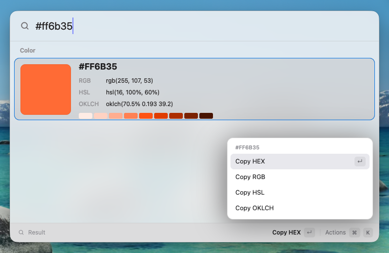

# Spotlight: a Raycast-style launcher in GPUIX

A keyboard-first launcher that really drives this Mac, written as a React tree and painted natively with Metal by [GPUIX](https://github.com/remorses/gpuix) (`@gpuix/react@0.11.0` + `@gpuix/native@0.11.0`). There's no Electron and no web view.



Demo (real time, real keyboard input): [`media/demo.mp4`](media/demo.mp4)

## What it does

- **Apps**: scans `/Applications`, `/Applications/Utilities`, `/System/Applications` (+ Utilities), `~/Applications` and Finder. Reads each bundle's `Info.plist`, converts its `.icns` to a 64 px PNG with `sips` once into `~/Library/Caches/gpuix-spotlight/icons`, and shows it with ``.
- **Files**: searches under `~` with `mdfind` as you type (140 ms debounce). Results in `~/Documents`, `~/Desktop` and `~/Downloads` sort first, and files show Finder's own generic icons.
- **System commands**: Toggle Dark Mode, Lock Screen and Sleep Display (via `osascript`/`pmset`), and Empty Trash, which asks first in a GPUIX `Dialog` showing the real item count.
- **Calculator / converter**: answers inline as you type. It handles `12*(3+4)`, `2^10`, `sqrt(2)`, `20% of 150`, units (`5 ft to cm`, `100 f in c`, `3 kg in lb`, `1.5 gb in mb`, `45 min in hours`) and currencies (`12 usd in eur`) from a static rate table. Enter copies the answer.
- **Clipboard history**: polls `pbpaste` every second and keeps the last 40 entries, persisted, in a split list + preview view with fuzzy filtering. Enter copies an entry back.
- **Colour converter**: type `#ff6b35`, `rgb(…)` or `hsl(…)` to see a swatch, HEX/RGB/HSL/OKLCH and a shade ramp. Every format can be copied from the action panel.
- **Keyboard UX**: Up/Down moves the highlight (and wraps), Enter runs the primary action, **⌘↵** reveals in Finder, **Tab** or **⌘K** opens an action panel for the selected item (Open with TextEdit, Quick Look, Copy Path, Quit app…), and **Esc** closes the panel, clears the query, leaves a sub-view, then closes the launcher on a double press.
- **Fuzzy matching**: prefix, word-boundary and subsequence scoring. Matched characters are highlighted in the results.
- **Learned ranking**: every open is recorded in `~/Library/Application Support/gpuix-spotlight/state.json`, and frequency + recency boost future results and the "Recent" list.
- Follows the system appearance (light/dark), so Toggle Dark Mode restyles the launcher live.

## GPUIX features used

- `render()` window options: borderless-looking `titlebarTransparent` window with traffic lights moved off-screen, `windowBackground: 'blurred'` for real macOS frosted glass, fixed size, and `focus: false` under `GPUIX_BACKGROUND=1`.
- Native `<input>` (`autoFocus`, controlled `value`, `onChange`, `onSubmit`) plus root-level `onKeyDown` with `modifiers.cmd` for ⌘↵ / ⌘K.
- `` for cached app icons, inline `<svg>` glyphs for commands, `boxShadow`, rounded/bordered translucent fills.
- Headless `Dialog` (`DialogPortal`, `DialogBackdrop`, `DialogPopup`, `DialogTitle`) for the Empty Trash confirmation, which renders in GPUI's deferred overlay layer.
- Clipped, scrolled list with the selection kept in view, and the debug frame overlay (`SPOTLIGHT_FRAME_OVERLAY=1`).
- Test renderer `@gpuix/react/testing`: `createTestRoot`, `nativeSimulateKeystrokes`, `nativeSimulateClick`, `getAllText`, `findByTestId`, `captureScreenshot`.

## Run

```sh
bun install
bun run dev        # bun --hot app.tsx
bun run test       # native GPU test renderer (macOS)
bun run typecheck
```

`SPOTLIGHT_FRAME_OVERLAY=1 bun app.tsx` shows the GPUI frame-time overlay.

## Tests

`test/launcher.test.tsx` mounts the real `<Launcher>` in GPUIX's native GPU test renderer. It injects a fake system layer (recorded `open`/`reveal`/`copy`/command calls, a scripted clipboard, canned `mdfind` hits) and a temp state dir, and drives it with simulated keystrokes and clicks:

- typing filters to the right app with highlighted characters, Down moves the selection, Enter opens it, and the open is persisted and lifts the app to the top of "Recent";
- `12 usd in eur` shows `€11.04` and Enter copies `11.04`;
- ⌘↵ reveals a file in Finder, and ⌘K opens the action panel, where Down Down Enter runs "Open with TextEdit";
- new clipboard contents show up in Clipboard History, filtering narrows it, and Enter copies an entry back;
- Empty Trash shows the confirm dialog with the item count. Cancel does nothing, and confirm runs the command;
- `#ff6b35` renders the colour card, which is also captured to PNG.

There are also pure tests for the calculator/converter, fuzzy matcher and colour parser. `bun test`: 8 pass. `tsc --noEmit`: clean.

## Performance

Measured on this macOS 26.6 VM (arm64, **Apple Paravirtual Metal GPU**, so slower than real Apple silicon):

| | |
|---|---|
| Cold start (no icon cache, 70 apps, `sips` conversions) | 330 ms indexing, 658 ms to first mount |
| Warm start (icon cache hit) | 6 ms indexing, 327 ms to first mount |
| Frame time while typing / moving selection (GPUI overlay) | 3.6 ms current, p90 5.5 ms, p99 6.8 ms, max 14.5 ms |
| Memory (RSS) | ~151 MB idle, ~189 MB after a session of searching |
| CPU at idle (1 s clipboard poll, 2.5 s appearance poll) | ~3 % |

## GPUIX findings (0.11.0)

- **`<div>` is not flex by default.** Rows built from nested `<div>`s with `flexDirection`, `gap`, `alignItems` overlapped until every container got an explicit `display: 'flex'`. If you're coming from React Native/Yoga, where flex is the default, this is surprising.
- **`BoxShadow` uses `blurRadius`/`spreadRadius`** (not `blur`/`spread`). The README examples are easy to misremember. TypeScript catches it.
- **Enter reaches the app by different paths in the live window and in the test renderer.** In the live window a focused `<input>` delivers Enter as a root `onKeyDown` (`onSubmit` didn't fire in a probe). In the native test renderer, `nativeSimulateKeystrokes('enter')` arrives as the input's submit action instead. The launcher routes both to one deduped `submit()`.
- **`TestElement` has no `props`**, so a controlled `<input>`'s value can't be read back in tests. Assert on rendered text instead.
- **`getAllText()` returns one string per text run.** A highlighted title like `Calc|ulator` is two nodes, so join with `''` before substring assertions.
- In the test renderer, `nativeSimulateKeystrokes('shift-3')` typed `3` rather than `#`. Passing the literal `#` works.
- Input automation on this VM: a standalone `cliclick kp:return` invocation sometimes didn't reach the window (no keydown logged), while `kp:return` in the same `cliclick` call as the typing, or System Events `key code 36`, always did. It isn't clear whether this comes from GPUIX or cliclick. The demo driver uses System Events key codes.
- Startup logs repeated `skipping duplicate font … in family ".AppleSystemUIFont"` warnings from `gpui_macos::text_system`. They're harmless.
