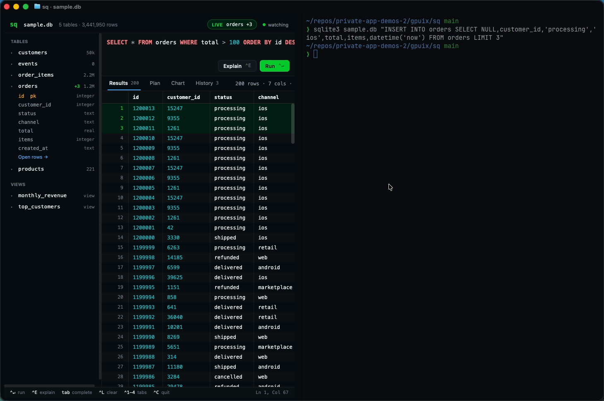

# sq: a SQLite studio that runs in your terminal

`sq sample.db` opens a full GUI SQLite studio **inside Ghostty**. It is a GPUIX app (React for Zed's GPUI) whose frames go to the terminal over the **Kitty Graphics protocol**, so it gets terminal superpowers for free: launch it from your shell, split it into panes, run `sqlite3` next to it, and quit with Ctrl-C back to your prompt.



Demo video: [`media/demo.mp4`](media/demo.mp4)

## What it does

- **Schema sidebar**: tables and views with live row counts; expand a table to see its columns, types and primary key; *Open rows* runs `SELECT *`.
- **SQL editor** with syntax highlighting (keywords, functions, strings, numbers, comments) and **autocomplete** of tables, views, columns and `table.column`. Tab accepts, arrows move.
- **Run** with ⌃↵ (⌘↵ in a native window). Results land in a **virtualized grid** that pages through up to 2M rows, with click-to-sort headers, drag-to-resize columns and a **cell inspector** (JSON values are pretty-printed with `<code>`).
- **EXPLAIN QUERY PLAN** as a tree, with full scans and temp B-trees flagged.
- **Quick chart**: the first text column against the first numeric one, with a hover readout.
- **History** of every query with row counts and timings; click to restore.
- **Live refresh**: run `sqlite3` (or any writer) in a split pane. sq polls `PRAGMA data_version` plus the database/WAL file stamps every 250 ms, re-counts tables, re-runs the current query, and flashes `LIVE orders +3` with the new rows highlighted.

## Run it

Needs macOS and Ghostty or kitty (tmux is not supported by GPUIX terminal mode).

```sh
cd gpuix/sq
bun install
bun run sample          # writes sample.db: 1.2M orders, 2.2M order items, 50k customers (~3.6 s)
bun link                # puts `sq` on your PATH
sq sample.db            # or: bun bin/sq.ts sample.db
```

```
sq <file.db> [-e "<sql>"] [--window]
  -e, --execute <sql>   open with this query in the editor and run it
  -w, --window          open a native window instead of rendering in the terminal
```

Keys: ⌃↵ run · ⌃E explain · Tab complete · ⌃L clear editor · ⌃1–4 tabs · Esc close inspector · ⌃C quit.

Try a split: press ⌘D in Ghostty and run

```sh
sqlite3 sample.db "INSERT INTO orders SELECT NULL,customer_id,'processing','ios',total,items,datetime('now') FROM orders LIMIT 3"
```

## Tests

```sh
bun test            # GPU test renderer: query, autocomplete, sort, live refresh from a 2nd connection, plan, history
bun run typecheck
```

`tests/app.test.tsx` drives the real UI on `@gpuix/react/testing` + `connectTest` against a generated 20k-order database, including an external `INSERT` from a second connection that must show up as `orders +1` and a highlighted row. `tests/sql.test.ts` covers the tokenizer and completion ranking.

## Performance (Apple Paravirtual GPU on a macOS VM, sample.db = 202 MB)

| | |
|---|---|
| Schema + exact row counts for 5 tables (3.4M rows) | 6.6 ms |
| `SELECT * FROM orders` (1.2M rows into the grid) | 245 ms |
| `monthly_revenue` view (GROUP BY over 1.2M rows) | 323 ms |
| Default revenue-by-country join (1.2M ⨝ 50k) | 1.34 s |
| Change poll (`data_version` + 2 stats) | 7 µs |
| Process RSS with 1.2M rows loaded | ~380 MB |

Queries run synchronously on the JS thread, so a slow query blocks input until it returns; live refresh re-runs the current query, so keep the live view on a cheap query.

## How it works with Ghostty

- `render(<SqApp />, { terminal: true })`; `isTerminal()` drops the traffic-light spacer and switches shortcuts to ⌃, because Ghostty keeps ⌘↵ (fullscreen), ⌘A (select all), ⌘D (split) and ⌘1–9 (tabs) for itself.
- Colours come from Ghostty's `GitHub Dark High Contrast` theme (`#0a0c10` background, `#71b7ff` blue, `#26cd4d` green, ...) so the app blends into the terminal.
- `bin/sq.ts` runs the app as a child process with stderr sent to `~/.cache/sq/sq.log`. GPUIX holds native log lines on stderr until exit, which otherwise buried the restored prompt after Ctrl-C.
- The editor is a transparent native `<textarea>` over a token-coloured `<text>` overlay; GPUIX's `<code>` highlighter has no SQL grammar.

## Findings (GPUIX 0.11.0, Bun 1.4.3)

1. **Terminal mode works well in Ghostty.** Click, hover, drag, scroll, typing, Tab and ⌃ chords all arrive; splits and divider drags reflow the app every frame; Ctrl-C restores the prompt.
2. **Held stderr dumps on exit.** In terminal mode the native INFO/WARN lines (`gpui_terminal::kitty sending frames…`, duplicate-font warnings) and React key warnings print after the app quits, under the prompt. `RUST_LOG=error` did not silence them; redirecting the child's stderr did.
3. **⌘ shortcuts are owned by the host terminal.** ⌘↵ toggled Ghostty fullscreen instead of reaching the app. Terminal-mode apps need ⌃ alternatives.
4. **No SQL in `<code language>`** and `whiteSpace: 'pre'` / `letterSpacing` are not supported styles, hence the overlay editor.
5. **`<virtual-list>` count changes are expensive** at very large counts (seen in an earlier experiment), so the grid pages 20k rows at a time with Prev/Next.
6. Not GPUIX, but worth knowing: in **bun:sqlite**, a statement cached by `db.query()` (even after `.all()` on `EXPLAIN QUERY PLAN`) can keep a read transaction open, pinning the connection to an old snapshot so external writes never appear. sq prepares and finalizes every statement instead.

Embedding in VS Code, Zed or Codex terminals and the SSH path were not part of this experiment's demo.
