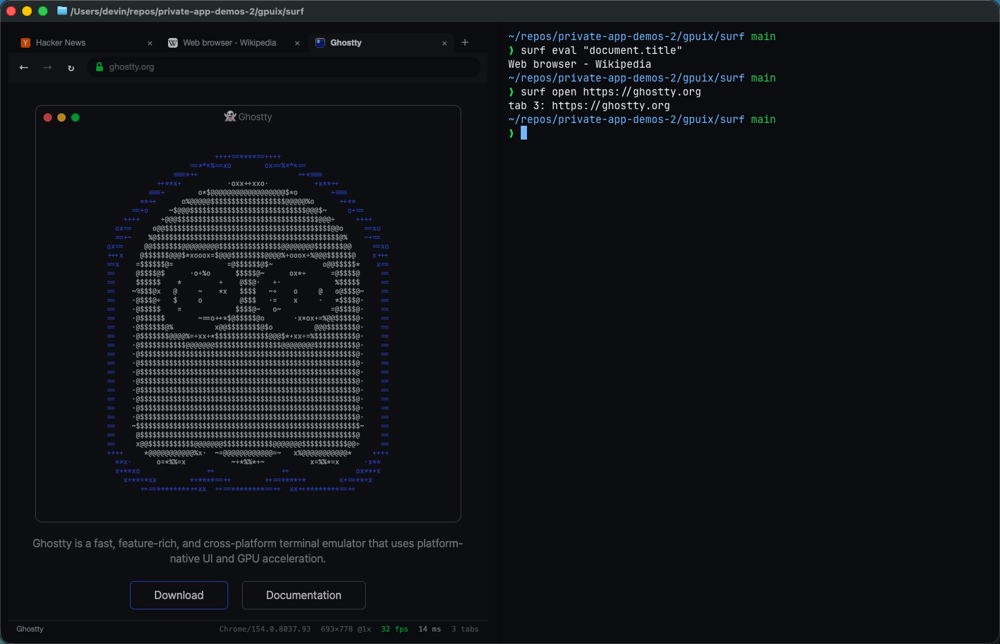

# surf

A real web browser inside Ghostty. `surf https://news.ycombinator.com` starts **headless Google Chrome**, drives it over the Chrome DevTools Protocol (raw CDP over a WebSocket, no puppeteer/playwright), and paints the pages into a [GPUIX](https://github.com/remorses/gpuix) 0.11.0 app that renders in the terminal over the Kitty graphics protocol. The tab strip, toolbar, omnibox, find bar and status line are GPUIX; the pages are Chrome.



Demo: [`media/demo.mp4`](media/demo.mp4) (real time, real input, Ghostty with `theme = GitHub Dark High Contrast`).

## Run it

Needs Bun, Google Chrome (or Chromium; `--chrome <path>` or `$SURF_CHROME`), and Ghostty or kitty. Verified with **Google Chrome 154.0.8037.93** on macOS 26 (arm64).

```bash
bun install
bun link                              # puts `surf` on your PATH (or: bun src/cli.ts)
surf https://news.ycombinator.com     # draws the browser in this pane
```

Split the pane (Cmd-D) and drive the running browser from the shell:

```bash
surf eval "document.title"            # → Web browser - Wikipedia
surf open https://ghostty.org         # → tab 3: https://ghostty.org
surf shot page.png                    # PNG of the visible page (--full for the whole page)
surf tabs · surf tab 2 · surf go <url> · surf back · surf find chrome · surf info · surf ls
```

`surf --help` lists everything. Keys: Ctrl-L omnibox · Ctrl-T new tab · Ctrl-W close · Ctrl-Tab next tab · Ctrl-R reload · Ctrl-F find (Enter = next) · Alt-←/→ back/forward · Ctrl-1..9 tab · Ctrl-V paste · Esc back to the page · Ctrl-C quit. Ctrl is used because Ghostty keeps Cmd shortcuts.

Ctrl-C closes Chrome (`Browser.close`, then SIGKILL of anything still holding the profile), deletes the temporary profile and socket, restores the terminal and prints `surf: N frames painted · N tabs · Chrome closed`.

## How it works

| piece | file |
| --- | --- |
| CDP client: request ids, events, flattened target sessions | `src/cdp.ts` |
| Chrome launcher: `--headless`, random debugging port, throwaway profile, muted, no background throttling; orphan reaper | `src/chrome.ts` |
| Tabs (one CDP target + session per tab), navigation/history, `Page.startScreencast`, input dispatch, find, eval, screenshots | `src/browser.ts` |
| Latest-frame slot (stale frames are acked and dropped), JPEG/PNG header parsing, fps meter | `src/frame.ts` |
| Pointer mapping (pane px → CSS px), viewport/DPR sizing, wheel deltas, GPUIX key → `Input.dispatchKeyEvent` mapping | `src/input.ts` |
| Omnibox: URL vs host vs search (DuckDuckGo html), secure/insecure | `src/omnibox.ts` |
| JSON-lines protocol over a Unix socket in `$TMPDIR/surf-$UID/<pid>.sock` | `src/ipc.ts` |
| Session: Chrome lifecycle, debounced viewport fitting on pane resize, socket handlers, cleanup | `src/session.ts` |
| GPUIX UI | `src/app.tsx` |

- **Pixels.** Chrome's screencast JPEG frames (quality 82) go straight into the GPUIX `` with `setImage(bytes)`; GPUIX decodes them natively, so there's no JS-side JPEG decoder or `setImagePixels` copy. Only the active tab streams. Each frame is acked to Chrome when the UI takes it, and a newer frame replaces an unshown one (counted as dropped), so Chrome never runs ahead of the terminal.
- **Viewport.** The page `` box is the Chrome viewport: `Emulation.setDeviceMetricsOverride` gets its CSS size and the device pixel ratio, and the screencast is restarted at the new size. A Ghostty split or divider drag reflows the page after a 90 ms debounce (1422×778 full pane → 693×778 split → 855×778 after a drag in the demo).
- **Input.** Mouse move/down/up/double-click/wheel are mapped from pane coordinates to CSS pixels and sent with `Input.dispatchMouseEvent` (left button is GPUIX button `0`). Keys go through `Input.dispatchKeyEvent` with real `code`/`windowsVirtualKeyCode` so editing keys, Enter and shortcuts behave; paste uses `Input.insertText`. The Chrome cursor shape is shown on hover (`pointer` over links, `text` over inputs) from `document.elementFromPoint`.
- **Titles.** `document.title` set by script doesn't always produce `Target.targetInfoChanged`, so the title is re-read after loads and at most once a second while the page repaints.

## Measured (Apple Paravirtual GPU)

This VM's GPU is Apple Paravirtual Metal, slower than a real Mac, and the terminal frames travel over the Kitty graphics protocol, so treat these as a floor:

- **Page fps** (screencast frames painted, shown in the status line): 30–33 fps on ghostty.org's animated ASCII ghost at 1422×778 and 693×778, ~11 fps on a 400×400 animated GIF (the GIF's own rate), 15–20 fps while scrolling Wikipedia. Static pages send no frames (0 fps) by design.
- **Input latency** (input event → next painted frame, smoothed, in the status line): 6–40 ms for clicks and typing, ~160 ms for a click that navigates (that one includes Chrome's first paint of the new page).
- `bun test`: 34 tests in ~17 s, including a real headless-Chrome integration test.

## Adapted from the prompt

Kept: real Chrome over CDP, GPUIX-drawn tabs/omnibox/back/forward/reload/stop/progress/title/lock/find/status line, mouse/wheel/keyboard/paste passthrough with coordinate scaling, viewport following the pane, `surf open/shot/eval` over a local socket, Cmd-D split demo with the page reflowing, clean Ctrl-C. Real sites in the demo: Hacker News (click a story, scroll, go back), Wikipedia (portal search form, long article, find), ghostty.org (animation).

Cut or changed:
- **No second side-by-side surf in the demo.** It works (`surf ls`, `surf -p <pid> …`), but the right pane shows the CLI driving the left browser, which reads better at 1920×1080.
- **No downloads, file pickers, dialogs (alert/confirm), permissions prompts, extensions, bookmarks or persistent history.** Each run uses a throwaway profile. JS `alert`/`confirm`/`prompt` dialogs are dismissed automatically (so the page never hangs) and `beforeunload` prompts are accepted.
- **Cursor shape** comes from the element under the pointer (`cursor` CSS), not from Chrome's own cursor events, which headless mode doesn't report.
- **HiDPI:** on a 1x display (this VM) frames match the pane exactly. At DPR > 1 the window is grown so the screencast can deliver device-resolution frames, but some Chrome builds still deliver CSS-resolution frames, which GPUIX upscales.

## Tests

```bash
bun test          # input/DPR/key mapping, frame parsing + latest-frame dropping, omnibox + terminal scale, Unix-socket protocol, and a headless-Chrome integration test
bun run typecheck
```

`tests/chrome.integration.test.ts` serves a local page, launches headless Chrome, waits for a screencast frame, maps a click through `mapPoint` and the CDP input path, and asserts the button text and title changed; then types into an input, pastes with `insertText`, and resizes the viewport to 320×300@2.

## GPUIX findings (0.11.0)

- `` takes encoded JPEG/PNG bytes via `setImage(Uint8Array)` as well as raw `setImagePixels`, so a JPEG screencast needs no decoder in JS.
- With both a hidden `<input>` focused and a root `onKeyDown`, every keystroke arrives twice (once as `onChange`, once as a key event), so text typed into the page doubled. Page keys now only go through the root handler.
- Terminal mode reports some letters as `key: "space"` with the letter in `keyChar`; `printable()` handles both. Ghostty sends Option-←/→ as Alt-b/Alt-f, so both mean back/forward.
- Cmd-V is Ghostty's paste and doesn't reach the app as a key, so Ctrl-V reads the system clipboard (`pbpaste` / `wl-paste` / `xclip`) and calls `Input.insertText`.
- `[gpuix]` INFO lines print under the prompt after exit unless `RUST_LOG=error` is in the process env, so the CLI re-execs itself with it and filters `[gpuix]` console lines.
- The first click into an unfocused Ghostty split only focuses the split; it doesn't reach the app.
- Headless Chrome's screencast frame size is capped by the browser window size, not just `maxWidth/maxHeight`; `Browser.setWindowBounds` lifts the cap.
