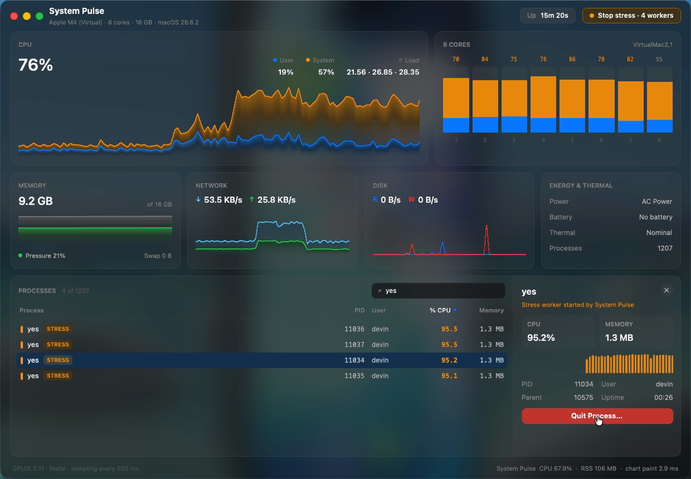

# System Pulse

A live macOS system monitor (Activity Monitor meets iStat Menus) on a frosted-glass window, built with [GPUIX](https://github.com/remorses/gpuix) 0.11: a React tree painted natively by GPUI with Metal. No Electron, no web view.



Demo (real time, real mouse/keyboard input): [`media/demo.mp4`](media/demo.mp4)

## What it shows

Everything is real data from the machine it runs on, sampled every 500 ms:

| Panel | Source |
| --- | --- |
| CPU total (user / system stacked area chart) + 8 per-core gauges | `os.cpus()` tick deltas |
| Load average, uptime | `os.loadavg()`, `os.uptime()` |
| Memory used, pressure, swap | `vm_stat`, `sysctl hw.memsize vm.swapusage` |
| Network in / out | `netstat -ib` byte-counter deltas (physical interfaces) |
| Disk read / write | `ioreg -c IOBlockStorageDriver` byte-counter deltas (what `iostat` reads) |
| Power, battery, thermal state | `pmset -g batt`, `pmset -g therm` |
| Top processes (1,200+ rows) | `ps -Aco pid,ppid,pcpu,rss,user,comm` |

Interactions:

- **Charts** scroll smoothly at 60 fps. Hover any chart for a value tooltip with the time offset ("19s ago", "now").
- **Process table**: click a header to sort (Process / PID / User / % CPU / Memory, click again to flip direction), type in the search field to filter by name, user or PID.
- **Detail panel**: click a row and a panel slides in (native `motion.div` animation) with live CPU / memory, a CPU history strip, PID, parent, user and run time.
- **Stress test**: starts four `yes > /dev/null` workers owned by the app; the cores visibly pin and the CPU chart climbs. Workers are tagged `STRESS` in the table.
- **Quit Process…** asks for confirmation through a GPUIX `Dialog` and sends SIGTERM (then SIGKILL if it hasn't exited after 1 s). It is only enabled for the stress workers the app spawned itself (other processes show a disabled button), so you can't accidentally kill a real process. A shell watchdog kills the workers if System Pulse itself dies without cleaning up.
- **Footer**: the app's own CPU %, RSS and average chart paint time, measured live.

## GPUIX features used

- macOS window options: `windowBackground: 'blurred'` (vibrancy), `titlebarTransparent`, traffic-light offset, `focus: false` under `GPUIX_BACKGROUND=1`
- Live images: five charts rendered by rasterizing anti-aliased lines + gradient fills into an RGBA `Uint8Array` and pushing it with `` ref `setImagePixels()`, repainted only when the chart scrolls by a whole pixel column
- Native animations: `motion.div` for the core gauges, process CPU bars and the detail panel slide-in
- Headless `Dialog` (`DialogPortal`, `DialogBackdrop`, `DialogPopup`, `DialogTitle`, `DialogDescription`, `DialogClose`)
- `<input>` with `onInput`, hover state styles (`style.hover`), `cursor`, `tabIndex`, `useWindowSize`
- Test renderer (`@gpuix/react/testing`) and automation (`@gpuix/react/automation`)

## Run

```sh
bun install
bun run dev        # bun --hot src/main.tsx
bun run start      # without hot reload
bun test           # 9 tests: parsers, real counters, GPU test renderer, live window automation
bun run typecheck  # tsc --noEmit
```

Requires macOS on Apple Silicon (`@gpuix/native-darwin-arm64`) and Bun ≥ 1.3.

## Tests

- `src/app.test.tsx` renders the whole app in the GPUIX GPU test renderer against a deterministic fake data source and drives it through automation locators: sorts by name and CPU (asserting row order), moves keyboard focus off the search field with Tab and sorts with Enter on a focused header, filters with the search input, hovers the CPU chart (tooltip appears), starts the stress test (4 workers, cores 0-3 pinned at 98 %, total CPU up >30 points), checks WindowServer can be inspected but not quit, opens a worker's detail panel, quits it through the dialog (asserting the kill reached the source and the button now reads "3 workers"), stops stress, and captures a screenshot.
- `src/live.test.ts` launches the real app with `launch()` + `GPUIX_BACKGROUND=1` and live sampler, clicks **Stress test**, finds the real `yes` children with `pgrep -P`, searches for one, opens it, confirms **Quit**, and asserts the OS process actually exited and the count dropped.
- `src/sampler.test.ts` covers the `vm_stat` / swap / `ps` / `pmset` / per-core-delta parsers and reads the real counters on this machine.

## Performance (Apple Paravirtual Metal VM, not real hardware)

Measured on a macOS 26.6 VM (`VirtualMac2,1`, "Apple M4 (Virtual)", 8 vCPU, 16 GB) whose GPU is **Apple Paravirtual Metal**. A real M-series Mac will be faster; treat these as an upper bound.

| Metric | Value |
| --- | --- |
| Cold start (launch → `mount complete`) | 360-580 ms |
| Chart paint (5 charts, raw RGBA rasterize + `setImagePixels`) | 1.5-3 ms average per tick, 6 ms worst seen |
| App CPU while running (sampling + paint + React) | ~30-55 % of one core (higher during stress) |
| Memory | 108-138 MB from `process.memoryUsage().rss`; `ps` reports ~330 MB RSS for the same process (includes Metal/IOSurface mappings) |
| Demo recording | 60 fps capture, no visible dropped frames in scroll |

The first version repainted every chart at 60 Hz and spent ~15 ms per tick (90 % CPU). Snapping each chart's time axis to whole pixel columns and skipping paints when nothing moved cut that to ~2 ms. Memoizing process rows (1,200 of them refreshed every second) cut the rest.

## GPUIX findings (0.11.0, `@gpuix/react` + `@gpuix/native`)

1. **Flex properties do nothing without `display: 'flex'`.** `flexDirection`, `gap`, `alignItems` etc. are silently ignored on a plain `div`; children stack as blocks. Repro: `<div style={{ flexDirection: 'row', gap: 8 }}><div/><div/></div>` renders vertically. The README examples set `display: 'flex'` but don't call it out; coming from React Native this is the first thing that breaks.
2. **Automation clicks use bounds from the last painted frame, so they miss elements that are mid-animation.** Clicking a button inside a `motion.div` panel while it slides in (width 0 → 300) hit coordinates that were already off-screen (`x: 1349` in a 1240 px window). Workaround: wait for the animation (~450 ms) before clicking. Similarly, a row can exist in the tree (`waitFor()` resolves) a frame before it has painted bounds, so `click()` throws `Element has no painted bounds`; the live test polls `bounds()` first.
3. **Test renderer: hover-driven state needs an explicit `root.renderer.flush()`** before `waitFor()` sees the new element (the chart tooltip never appeared otherwise, timing out after 5 s).
4. **Elements laid out below the window are still "found" but un-clickable.** A tall detail panel pushed its button to `y: 966` in an 860 px window; `click()` silently did nothing instead of erroring. Made the panel compact.
5. **Type surface:** `hoverStyle` / `focusable` props don't exist (use `style.hover` and `tabIndex`), and `motion` `animate` dimensions only accept numbers, not `'50%'` strings.
6. **Positioned overlays block hover on the element under them.** A tooltip or cursor line drawn `position: 'absolute'` under the pointer fires `onMouseLeave` on the chart and hides itself, so a single pointer move (no further motion) never shows the tooltip. Fix: `pointerEvents: 'none'` on every overlay child.
7. **Tab never leaves a focused `<input>` in the native window.** With the search field focused, Tab and Space reach neither the input's `onKeyDown` nor `render({ onKeyDown })` (letters do), so the default Tab focus move never runs. The GPU test renderer's `press('tab')` does move focus, so the test passes while the real window doesn't. Tab between focusable `div`s works, but not every time. Header cells and buttons are still `tabIndex` stops with a `focusVisible` ring and Enter to activate.
8. Background (`GPUIX_BACKGROUND=1`) automation screenshots render the window without vibrancy, on a light backdrop, so they look different from the real window.
