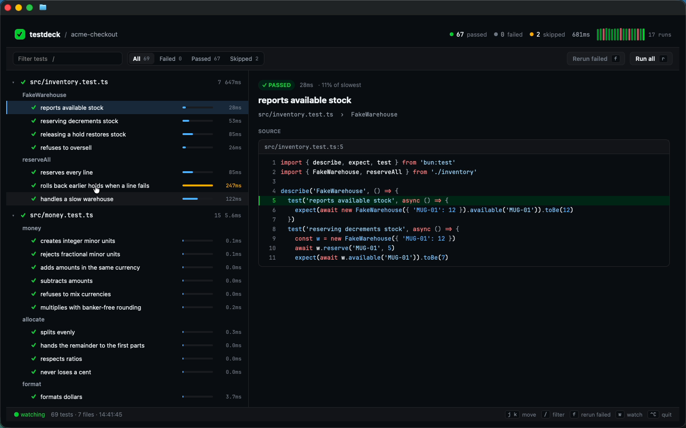
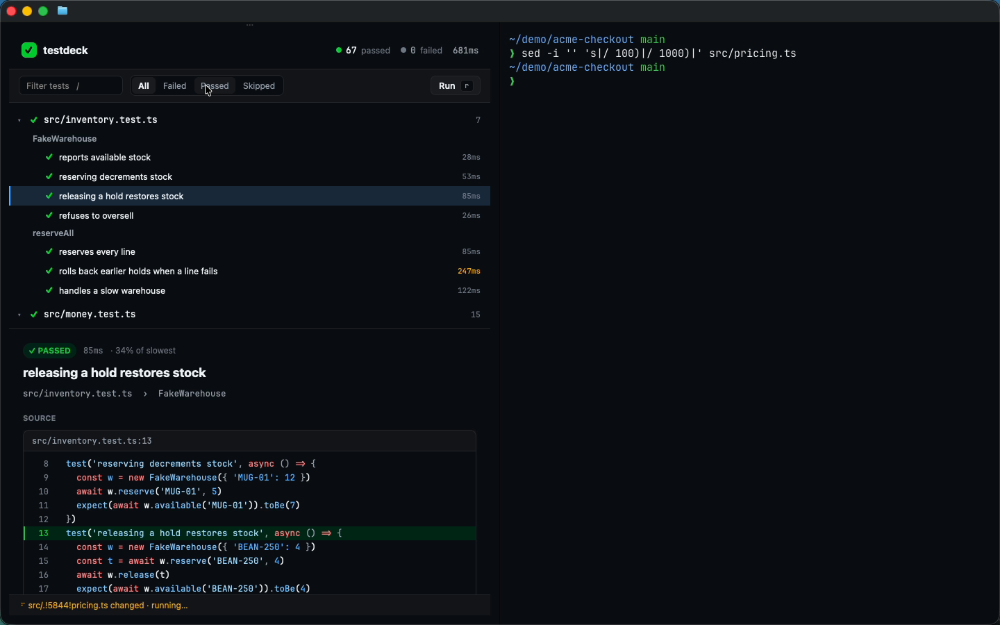

# testdeck

A watch-mode dashboard for `bun test` that paints inside your terminal. It's built with [GPUIX](https://github.com/remorses/gpuix) (React → GPUI → Metal) and streamed into Ghostty over the kitty graphics protocol. Run `testdeck` in a project and you get a real GUI in the pane where you'd normally run a TUI: a test tree, timing bars, failure diffs, and source code. Split the pane, edit a file next to it, and watch the tree go red, then green.





Demo (Ghostty, GitHub Dark High Contrast, real input): [`media/demo.mp4`](media/demo.mp4)

## What it does

- Runs the real `bun test` with `--reporter=junit`, parses the report, and shows **file → describe → test** with pass / fail / skip / todo icons and per-test **timing bars** (scaled to the slowest test, yellow when slower than half the slowest test).
- **Failure view**: the assertion headline, a native **`<diff>`** of expected vs received, the **stack** (`n` steps through frames), and the source around the failing line in **`<code>`**, with that line highlighted.
- **Filter tabs** (All / Failed / Passed / Skipped, `1`–`4`) and **search** (`/`) by test, describe, or file name.
- **Rerun failed** (`f`) runs only the failing files with a `-t` name pattern and merges the results into the previous run. **Run all** is `r`.
- **Watch mode** (on by default, `w` toggles): saves to `.ts/.tsx/.js/.json` files under the project rerun the suite after a 180 ms debounce. Files with failures sort to the top.
- **Run history sparkline**: the last 40 runs per project, green/red by outcome, persisted in `~/.cache/testdeck/`.
- Colors come from the **Ghostty theme** itself. testdeck reads `theme = …` from `~/.config/ghostty/config`, loads the theme file from `Ghostty.app/Contents/Resources/ghostty/themes/` and uses its background, foreground, and ANSI palette, so the app blends into the terminal. It falls back to GitHub Dark High Contrast.
- **Reflows** to the pane size with `useWindowSize()`. It shows tree and detail side by side when wide, stacks them in a narrow split, and uses compact toolbar labels under 760 px.

## Run it

```sh
bun install
bun link                       # puts `testdeck` on your PATH
cd sample && testdeck          # or: testdeck path/to/project
testdeck --help
```

```
usage
  testdeck [dir] [options]

options
  -t, --test <regex>   only run tests whose name matches
      --failed         open on the Failed filter
      --no-watch       run once, don't re-run on save
      --window         open a native window instead of the terminal
  -h, --help           show this help
```

Inside a terminal, testdeck calls `render(<App />, { terminal: true })`. It only does that when both stdin and stdout are TTYs and the terminal speaks the kitty graphics protocol (Ghostty or kitty). Anywhere else it prints a one-line note and opens a native window. `GPUIX_TERMINAL=1` forces terminal mode and `GPUIX_TERMINAL=0` forces a window. Ctrl-C quits and gives the prompt back.

`sample/` is a small checkout library ("acme-checkout") with 69 bun tests across 7 files: money, cart, pricing/discount codes, shipping, tax, slugs, and an async fake warehouse. When green it reports 67 passed and 2 skipped (one `test.skip`, one `test.todo`). To make it go red, run `sed -i '' 's|/ 100)|/ 1000)|' src/pricing.ts` (4 failures). `git checkout src/pricing.ts` makes it green again.

## Tests

```sh
bun run test        # bun test ./test
bun run typecheck   # tsc --noEmit
bun run perf        # startup + watch latency via @gpuix/react/automation
```

- `test/runner.test.ts`: JUnit parsing (nested suites, todo/skip, timings, entities, expected/received → unified patch). Also runs real `bun test` on a temp project, then a partial rerun merge, plus load-error reporting and the Ghostty theme parser.
- `test/app.test.ts`: launches the real app with `@gpuix/react/automation` (`GPUIX_BACKGROUND=1`) on a copy of `sample/`. It checks the green counts, then breaks `pricing.ts` on disk and waits for watch mode to show 4 failures. It also checks the Failed filter, selecting the failing test, the `✕ FAILED` badge, the `<diff>` and source panes, and search plus Escape-to-clear. Finally it restores the file and waits for green again with the run count going up.

## Performance

Measured on this macOS VM (Apple Paravirtual Metal, so a real M-series GPU will be faster) with `bun run perf`:

| | |
|---|---|
| launch → first frame with the shell UI | 274 ms |
| launch → full results for 69 tests | 971 ms |
| save → tree red (4 failures) | 866–907 ms |
| save → tree green | 886–905 ms |

Save-to-result is almost all `bun test` itself (~680 ms for the sample) plus the 180 ms debounce. Painting and parsing are negligible next to it. The terminal stays responsive during runs because the test process is async.

## GPUIX features used

Terminal mode (`render({ terminal: true })`, `isTerminal()`), `<diff>`, `<code>` with a custom `GpuixTheme` syntax palette, `registerFont()` (bundled JetBrains Mono), `<input>`, `useWindowSize()`, window-level `onKeyDown`, `<scroll>` regions, hover styles, and `@gpuix/react/automation`.

## GPUIX findings (0.11.0)

- **Zed's integrated terminal can't show frames.** In Zed (Homebrew cask, current stable) the app starts and receives input, but the pane stays blank: Zed's terminal doesn't implement the kitty graphics protocol, and GPUIX doesn't detect that. The held stdout/stderr (GPUIX startup logs) also dumps into the shell on Ctrl-C. testdeck now checks `TERM`/`TERM_PROGRAM`/`KITTY_WINDOW_ID` and opens a native window with a note instead. The demo has no Zed segment for this reason.
- **`RUST_LOG` set from JS doesn't reach `env_logger`.** Assigning `process.env.RUST_LOG` before `render()` doesn't silence the native `INFO`/`WARN` lines, which then print after the app exits in terminal mode. Setting it in the process environment works, so the bin shebang is `#!/usr/bin/env -S RUST_LOG=error bun`.
- **Escape in a focused `<input>`** doesn't reach the window `onKeyDown`, so a handler on the input itself is needed to clear and blur.
- The first click into an unfocused Ghostty split only focuses the pane (Ghostty behavior, not GPUIX). The next click reaches the app.
- Text color doesn't inherit, and `<div>` isn't flex by default (both documented). Every `Txt` passes a color, and layout helpers set `display: 'flex'`.

## Layout

```
cli.tsx           bin entry, arg parsing, terminal detection
src/App.tsx       dashboard
src/runner.ts     bun test --reporter=junit → TestCase[] (+ failure patch, frames)
src/watch.ts      recursive fs.watch with debounce
src/history.ts    per-project run history
src/theme.ts      Ghostty theme loader → palette
sample/           acme-checkout: 69 bun tests
```

JetBrains Mono is bundled under the SIL Open Font License (`fonts/OFL.txt`).
