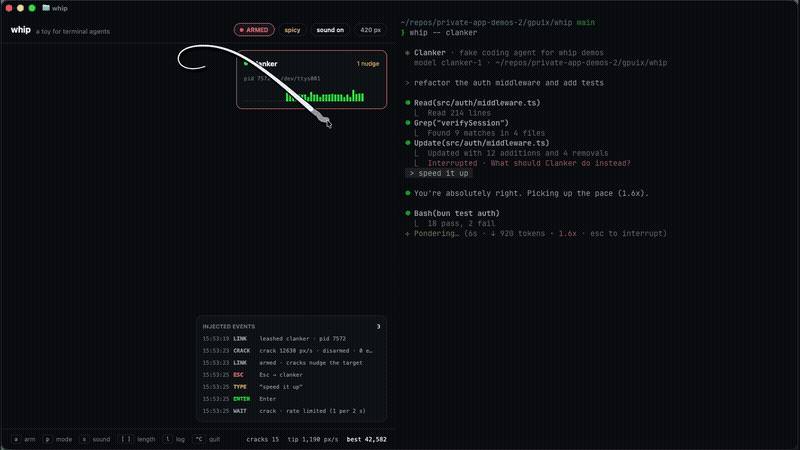

# whip

A digital whip for terminal coding agents, painted inside Ghostty with [GPUIX](https://github.com/remorses/gpuix).

Run your agent in one Ghostty split and `whip` in the other. Move the mouse and a verlet-rope whip follows it. Flick it hard and it cracks: a flash ring, a short synthesized crack, and (only when armed) a nudge to the agent: **Esc**, one message, **Enter**. Polite mode ("Please continue, you're doing great") is on by default; press `p` for "FASTER".

> **It's a toy.** It sends keystrokes, but only to an agent you started through `whip --`, only when armed, never more than one nudge per 2 seconds, and never anything except Esc, the message text and Enter. No network, no telemetry.



## Run it

Needs macOS, [Bun](https://bun.sh) and Ghostty (or kitty). It paints over the kitty graphics protocol, so tmux and editor terminals won't show it.

```sh
cd gpuix/whip
bun install
bun link            # puts `whip` and `clanker` on your PATH

whip                # the whip, in this pane
# Cmd-D to split, then in the new pane:
whip -- claude      # or: whip -- codex, whip -- clanker
```

`clanker` is a fake coding agent for demos. It streams pretend tool calls, stops on Esc with "Interrupted · What should Clanker do instead?", reads the nudge, replies, and speeds up when told to go faster.

```
whip                     open the whip in this pane
whip -- <agent command>  run an agent on a leash so whip panes can nudge it
whip --target <path>     a /dev/ttysNNN picks the leashed agent on that tty;
                         a file path is a hook: each nudge is appended as a line
-a, --armed   --spicy   --mute   -l, --length <px>   --intro   -h, --help
```

Keys in the whip: `a` arm/disarm (also Ctrl-Alt-W), `p` polite/spicy, `s` sound, `[` `]` length, `t` next target, `l` event log, `?` intro, Ctrl-C quit. Click an agent card to target it. Settings (messages too) live in `~/.whip/settings.json`.

```sh
bun test            # physics, raster, safety gate, socket link, CLI, GPU test-renderer UI
bun run typecheck
```

`tools/drive.swift` is the small CGEvent driver (move, glide, drag, keys, typing) used to record `media/demo.mp4` with real input. `tools/demo.drive` is the script for that take.

## How it works

- `src/physics.ts`: fixed-step (120 Hz) verlet rope, 40 segments, 420 px, 10 constraint iterations, gravity 900 px/s², damping 0.99, a light bending constraint and a follow-the-leader clamp so fast flicks don't stretch it. A crack fires when the tip passes ~8.3 rope-lengths per second (3,500 px/s at 420 px) while the rope is ≥ 86 % extended, debounced at 400 ms. The whip shortens itself to fit when a split halves the pane.
- `src/raster.ts`: a CPU rasterizer that samples a Catmull-Rom curve through the rope and paints shadow, dark outline and a tapered white fill into an RGBA buffer, plus the flash ring and sparks. Only the dirty rectangle is cleared each frame. The buffer goes to a full-pane `` with `setImagePixels`; GPUIX ships it to Ghostty over the kitty graphics protocol. The crack "shake" offsets just the whip for two frames.
- `src/leash.ts`: `whip -- cmd` runs the agent in a Bun PTY, passes your terminal through untouched, and listens on `~/.whip/agents/<pid>.sock`. The `NudgeGate` turns a nudge into exactly three writes (Esc, wait 150 ms, sanitized text, Enter) and rate-limits to one per 2 s. It also reports output volume, which drives the activity sparkline on the agent card.
- `src/link.ts`: the whip pane discovers leash sockets, sends nudges and logs every injected event in the panel. Disarmed cracks log `0 events`.
- `src/sound.ts`: a 26 ms band-passed noise burst rendered to a WAV once and played with `afplay`. No audio files in the repo.

## Adapted from the original prompt

The prompt asked for a Tauri/Electron transparent, click-through, always-on-top desktop overlay that finds the window under the whip tip (WindowFromPoint / CGWindowList), checks a terminal allowlist, and posts OS-level synthetic keystrokes. This is the GPUIX-in-Ghostty version:

| Original | Here |
| --- | --- |
| Transparent overlay over the whole desktop | A Ghostty split that paints the whip with GPUIX (kitty graphics protocol) |
| Window under the tip + terminal-app allowlist | The "allowlist" is explicit: only agents started with `whip --` can be nudged, picked by clicking their card, `t`, or `--target /dev/ttysNNN` |
| CGEventPost / SendInput (Accessibility permission) | Writes into the agent's own PTY, so no Accessibility permission and no way to type into other apps |
| Tray menu: arm, polite, length, sound, quit | Pills in the top bar + single keys (`a`, `p`, `[ ]`, `s`, Ctrl-C) |
| Global hotkey Ctrl+Alt+W | `a` or Ctrl-Alt-W while the whip pane has focus (Ghostty owns Cmd shortcuts) |
| Web Audio crack | Same synthesis idea (band-passed noise < 30 ms) rendered to WAV, played with `afplay` |
| First-run explanation | One-screen intro on first run (`--intro` to see it again) |
| Debug panel of injected events | "Injected events" panel with a running count |

Cut: Windows and Linux support, cracking over arbitrary windows (a browser, another app), and a real global hotkey. Not verified: the "< 3 % CPU at 120 Hz on M1" target; this ran on an Apple Paravirtual GPU VM (see findings).

## GPUIX findings (0.11.0, terminal mode in Ghostty)

- A full-pane `` fed by `setImagePixels` works well as a canvas for a simulation in terminal mode. Overlay it with `position:absolute` and `pointerEvents:'none'` so the root still gets `onMouseMove`. Mouse coordinates arrive in pane pixels, so physics in pixels just works, and moves come in fast enough for flick detection.
- Painting is the bottleneck, not physics: the sim runs at 120 Hz in JS, and the app repaints at most every ~15 ms and only while the rope moves or a flash is fading, so an idle whip costs nothing.
- `useWindowSize()` follows Ghostty splits and divider drags. Size the `` from it and resize the RGBA buffer to match; with `objectFit:"fill"` and a stale buffer you get a stretched whip for a frame.
- Bun strips the first `--` from `process.argv`, so `whip -- claude` arrives as `whip claude`. The CLI treats the first non-flag word as the start of the agent command.
- `#!/usr/bin/env -S RUST_LOG=error bun` on the bin keeps GPUIX's held logs from printing under the prompt after Ctrl-C.
- Keys: plain letters arrive with the character in `keyChar`; handling both `keyChar` and `key` covers terminal and window mode. `EventModifiers` is `{ shift, ctrl, alt, cmd }`.
- Every `<text>` needs a `color`, and `<div>` needs `display:'flex'`.
- The GPU test renderer (`createTestRoot`) renders the app with no window; `getPaintedText()` is enough to assert the intro, pills and empty-state copy. Pass `loop={false}` so the sim timer doesn't keep the test alive.
- Verlet integration stores velocity implicitly as `pos - prev`. Anything that moves the rope from outside the sim (a length change, a split resize, the first pointer sample after launch) has to move `prev` too (`Whip.setLength` and `Whip.teleport`). Otherwise the jump reads as a 20,000+ px/s flick and fires a crack. The testing agent caught both cases.
- Running a PTY (`Bun.spawn({ terminal })`) in one split and the GPUIX app in the other, talking over a Unix socket, needs no special handling: the leash never touches GPUIX and the app never reads stdin.
