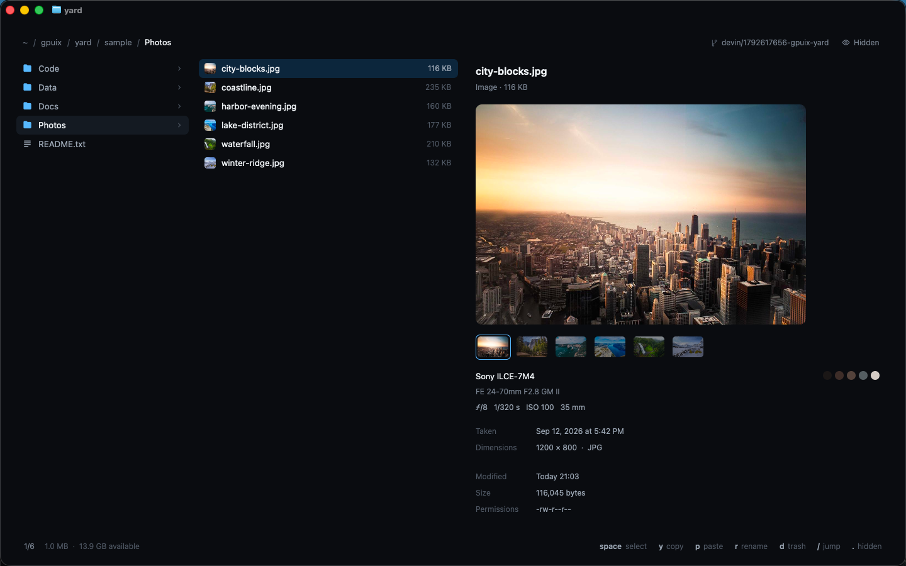

# yard

A yazi/ranger-style file manager **GUI that runs inside your terminal**. Built with [GPUIX](https://github.com/remorses/gpuix) (React for Zed's GPUI): the React tree is painted natively on the GPU (Metal) and the frames are streamed into Ghostty over the **Kitty Graphics protocol**. No Electron, no web view, no TUI character grid.

```sh
yard              # current directory
yard ~/Downloads  # any directory
yard -a sample    # show dotfiles
yard --help
```



## What it does

- **Miller columns**: parent · current · preview, with file-type icons, item counts and sizes. Collapses to two columns and then one as the pane gets narrower, so it reflows cleanly when you split Ghostty.
- **Keyboard**: `h j k l` / arrows, `g`/`G`, `ctrl-d`/`ctrl-u`, `enter` opens (folders navigate, files open with `open`), `~` home.
- **Mouse**: click a row to select, click it again (or double-click) to open, click a parent-column row to jump, clickable **breadcrumbs**, scroll wheel / trackpad moves through the list, hover highlight.
- **Rich previews**: images through `` (with real pixel dimensions read from the file header), syntax-highlighted code through `<code>`, GitHub-flavoured Markdown through `<markdown>`, pretty-printed JSON with a shape summary, and recursive **directory sizes** with per-child bars.
- **Photos, Quick Look style**: `enter` (or a second click) on a photo opens a full-pane viewer with a fade-in; `←/→`, `h/l` or the wheel flip through the folder, `esc` closes, `o` opens in Preview. The preview panel shows the photo, a clickable filmstrip of its siblings, camera/lens/exposure read straight from the JPEG's **EXIF** (own parser, no dependencies), the date it was taken and a 5-colour **palette** extracted from the pixels. Rows get real thumbnails instead of generic icons, and a folder of photos previews as a **gallery grid**. Thumbnails and palettes are made once with macOS `sips` in the background and cached in `~/.cache/yard/thumbs`.
- **Git aware**: inside a repo the header shows the branch (and commits ahead), and rows carry status badges (modified/new/deleted, rolled up into folders) from `git status --porcelain`.
- **Motion**: the selection highlight slides between rows, previews cross-fade, toasts and sheets ease in (GPUIX native `motion.div`).
- **Fuzzy jump** (`/` or `f`): fuzzy search across every file under the start folder, with matched characters highlighted; `enter` jumps there.
- **Multi-select and file ops**: `space` marks, `a` marks all, `y` copy, `x` cut, `p` paste, `r` rename (`ctrl-u` clears the prompt), `n` new folder, `d` trash (with a confirm sheet; uses Finder's Trash on macOS). Name collisions become `name copy.ext`, `name copy 2.ext`.
- **Two-pane file manager across splits**: the copy/cut clipboard lives in `~/.cache/yard/clipboard.json`, so you can `y` in one Ghostty split and `p` in a `yard` running in another split. Every pane watches its folders (`fs.watch`), so a paste, `mv` or `git checkout` in another pane shows up instantly.
- **Hidden files**: `.` or the pill at the top right.
- Colours come straight from Ghostty's **GitHub Dark High Contrast** theme so the app blends into the terminal.

A `sample/` folder ships with photos, code (TypeScript, Rust, Go, Python), Markdown docs, JSON/CSV data and some dotfiles.

## Run

```sh
bun install
bun link              # puts `yard` on your PATH
yard sample           # inside Ghostty or kitty
bun run dev           # hot reload against ./sample
bun test              # filesystem model + GPU test-renderer interaction tests
bun run typecheck
```

`yard -w` opens the same UI in a native macOS window instead of the terminal.

## GPUIX features used

`render(..., { terminal: true })` (Kitty Graphics protocol, shared memory locally), `isTerminal()`, `useWindowSize()` for responsive columns, ``, `<code>` with a custom `GpuixTheme` syntax palette, `<markdown>`, `<svg source>` icons, `<input>` with `onSubmit`, `onScroll` wheel deltas, `onKeyDown` with `autoFocus`/`tabIndex`, `hover` styles, and the native test renderer (`@gpuix/react/testing`: `nativeSimulateKeystrokes`, `nativeSimulateClick`, `getPaintedText`, `captureScreenshot`).

## Tests

`test/yard.test.tsx` runs against a temporary copy of `sample/`:

- photo/git metadata: EXIF camera/lens/exposure from the sample JPEGs, dominant-colour extraction, porcelain status parsing with folder roll-up;
- filesystem model: sorting, hidden files, copy/move/rename/trash on disk, collision names, copy-into-self guard, JPEG/PNG header sizes, fuzzy walk, shared clipboard;
- GPU test renderer: `hjkl` through the columns with breadcrumbs and directory totals, mouse selection and folder entry, hidden toggle by key and by click, multi-select → copy → paste into another folder (asserts the files on disk), cut → paste, rename through the prompt, trash with confirmation, opening the photo viewer and flipping through it by keyboard and filmstrip click (asserting EXIF text), fuzzy jump to `scheduler.ts` with the highlighted code painted, and `ctrl-c` quitting.

## Performance

Measured on this macOS VM (Apple **Paravirtual** Metal GPU, slower than real Apple silicon), Ghostty 1440×900 window:

- Startup to first frame in Ghostty: ~0.6–0.8 s (Bun + native module load).
- Memory: ~95 MB RSS per running `yard` (two splits ≈ 190 MB).
- Idle CPU: ~0.2–0.3 %. Navigation stays responsive with key repeat; folder size walks are async and capped at 25k entries so huge trees never block the UI.

## GPUIX findings (0.11.0)

- **Startup logs leak into the shell.** Terminal mode holds stdout/stderr and replays them on exit, so `[gpuix] …` mount logs and GPUI `WARN gpui_macos::text_system skipping duplicate font …` / `ERROR gpui::asset_cache Failed to load asset: Usvg(NotAnUtf8Str)` lines show up after quitting. Worked around with `RUST_LOG=off` in the shebang and by filtering `[gpuix]` lines from `console.log`.
- **`` cannot load `.icns`** (`img: load failed`), even though macOS app icons are the obvious thing to show in a file manager. Use PNG/JPEG.
- **`ctrl-c` with a focused element**: the key also reaches `onKeyDown` as `key: 'c'` with `ctrl`, so the app quits itself on it to be safe.
- **`SyntaxTheme` typing**: assigning an object literal to `GpuixTheme.syntax` fails to typecheck (`constructor` collides with `Object.prototype.constructor`); needs an explicit `constructor` colour or a cast.
- **No `focusElement` on `useGpuix().renderer` types**, although the runtime has it; needs a cast to restore focus after closing a prompt.
- **`motion.div` has a narrow prop type**: no `testId`, so animated layers need a plain `<div testId>` inside them for tests/automation.
- **`AnimatePresence` exit in the test renderer**: after the child is removed, the exiting layer stayed mounted (still hit-testable) in `createTestRoot`, so an invisible viewer swallowed the next click. yard closes the viewer instantly instead of animating it out.
- Ghostty keeps `cmd-a` for its own select-all, so it never reaches a focused GPUIX `<input>`; yard clears prompts with `ctrl-u` instead.
- Not tried: tmux (unsupported per README). VS Code/Zed/Codex terminals don't implement the Kitty Graphics protocol's shared-memory path GPUIX uses, so the demo stays in Ghostty.
